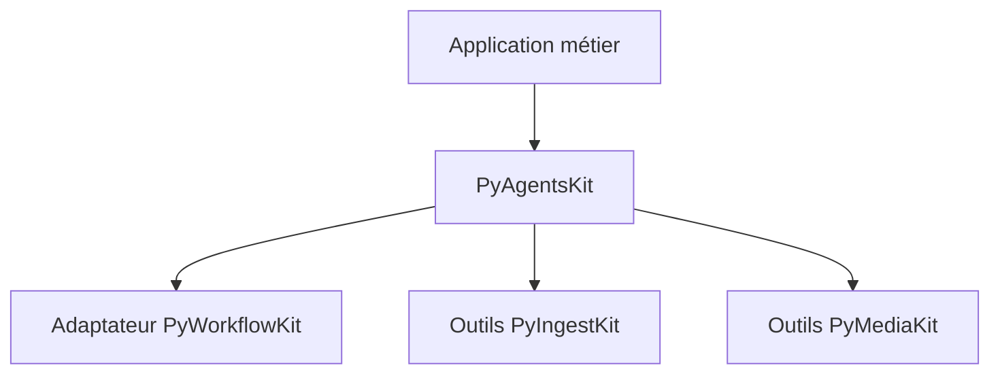
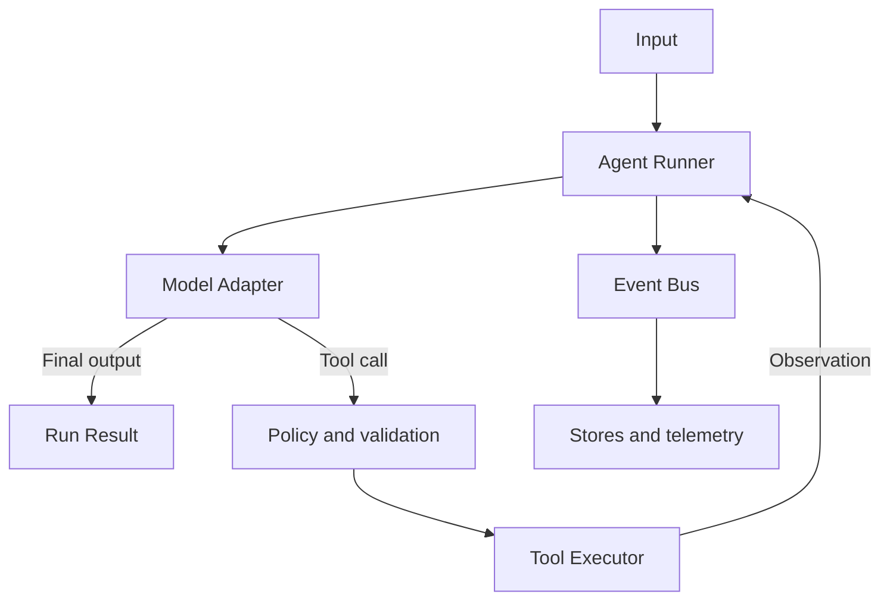
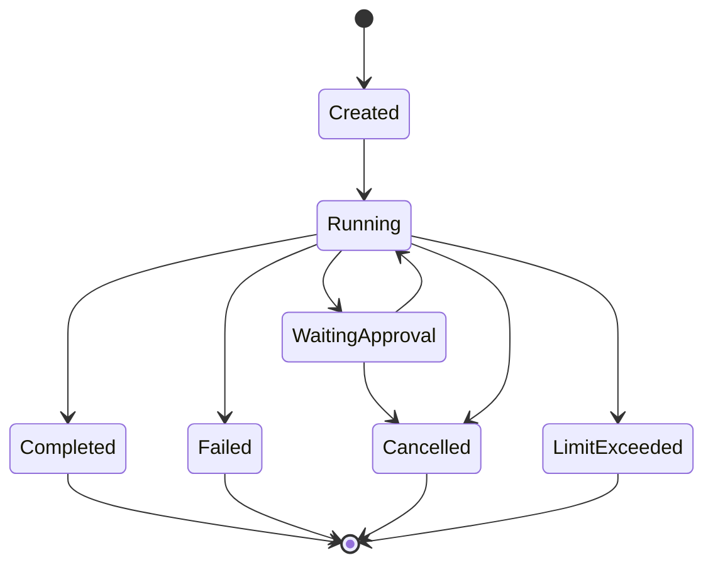

# PyAgentsKit

## Vision produit et architecture de référence

**Document :** `00_PYAGENTSKIT_PROJECT_VISION_ARCHITECTURE_v0.1.md`  
**Version du document :** 0.1  
**Statut :** Vision fondatrice, complétée par les ADR de la Phase 0  
**Date :** 4 septembre 2026  
**Auteur / porteur du projet :** Thomas AWOUNFOUET  
**Nom de travail du projet :** PyAgentsKit  
**Nom du package envisagé :** `pyagentskit`  
**Licence retenue pour la Phase 0 :** Apache-2.0

---

> **Amendement Phase 0 :** les ADR acceptés dans `docs/adr/` sont normatifs lorsqu'ils
> précisent ou remplacent une proposition de ce document. En particulier, ADR-0007 limite la V1
> au runtime mono-agent ; les équipes multi-agents universelles sont reportées après la V1.

---

## 1. Résumé exécutif

PyAgentsKit est un projet de framework Python open source destiné à construire, exécuter, sécuriser, observer et tester des agents d'intelligence artificielle capables d'utiliser des modèles, des outils et un contexte persistant.

Le framework vise un espace précis entre deux extrêmes :

- les appels directs aux SDK des fournisseurs, simples au départ mais rapidement insuffisants pour gérer les boucles agentiques, les outils, les limites, les traces, les sessions et les politiques de sécurité ;
- les plateformes agentiques très intégrées, puissantes mais parfois difficiles à comprendre, à remplacer, à tester ou à intégrer progressivement dans une application Python existante.

La proposition de valeur centrale est la suivante :

> Fournir un runtime agentique Python lisible, typé, observable, testable et indépendant des fournisseurs, fondé sur des contrats stables et des événements structurés.

PyAgentsKit n'a pas vocation à devenir un clone généraliste de LangChain, une plateforme SaaS, un ordonnanceur distribué ou un moteur d'ingestion. Il doit rester un composant logiciel installable, exploitable dans un script, une API FastAPI, une application Django, un worker ou un workflow plus large.

Le projet s'inscrit dans un écosystème cohérent :

| Projet | Responsabilité principale |
|---|---|
| PyIngestKit | Acquérir, valider, transformer et publier des données |
| PyWorkflowKit | Définir et exécuter des workflows déterministes |
| PyMediaKit | Traiter images, vidéos, audio et documents |
| **PyAgentsKit** | Exécuter des boucles agentiques pilotées par des modèles et des outils |

La première version doit volontairement se concentrer sur un agent unique, une boucle modèle-outils robuste, des outils Python typés, des sorties structurées, des événements, des budgets d'exécution et un fournisseur de référence. La persistance avancée, le multi-agent, le Human-in-the-Loop et l'exécution durable seront introduits progressivement.

---

## 2. Contexte et problème

### 2.1. Le passage d'un appel LLM à un agent

Un appel de modèle classique suit un flux relativement simple :

```text
Entrée utilisateur
      ↓
Appel du modèle
      ↓
Réponse
```

Un agent ajoute une boucle de décision dynamique :

```text
Entrée utilisateur
      ↓
Modèle → sélection d'une action
      ↓
Exécution d'un outil
      ↓
Observation du résultat
      ↓
Modèle → nouvelle décision
      ↓
Résultat final ou nouvelle action
```

Cette boucle introduit immédiatement des besoins qui dépassent un simple client HTTP :

- validation des arguments d'outils ;
- suivi de l'état d'exécution ;
- limitation du nombre d'étapes ;
- timeouts et annulation ;
- gestion des erreurs et retries ;
- autorisation des actions sensibles ;
- journalisation et traçabilité ;
- suivi des tokens, coûts et latences ;
- gestion du contexte et des sessions ;
- sorties structurées ;
- streaming ;
- tests déterministes ;
- suspension et reprise ;
- délégation éventuelle à d'autres agents.

### 2.2. Le problème côté développeur

Un développeur peut écrire une boucle agentique directement :

```python
while True:
    response = model.generate(messages, tools=tools)
    if response.is_final:
        return response.output
    observation = execute_tool(response.tool_call)
    messages.append(observation)
```

Ce prototype masque cependant de nombreuses responsabilités de production :

```text
run_id
session_id
step_id
validation
timeouts
cancellation
retry policy
tool permissions
idempotency
usage accounting
event stream
structured logs
artifacts
guardrails
approvals
tracing
testing
replay
```

L'enjeu de PyAgentsKit n'est donc pas seulement de faciliter l'appel d'un modèle. Il est de fournir le **runtime fiable** qui entoure et gouverne la boucle agentique.

### 2.3. Pourquoi créer un framework supplémentaire ?

L'écosystème possède déjà des solutions solides :

- l'OpenAI Agents SDK fournit notamment agents, outils, handoffs, guardrails, sessions et tracing ;
- Pydantic AI propose une approche Python fortement typée et un graphe interne d'exécution ;
- LangGraph se positionne comme runtime d'orchestration avec persistance, streaming, Human-in-the-Loop et exécution durable ;
- smolagents privilégie un noyau très compact et des agents fondés sur des appels d'outils ou l'exécution de code.

PyAgentsKit n'est pertinent que s'il assume une identité claire :

1. une architecture compréhensible et documentée ;
2. des contrats indépendants des fournisseurs ;
3. une compatibilité naturelle avec les applications Python existantes ;
4. une observabilité native fondée sur des événements ;
5. une sécurité explicite autour des outils ;
6. une intégration facultative avec les autres frameworks Py\*Kit ;
7. une progression contrôlée du simple agent local vers l'exécution durable.

---

## 3. Vision, mission et promesse

### 3.1. Vision

Permettre à un développeur Python de faire évoluer un agent depuis un prototype local jusqu'à un composant exploitable en production sans réécrire son cœur métier ni l'enfermer dans un fournisseur de modèles ou une plateforme propriétaire.

### 3.2. Mission

Fournir les primitives, contrats et mécanismes d'exécution nécessaires pour :

- définir un agent ;
- lui connecter des modèles et des outils ;
- contrôler sa boucle de décision ;
- borner ses actions et sa consommation ;
- conserver son contexte ;
- tracer chaque étape utile ;
- tester son comportement ;
- l'intégrer dans une application ou un workflow existant.

### 3.3. Promesse développeur

```bash
pip install pyagentskit
```

Puis :

```python
from pyagentskit import Agent, tool
from pyagentskit.providers.openai import OpenAIModel


@tool
async def get_customer(customer_id: str) -> dict:
    """Retrieve a customer record."""
    return {"id": customer_id, "status": "active"}


agent = Agent(
    id="customer.support",
    model=OpenAIModel("gpt-5"),
    instructions="Help an operator resolve customer requests.",
    tools=[get_customer],
    max_steps=8,
)

result = await agent.run("Check customer C-1024.")

print(result.output)
print(result.usage.total_tokens)
print(result.trace_id)
```

Le code métier reste simple, tandis que le runtime prend en charge la validation, les identifiants, les événements, les limites et les erreurs.

---

## 4. Principes directeurs

### 4.1. Python-first

L'API doit ressembler à du Python naturel : fonctions, décorateurs, protocoles, context managers, dataclasses ou modèles Pydantic. Une configuration YAML pourra compléter l'API, mais ne devra jamais devenir obligatoire.

### 4.2. Typage aux frontières

Les entrées et sorties des outils, les sorties structurées des agents et les configurations doivent être validées. Les données non fiables provenant d'un modèle ne doivent pas entrer directement dans le code métier.

### 4.3. Provider-neutral core

Le noyau ne doit exposer aucun type propriétaire. Les SDK OpenAI, Anthropic, Azure, Google ou locaux seront encapsulés derrière des adaptateurs.

### 4.4. Observable by design

Toute transition significative doit produire un événement structuré. Les logs, traces, métriques, interfaces temps réel et systèmes de replay doivent pouvoir consommer le même flux d'événements.

### 4.5. Safe by construction

Un outil constitue une capacité accordée à un agent. Il doit pouvoir déclarer son niveau de risque, ses autorisations, son caractère idempotent, ses timeouts et ses exigences d'approbation.

### 4.6. Progressive complexity

Un agent local simple ne doit pas nécessiter Redis, PostgreSQL, Kafka, Temporal ou Kubernetes. Les capacités distribuées doivent être optionnelles.

### 4.7. Async-native, sync-friendly

Le runtime interne doit être asynchrone. Une façade synchrone doit rester disponible pour les scripts, notebooks et usages pédagogiques.

### 4.8. Composition over inheritance

Les comportements doivent être assemblés à partir de modèles, outils, stores, politiques, middleware et hooks. Les hiérarchies de classes profondes sont à éviter.

### 4.9. Explicit over magical

Le framework doit limiter les comportements implicites, les variables globales, les modifications invisibles de prompts et les décisions impossibles à retracer.

### 4.10. Established dependencies when justified

Le projet ne poursuit pas un objectif « zéro dépendance ». Il doit privilégier des bibliothèques Python établies lorsque leur valeur est claire, tout en gouvernant explicitement les dépendances obligatoires et optionnelles.

---

## 5. Terminologie normative

| Terme | Définition |
|---|---|
| Agent | Configuration associant instructions, modèle, outils, politiques et type de sortie |
| Run | Une exécution d'un agent pour une entrée donnée |
| Turn | Une interaction logique entre l'utilisateur et l'agent |
| Step | Une itération de la boucle agentique |
| Model call | Un appel adressé à un modèle via un adaptateur |
| Tool | Une capacité exécutable et décrite par un schéma |
| Tool call | La demande d'exécution d'un outil produite par un modèle |
| Observation | Le résultat normalisé d'un outil réinjecté dans le contexte |
| Context | Les données disponibles pendant un run mais pas nécessairement envoyées au modèle |
| Session | L'historique conversationnel et les métadonnées partagées entre plusieurs runs |
| Memory | Un mécanisme de stockage ou de récupération d'informations au-delà du contexte immédiat |
| Handoff | Le transfert explicite du contrôle à un autre agent |
| Guardrail | Une règle validant, transformant, bloquant ou escaladant une entrée, une sortie ou une action |
| Approval | Une décision humaine autorisant, modifiant ou refusant une action suspendue |
| Artifact | Un fichier, document, dataset ou objet durable produit pendant un run |
| Event | Un fait structuré et horodaté émis par le runtime |
| Trace | La représentation corrélée des événements et opérations d'un run |
| Replay | La réexploitation d'un historique d'événements ou de résultats enregistrés |

Le framework ne doit pas exposer ni persister une chaîne de pensée privée. Il peut enregistrer les décisions opérationnelles, appels d'outils, observations, résultats, métriques et résumés explicitement produits pour l'utilisateur.

---

## 6. Périmètre fonctionnel

### 6.1. Dans le périmètre

- définition déclarative et programmatique d'agents ;
- adaptateurs de modèles ;
- boucle agentique configurable ;
- outils Python typés ;
- sorties texte, structurées et multimodales ;
- exécution synchrone, asynchrone et streaming ;
- gestion des limites, timeouts et annulations ;
- événements, traces, métriques et usage ;
- sessions et abstractions de mémoire ;
- guardrails et politiques d'outils ;
- Human-in-the-Loop ;
- handoffs et composition multi-agent ;
- persistance, checkpoints et reprise à terme ;
- fixtures, modèles factices et évaluations ;
- CLI de développement et de diagnostic ;
- intégrations optionnelles avec FastAPI, Django, MCP et les Py\*Kit.

### 6.2. Hors périmètre du noyau

- entraînement ou fine-tuning de modèles ;
- hébergement de modèles ;
- base vectorielle propriétaire ;
- moteur RAG complet imposé ;
- interface graphique de chatbot ;
- navigateur web complet ;
- environnement arbitraire d'exécution de code ;
- ordonnanceur distribué généraliste ;
- plateforme SaaS d'observabilité ;
- marketplace centralisée d'outils ;
- pipeline d'ingestion générique ;
- traitement média générique ;
- remplacement de Django, FastAPI, Celery ou Temporal.

Ces fonctions peuvent être apportées par des extensions ou par des systèmes externes.

---

## 7. Utilisateurs cibles et cas d'usage

### 7.1. Profils cibles

1. **Développeur Python** souhaitant ajouter un agent dans une application existante.
2. **Data Engineer** souhaitant exposer des opérations de données comme outils contrôlés.
3. **Ingénieur IA** ayant besoin d'un runtime testable et indépendant des fournisseurs.
4. **Équipe produit** souhaitant progressivement industrialiser un prototype agentique.
5. **Formateur ou apprenant avancé** souhaitant comprendre une architecture agentique lisible.

### 7.2. Cas d'usage prioritaires

- assistant métier connecté à des API internes ;
- agent de support utilisant des outils de consultation et d'action ;
- agent d'analyse produisant une sortie Pydantic validée ;
- agent de recherche combinant plusieurs sources ;
- agent de préparation de documents ou de médias ;
- agent de contrôle déclenchant un workflow déterministe ;
- agent supervisé nécessitant une approbation avant écriture ;
- équipe de plusieurs agents spécialisés ;
- agent embarqué dans une commande CLI, une API ou un worker.

---

## 8. Frontières avec les autres Py\*Kit

### 8.1. Règle fondamentale

> PyAgentsKit décide **quelle capacité utiliser et pourquoi** ; les autres frameworks exécutent leur responsabilité technique propre.

### 8.2. Matrice de responsabilités

| Capacité | PyAgentsKit | PyWorkflowKit | PyIngestKit | PyMediaKit |
|---|---:|---:|---:|---:|
| Décision dynamique pilotée par modèle | Responsable | Non | Non | Non |
| Boucle modèle-outils | Responsable | Non | Non | Non |
| Outils et politiques agentiques | Responsable | Non | Non | Non |
| Handoffs entre agents | Responsable | Non | Non | Non |
| Graphe de tâches déterministe | Consommateur éventuel | Responsable | Interne éventuel | Interne éventuel |
| Retry durable d'une étape métier | Délègue | Responsable | Selon job | Selon traitement |
| Ingestion de sources | Déclenche éventuellement | Orchestre éventuellement | Responsable | Non |
| Validation et publication de datasets | Non | Non | Responsable | Non |
| Transformation image/vidéo/audio/document | Déclenche éventuellement | Orchestre éventuellement | Non | Responsable |
| Historique conversationnel | Responsable | Non | Non | Non |
| Traces agentiques | Responsable | Agrège ses exécutions | Agrège ses jobs | Agrège ses traitements |

### 8.3. Direction des dépendances



Les intégrations doivent être facultatives. Le noyau de PyAgentsKit ne doit pas installer les autres frameworks par défaut.

### 8.4. Agent versus workflow

| Question | Agent | Workflow |
|---|---|---|
| Qui choisit l'étape suivante ? | Le modèle dans les limites autorisées | Le graphe ou le code |
| Le chemin est-il connu à l'avance ? | Pas toujours | Oui, au moins structurellement |
| Déterminisme | Faible à partiel | Fort à contrôlable |
| Usage principal | Raisonnement, sélection d'outils, adaptation | Processus, dépendances, reprise, SLA |
| Moteur cible | PyAgentsKit | PyWorkflowKit |

Un workflow peut contenir une étape agentique. Un agent peut déclencher un workflow. Les deux concepts ne doivent toutefois pas partager artificiellement le même runtime.

---

## 9. Positionnement face à l'écosystème

| Solution | Force reconnue | Enseignement pour PyAgentsKit |
|---|---|---|
| OpenAI Agents SDK | Primitives intégrées : agents, tools, handoffs, guardrails, sessions, tracing | Proposer une ergonomie comparable tout en gardant un noyau multi-fournisseur |
| Pydantic AI | Typage Python, sorties structurées, injection de dépendances, graphe interne | Faire du typage et des contrats une propriété du cœur |
| LangGraph | Persistance, durable execution, streaming, Human-in-the-Loop | Séparer clairement runtime agentique et orchestration durable |
| smolagents | Simplicité, faible volume d'abstraction, CodeAgent et ToolCallingAgent | Garder un noyau lisible et éviter l'inflation architecturale |

### 9.1. Différenciation recherchée

PyAgentsKit doit se distinguer par la combinaison suivante :

- runtime lisible et modulaire ;
- événements normalisés dès la première version ;
- outils considérés comme des capacités gouvernées ;
- frontières explicites entre agent, workflow, ingestion et média ;
- compatibilité avec un usage local minimal ;
- passage progressif vers la persistance et la durabilité ;
- tests déterministes sans appels réels aux modèles ;
- intégration naturelle avec l'écosystème Python applicatif.

### 9.2. Stratégie de construction

PyAgentsKit ne doit pas encapsuler intégralement un framework agentique tiers. Il peut réutiliser :

- Pydantic pour les contrats et la validation ;
- les SDK officiels des fournisseurs dans des extras ;
- OpenTelemetry pour l'observabilité ;
- des moteurs durables via des adaptateurs ;
- MCP via une extension dédiée.

Le runtime et les modèles de domaine publics doivent néanmoins appartenir au projet.

---

## 10. Modèle conceptuel



### 10.1. Entités centrales

```text
AgentDefinition
├── id
├── version
├── instructions
├── model
├── tools[]
├── output_type
├── policies
└── limits

AgentRun
├── run_id
├── trace_id
├── session_id?
├── agent_id
├── status
├── input
├── steps[]
├── usage
├── artifacts[]
└── output | error
```

### 10.2. États d'un run



Les transitions doivent être explicites, validées et accompagnées d'un événement.

---

## 11. Architecture logique

### 11.1. Couches

```text
┌──────────────────────────────────────────────────────────────┐
│ API publique : Agent, tool, Runner, RunResult                │
├──────────────────────────────────────────────────────────────┤
│ Runtime : loop, state machine, limits, cancellation          │
├──────────────────────────────────────────────────────────────┤
│ Capabilities : tools, handoffs, guardrails, approvals        │
├──────────────────────────────────────────────────────────────┤
│ Context : messages, sessions, memory, artifacts              │
├──────────────────────────────────────────────────────────────┤
│ Ports : models, stores, telemetry, secrets, clocks           │
├──────────────────────────────────────────────────────────────┤
│ Adapters : OpenAI, Anthropic, SQLite, PostgreSQL, OTel, MCP  │
└──────────────────────────────────────────────────────────────┘
```

### 11.2. Arborescence cible

```text
src/pyagentskit/
├── __init__.py
├── agents/
│   ├── definition.py
│   ├── policies.py
│   └── result.py
├── runtime/
│   ├── runner.py
│   ├── loop.py
│   ├── state.py
│   ├── limits.py
│   └── cancellation.py
├── models/
│   ├── base.py
│   ├── request.py
│   ├── response.py
│   └── capabilities.py
├── tools/
│   ├── decorator.py
│   ├── definition.py
│   ├── registry.py
│   ├── executor.py
│   ├── policy.py
│   └── result.py
├── messages/
│   ├── message.py
│   └── content.py
├── context/
│   ├── run_context.py
│   └── dependencies.py
├── sessions/
│   ├── models.py
│   └── store.py
├── memory/
│   ├── base.py
│   ├── short_term.py
│   └── long_term.py
├── handoffs/
│   ├── definition.py
│   └── router.py
├── guardrails/
│   ├── base.py
│   ├── input.py
│   ├── output.py
│   └── tool_call.py
├── approvals/
│   ├── models.py
│   └── store.py
├── events/
│   ├── models.py
│   ├── bus.py
│   └── handlers.py
├── observability/
│   ├── logging.py
│   ├── tracing.py
│   ├── metrics.py
│   └── usage.py
├── artifacts/
│   ├── models.py
│   └── store.py
├── evals/
│   ├── cases.py
│   ├── evaluators.py
│   └── reports.py
├── testing/
│   ├── fake_model.py
│   ├── fake_tool.py
│   └── recorder.py
├── providers/
│   └── openai/
├── integrations/
│   ├── pyworkflowkit/
│   ├── pyingestkit/
│   ├── pymediakit/
│   ├── fastapi/
│   └── django/
├── cli/
│   └── app.py
├── exceptions.py
└── py.typed
```

Cette arborescence représente la cible à terme. La V0.1 ne doit créer que les modules réellement utilisés.

---

## 12. API publique envisagée

### 12.1. Définition d'un outil

```python
from pydantic import BaseModel, Field
from pyagentskit import tool


class Weather(BaseModel):
    city: str
    temperature_c: float
    condition: str


@tool(
    name="weather.get",
    description="Retrieve the current weather for a city.",
    risk="read",
    timeout=10.0,
    idempotent=True,
)
async def get_weather(
    city: str = Field(min_length=2),
) -> Weather: ...
```

Le décorateur doit :

- inspecter la signature ;
- produire un schéma JSON ;
- valider les arguments ;
- valider le résultat ;
- préserver la fonction Python originale ;
- exposer les métadonnées de sécurité et d'exécution.

### 12.2. Sortie structurée

```python
class SupportDecision(BaseModel):
    customer_id: str
    summary: str
    recommended_action: str
    confidence: float = Field(ge=0, le=1)


agent = Agent(
    id="support.triage",
    model=model,
    instructions="Classify and summarize the request.",
    output_type=SupportDecision,
)
```

### 12.3. Injection de dépendances

```python
class AppDependencies(BaseModel):
    tenant_id: str
    customer_repository: CustomerRepository


@tool
async def get_customer(
    customer_id: str,
    ctx: RunContext[AppDependencies],
) -> Customer:
    return await ctx.deps.customer_repository.get(
        tenant_id=ctx.deps.tenant_id,
        customer_id=customer_id,
    )
```

Les dépendances d'application ne doivent pas être sérialisées dans le prompt par défaut.

### 12.4. Streaming d'événements

```python
async for event in agent.run_stream("Investigate incident INC-42"):
    match event:
        case TextDelta(delta=text):
            print(text, end="")
        case ToolCallStarted(tool_name=name):
            print(f"\nCalling {name}...")
        case RunCompleted(result=result):
            print(result.output)
```

---

## 13. Contrats fondamentaux

### 13.1. Contrat modèle

```python
from typing import AsyncIterator, Protocol


class Model(Protocol):
    @property
    def capabilities(self) -> ModelCapabilities: ...

    async def generate(
        self,
        request: ModelRequest,
        *,
        context: ModelCallContext,
    ) -> ModelResponse: ...

    def stream(
        self,
        request: ModelRequest,
        *,
        context: ModelCallContext,
    ) -> AsyncIterator[ModelStreamEvent]: ...
```

Le contrat doit normaliser :

- messages et rôles ;
- contenus texte et multimodaux ;
- appels d'outils ;
- sorties structurées ;
- raisons de terminaison ;
- usage ;
- erreurs temporaires ou définitives ;
- identifiants du fournisseur utiles au diagnostic.

### 13.2. Contrat outil

```python
class Tool(Protocol):
    definition: ToolDefinition

    async def invoke(
        self,
        arguments: dict[str, object],
        *,
        context: RunContext,
    ) -> ToolResult: ...
```

### 13.3. Contrat session

```python
class SessionStore(Protocol):
    async def load(self, session_id: str) -> Session | None: ...
    async def save(self, session: Session) -> None: ...
    async def append(self, session_id: str, events: list[SessionEvent]) -> None: ...
```

### 13.4. Contrat événements

```python
class EventHandler(Protocol):
    async def handle(self, event: AgentEvent) -> None: ...
```

Les handlers ne doivent pas pouvoir modifier silencieusement l'état du run. Les transformations doivent passer par des middleware ou hooks explicitement conçus pour cela.

---

## 14. Runtime et boucle agentique

### 14.1. Algorithme nominal

```text
1. Créer le run et son contexte
2. Charger éventuellement la session
3. Valider l'entrée
4. Construire la requête modèle
5. Vérifier les budgets et limites
6. Appeler le modèle
7. Normaliser la réponse
8. Si sortie finale : valider et terminer
9. Si appel d'outil :
   a. valider le nom et les arguments
   b. évaluer la politique
   c. demander une approbation si nécessaire
   d. exécuter l'outil avec timeout
   e. normaliser l'observation
   f. enregistrer usage et événements
10. Revenir à l'étape 4
```

### 14.2. Limites obligatoires

Tout run doit disposer de limites finies ou d'une politique explicite :

```python
RunLimits(
    max_steps=8,
    max_model_calls=8,
    max_tool_calls=16,
    max_parallel_tools=4,
    timeout_seconds=120,
    max_input_tokens=50_000,
    max_output_tokens=8_000,
    max_total_tokens=80_000,
    max_cost_usd=2.00,
)
```

La disponibilité de certaines limites dépendra des informations retournées par le fournisseur. Le runtime doit signaler clairement les limites non applicables.

### 14.3. Parallélisme

Les appels d'outils parallèles ne doivent être autorisés que si :

- le fournisseur les exprime explicitement ;
- les outils concernés l'autorisent ;
- les politiques de concurrence sont satisfaites ;
- aucun ordre métier implicite n'est requis ;
- les budgets globaux restent respectés.

### 14.4. Retry

Le runtime doit distinguer :

- retry d'un appel modèle temporairement indisponible ;
- retry d'un outil idempotent ;
- nouvelle décision du modèle après une erreur fonctionnelle ;
- reprise durable d'un run interrompu.

Ces quatre mécanismes ne doivent pas être fusionnés sous une annotation générique `retry`.

---

## 15. Système d'outils

### 15.1. L'outil comme capacité

Un outil ne doit pas être réduit à une fonction avec une description. Il doit exposer un contrat de gouvernance :

```python
ToolDefinition(
    name="invoice.send",
    version="1.0.0",
    description="Send an approved invoice.",
    risk=ToolRisk.EXTERNAL_WRITE,
    idempotent=False,
    requires_approval=True,
    timeout_seconds=30,
    concurrency_limit=1,
    tags={"billing", "email"},
)
```

### 15.2. Classification initiale des risques

| Niveau | Exemple | Politique par défaut envisagée |
|---|---|---|
| `PURE` | Calcul local sans effet de bord | Autorisé |
| `READ` | Lecture d'une API ou d'une base | Autorisé selon périmètre |
| `LOCAL_WRITE` | Création d'un fichier temporaire | Politique configurable |
| `EXTERNAL_WRITE` | Envoi de message, modification distante | Approbation recommandée |
| `DESTRUCTIVE` | Suppression, révocation, écrasement | Approbation obligatoire |
| `CODE_EXECUTION` | Exécution de code généré | Refusée par défaut |

### 15.3. Résultat normalisé

```python
ToolResult(
    status="succeeded",
    content={...},
    display_text="Customer found",
    artifacts=[],
    metadata={"source": "crm"},
    retryable=False,
)
```

Le contenu transmis au modèle peut être différent du contenu conservé dans la trace ou présenté à l'utilisateur. Cette transformation doit rester explicite.

### 15.4. MCP

MCP doit être ajouté via une extension qui convertit les outils distants en `ToolDefinition`. Les contrôles PyAgentsKit restent applicables : validation, politiques, approbation, timeout, traces et masquage des secrets.

La découverte d'un outil distant ne doit jamais équivaloir automatiquement à son autorisation.

---

## 16. Messages, contexte, sessions et mémoire

### 16.1. Séparation des concepts

| Concept | Durée | Visible par le modèle ? |
|---|---|---|
| Message | Un historique ou une requête | Oui, selon sélection |
| RunContext | Durée d'un run | Non par défaut |
| Session | Plusieurs runs liés | Partiellement |
| Memory | Long terme ou récupération | Uniquement après sélection |
| Artifact | Durable | Seulement via référence ou extraction |

### 16.2. Gestion du contexte

Le framework doit pouvoir appliquer une stratégie de fenêtre de contexte :

- conservation intégrale sous le seuil ;
- suppression de données techniques inutiles ;
- résumé contrôlé ;
- sélection de messages ;
- externalisation des résultats volumineux en artifacts ;
- récupération de mémoire pertinente.

### 16.3. Stores envisagés

- mémoire en processus pour les tests et prototypes ;
- SQLite pour un usage local persistant ;
- PostgreSQL pour les applications de production ;
- stores externes via interfaces d'extension.

Le choix d'un store ne doit pas modifier l'API de l'agent.

---

## 17. Guardrails et Human-in-the-Loop

### 17.1. Points d'interception

Les guardrails peuvent s'appliquer :

1. à l'entrée utilisateur ;
2. avant un appel modèle ;
3. à une réponse modèle ;
4. avant un appel d'outil ;
5. au résultat d'un outil ;
6. à la sortie finale.

### 17.2. Décisions possibles

```text
ALLOW
TRANSFORM
RETRY_WITH_FEEDBACK
REQUIRE_APPROVAL
REJECT
ABORT
```

### 17.3. Suspension et reprise

Une approbation doit produire un état durable :

```python
ApprovalRequest(
    approval_id="apr_...",
    run_id="run_...",
    tool_name="invoice.send",
    proposed_arguments={...},
    risk="external_write",
    expires_at=...,
)
```

L'humain doit pouvoir :

- approuver ;
- modifier les arguments ;
- rejeter avec un motif ;
- annuler le run.

Cette fonction dépend de la persistance et ne doit pas être simulée comme une simple saisie bloquante en production.

---

## 18. Multi-agent et handoffs

### 18.1. Position de principe

Le multi-agent n'est pas une capacité V0.1. Il doit être ajouté lorsque le runtime mono-agent est stable et observable.

### 18.2. Handoff

Un handoff transfère le contrôle et non simplement une chaîne de texte :

```python
Handoff(
    from_agent="support.router",
    to_agent="support.billing",
    input=BillingRequest(...),
    reason="Billing expertise required",
    return_policy="return_to_parent",
)
```

### 18.3. Contraintes nécessaires

- profondeur maximale ;
- agents autorisés ;
- budget global partagé ;
- contexte transmis explicitement ;
- prévention des boucles de délégation ;
- corrélation des traces ;
- isolation des outils et secrets ;
- politique d'erreur du sous-agent.

### 18.4. Modèles de collaboration à terme

- routeur vers spécialiste ;
- superviseur et workers ;
- séquence de handoffs ;
- délégation parallèle bornée ;
- critique ou validation croisée.

Ces modèles doivent être proposés comme compositions documentées, pas comme un moteur magique de « société d'agents ».

---

## 19. Événements, observabilité et journalisation

### 19.1. Catalogue initial d'événements

```text
run.created
run.started
run.completed
run.failed
run.cancelled
run.limit_exceeded

step.started
step.completed

model.request.started
model.response.completed
model.request.failed

tool.call.requested
tool.call.started
tool.call.completed
tool.call.failed

guardrail.evaluated
guardrail.rejected

approval.requested
approval.resolved

handoff.requested
handoff.completed

artifact.created
usage.updated
```

### 19.2. Enveloppe commune

```json
{
  "event_id": "evt_...",
  "event_type": "tool.call.completed",
  "occurred_at": "2026-09-04T18:42:17.284+02:00",
  "run_id": "2c9fd45c-...",
  "trace_id": "b673f5c0-...",
  "session_id": "session-42",
  "agent_id": "customer.support",
  "step": 3,
  "payload": {}
}
```

Les événements persistés doivent utiliser des timestamps ISO 8601 timezone-aware et des UUID complets.

### 19.3. Format terminal

Le format humain recommandé est :

```text
YYYY-MM-DD HH:mm:ss  LEVEL  [run=<8-char-id> agent=<agent_id> tool=<tool_name>] Message
```

Exemple :

```text
2026-09-04 18:42:17  INFO  [run=2c9fd45c agent=customer.support tool=customer.get] Tool completed
```

Principes :

- timestamp terminal dans le fuseau local ;
- UUID complet dans les événements structurés ;
- identifiant abrégé uniquement pour l'affichage humain ;
- absence des champs non applicables ;
- détails DEBUG visibles uniquement en mode verbose/debug ;
- secrets et données sensibles masqués avant tout handler.

### 19.4. OpenTelemetry

Une extension OpenTelemetry doit mapper :

- un run vers une trace ou un span racine ;
- un appel modèle vers un span ;
- un appel d'outil vers un span ;
- tokens, coût et latence vers des attributs ou métriques ;
- erreurs vers des statuts normalisés.

Le framework doit éviter d'imposer une plateforme d'observabilité particulière.

---

## 20. Usage, budgets et coûts

### 20.1. Modèle d'usage

```python
Usage(
    input_tokens=12_450,
    output_tokens=1_204,
    cached_input_tokens=8_000,
    reasoning_tokens=320,
    model_calls=3,
    tool_calls=4,
    estimated_cost_usd=0.18,
)
```

Les champs non fournis par un fournisseur doivent rester `None` plutôt qu'être inventés.

### 20.2. Budgets hiérarchiques

À terme, les budgets doivent pouvoir s'appliquer :

- par appel modèle ;
- par agent ;
- par run ;
- par session ;
- par délégation ;
- par tenant ou application.

Le dépassement doit produire un résultat et un événement spécifiques, pas une exception générique opaque.

---

## 21. Persistance, durabilité et replay

### 21.1. Trois niveaux

| Niveau | Garantie | Version cible |
|---|---|---|
| In-memory | Le run vit dans le processus | V0.1 |
| Persistent session | Historique conservé entre les runs | V0.2 |
| Durable run | Reprise au dernier checkpoint après interruption | V0.5 |

### 21.2. Checkpoints

Un checkpoint doit capturer au minimum :

- état du run ;
- compteur d'étapes ;
- historique normalisé ;
- appels d'outils demandés et résultats acquis ;
- usage cumulé ;
- approvals en attente ;
- version de l'agent et des outils ;
- références d'artifacts.

### 21.3. Replay

Le replay peut viser plusieurs objectifs :

1. reconstruire une trace pour diagnostic ;
2. réutiliser les résultats enregistrés sans rappeler les services ;
3. rejouer avec un autre modèle pour évaluation ;
4. reprendre une exécution durable.

Ces modes doivent être distingués. Rejouer un outil avec effets de bord n'est jamais autorisé automatiquement.

### 21.4. PyWorkflowKit

PyAgentsKit pourra fournir un adaptateur transformant certaines opérations en étapes PyWorkflowKit. L'intégration ne doit pas dupliquer dans le runtime agentique :

- les DAG déterministes ;
- les mécanismes génériques de scheduling ;
- la gestion de workers distribués ;
- les retries durables non spécifiques aux agents.

---

## 22. Artifacts

Les résultats volumineux ou binaires ne doivent pas être injectés intégralement dans le contexte du modèle.

```python
Artifact(
    artifact_id="art_...",
    name="analysis-report.md",
    media_type="text/markdown",
    size_bytes=42_816,
    checksum="sha256:...",
    uri="artifact://...",
    metadata={"producer": "report.generate"},
)
```

Le `ArtifactStore` doit prendre en charge :

- création ;
- lecture ;
- métadonnées ;
- durée de rétention ;
- contrôles d'accès ;
- intégrité ;
- références dans les messages ou résultats.

PyMediaKit pourra produire des artifacts média ; PyIngestKit pourra produire des manifests ou datasets ; PyAgentsKit conservera uniquement les références et métadonnées utiles.

---

## 23. Sécurité

### 23.1. Modèle de menace initial

PyAgentsKit doit considérer au minimum :

- prompt injection directe ou indirecte ;
- tool poisoning ;
- arguments d'outils malformés ;
- exfiltration de secrets ;
- confusion entre données et instructions ;
- accès inter-tenant ;
- appels destructifs non approuvés ;
- répétition d'effets de bord après retry ;
- déni de service par boucle ou contexte volumineux ;
- contenu d'outil trompeur réinjecté au modèle ;
- fuite de données dans les logs et traces ;
- dépendances compromises.

### 23.2. Principes de défense

- moindre privilège ;
- allowlist explicite d'outils ;
- validation stricte des entrées ;
- séparation instructions/données ;
- secrets injectés dans l'outil, jamais dans son schéma ;
- permissions évaluées côté runtime ;
- approbation pour les actions sensibles ;
- timeouts et budgets obligatoires ;
- idempotency keys pour les écritures compatibles ;
- redaction avant journalisation ;
- audit de la chaîne de dépendances ;
- refus par défaut pour l'exécution de code arbitraire.

### 23.3. Politique de secrets

Les clés fournisseurs et credentials doivent être fournis par l'application ou un `SecretProvider`. Ils ne doivent pas être stockés dans :

- la définition sérialisée de l'agent ;
- les événements ;
- les prompts ;
- les fichiers de configuration versionnés ;
- les exceptions utilisateur.

---

## 24. Erreurs et exceptions

Hiérarchie envisagée :

```text
PyAgentsKitError
├── ConfigurationError
├── AgentDefinitionError
├── ModelError
│   ├── ModelAuthenticationError
│   ├── ModelRateLimitError
│   ├── ModelTimeoutError
│   └── ModelResponseError
├── ToolError
│   ├── ToolNotFoundError
│   ├── ToolValidationError
│   ├── ToolPermissionError
│   ├── ToolTimeoutError
│   └── ToolExecutionError
├── GuardrailError
├── ApprovalError
├── SessionError
├── PersistenceError
├── RunCancelledError
└── RunLimitExceededError
```

Les erreurs fournisseur doivent conserver leur cause technique dans la trace tout en exposant une erreur normalisée au runtime.

---

## 25. Configuration

### 25.1. Priorité des sources

Ordre recommandé :

```text
Paramètres explicites Python
        ↓
Objet de configuration
        ↓
Fichier TOML/YAML facultatif
        ↓
Variables d'environnement
        ↓
Valeurs par défaut sûres
```

Les secrets ne doivent pas être placés dans le fichier déclaratif.

### 25.2. Exemple déclaratif envisagé

```yaml
agent:
  id: support.triage
  version: 1.0.0
  model:
    provider: openai
    name: gpt-5
  instructions_file: prompts/support.md
  tools:
    - customer.get
    - ticket.create
  limits:
    max_steps: 8
    timeout_seconds: 120
  output_type: app.models.SupportDecision
```

La configuration doit être validée par Pydantic et produire des erreurs localisées.

---

## 26. CLI

La CLI sera construite avec Typer et Rich.

Commandes cibles :

```bash
pyagentskit init
pyagentskit run path.to:agent "User request"
pyagentskit chat path.to:agent
pyagentskit inspect path.to:agent
pyagentskit tools list
pyagentskit trace show <run-id>
pyagentskit eval run evals/
pyagentskit doctor
```

La V0.1 peut se limiter à :

```bash
pyagentskit run
pyagentskit inspect
pyagentskit doctor
```

---

## 27. Testabilité et évaluations

### 27.1. Modèle factice déterministe

```python
model = FakeModel(
    responses=[
        ToolCall(name="weather.get", arguments={"city": "Paris"}),
        FinalOutput(text="It is 21°C in Paris."),
    ]
)
```

Il doit permettre de tester :

- l'ordre des appels ;
- les arguments ;
- les événements émis ;
- les limites ;
- les erreurs ;
- le résultat final ;
- l'absence d'appel réseau.

### 27.2. Pyramide de tests

| Niveau | Objectif |
|---|---|
| Unitaires | Contrats, validation, transitions, budgets |
| Contractuels | Conformité des adaptateurs modèle/store |
| Intégration | Boucle complète avec services simulés |
| Live provider | Petit ensemble opt-in avec vrais fournisseurs |
| E2E | Agent packagé dans CLI/API et persistance |
| Évaluations | Qualité fonctionnelle sur jeux de cas versionnés |

### 27.3. Évaluations

Une évaluation doit enregistrer :

- dataset et version ;
- définition et version de l'agent ;
- modèle et paramètres ;
- outils disponibles ;
- résultat ;
- trace ;
- métriques déterministes ;
- éventuels juges modèles clairement identifiés ;
- coût et durée.

Les tests de logiciel et les évaluations probabilistes ne doivent pas être confondus.

---

## 28. Dépendances et packaging

### 28.1. Socle envisagé

- Python 3.11 ou supérieur ;
- Pydantic v2 pour les modèles et validations ;
- AnyIO pour les primitives async portables, si justifié ;
- Typer et Rich pour la CLI ;
- HTTPX lorsque des appels HTTP génériques sont nécessaires ;
- importlib.metadata et entry points pour les extensions ;
- OpenTelemetry via extra optionnel.

### 28.2. Extras

```toml
pyagentskit[openai]
pyagentskit[anthropic]
pyagentskit[azure]
pyagentskit[sqlite]
pyagentskit[postgres]
pyagentskit[otel]
pyagentskit[mcp]
pyagentskit[cli]
pyagentskit[all]
```

### 28.3. Gouvernance

Chaque dépendance doit documenter :

- sa responsabilité ;
- son caractère obligatoire ou optionnel ;
- sa plage de versions ;
- sa licence ;
- son impact sur la taille et la sécurité ;
- la stratégie de mise à jour.

---

## 29. Versioning et compatibilité

- Semantic Versioning ;
- API publique explicitement listée ;
- modèles d'événements versionnés ;
- définition d'agent versionnée ;
- dépréciations documentées avant suppression ;
- tests contractuels pour les providers ;
- format de persistance migrable ;
- aucune garantie de stabilité globale avant V1.0, mais stabilité recherchée pour les primitives validées.

Les noms d'agents et d'outils doivent être stables, qualifiés et compatibles avec une évolution de version :

```text
customer.support
customer.get
invoice.send
media.image.transform
ingestion.reference.sync
```

---

## 30. Roadmap

### V0.1.0 — Agent Runtime Core

Objectif : exécuter de façon fiable et testable un agent unique utilisant des outils Python.

- `Agent`, `Runner`, `RunContext`, `RunResult` ;
- boucle modèle-outils ;
- outils typés et registre ;
- sortie texte et sortie Pydantic ;
- adaptateur OpenAI de référence ;
- `FakeModel` déterministe ;
- sync, async et base du streaming ;
- limites de steps, appels, tokens, timeout ;
- événements en mémoire ;
- logs structurés et format terminal ;
- usage et latence ;
- CLI minimale ;
- documentation Quickstart ;
- tests unitaires et d'intégration.

**Non inclus :** mémoire vectorielle, multi-agent, durable execution, marketplace, interface web.

### V0.2.0 — Sessions, contexte et artifacts

- sessions ;
- stores mémoire et SQLite ;
- historique conversationnel ;
- stratégies de contexte ;
- artifacts ;
- streaming stabilisé ;
- second fournisseur ;
- hooks applicatifs.

### V0.3.0 — Guardrails et approbations

- guardrails d'entrée, sortie et outil ;
- classification des risques ;
- politiques d'autorisation ;
- approbations ;
- suspension et reprise persistante ;
- redaction des données sensibles ;
- audit trail.

### V0.4.0 — Multi-agent

- handoffs typés ;
- routeur et spécialistes ;
- budgets partagés ;
- limites de profondeur ;
- traces corrélées ;
- patterns de collaboration documentés.

### V0.5.0 — Durable execution

- checkpoints ;
- reprise après interruption ;
- idempotence ;
- replay contrôlé ;
- PostgreSQL ;
- intégration PyWorkflowKit ;
- workers optionnels.

### V0.6.0 — Evals et observabilité avancée

- datasets d'évaluation ;
- evaluators déterministes ;
- model-as-judge optionnel ;
- comparaison de versions ;
- OpenTelemetry ;
- export de rapports.

### V0.7.0 — Écosystème et intégrations

- MCP ;
- FastAPI ;
- Django ;
- PyIngestKit ;
- PyMediaKit ;
- bibliothèque d'exemples production-ready.

### V1.0.0 — Stable

- API publique stabilisée ;
- migrations documentées ;
- matrice de compatibilité ;
- sécurité auditée ;
- documentation complète ;
- benchmarks ;
- politique de support ;
- release-check reproductible.

---

## 31. Plan d'implémentation de la V0.1

### Lot 1 — Fondation du package

- dépôt, `pyproject.toml`, `src/`, tests ;
- CI lint/typecheck/tests/build ;
- gouvernance et conventions ;
- modèles de base et exceptions.

### Lot 2 — Modèle et messages

- `Model` protocol ;
- requêtes, réponses et tool calls normalisés ;
- messages ;
- `FakeModel` ;
- tests contractuels.

### Lot 3 — Outils

- décorateur `@tool` ;
- génération de schéma ;
- validation arguments/résultats ;
- registre ;
- exécuteur ;
- timeout et erreurs.

### Lot 4 — Runtime

- `Agent` ;
- state machine ;
- boucle ;
- limites ;
- résultat final ;
- annulation ;
- exécution async et façade sync.

### Lot 5 — Événements et observabilité

- enveloppe événement ;
- bus en mémoire ;
- handler logs ;
- usage ;
- corrélation run/trace ;
- masquage minimal.

### Lot 6 — Provider de référence

- adaptateur OpenAI ;
- mapping outils ;
- sorties structurées ;
- streaming ;
- erreurs normalisées ;
- tests live opt-in.

### Lot 7 — CLI, documentation et release

- `run`, `inspect`, `doctor` ;
- Quickstart ;
- tutoriel premier agent ;
- exemple support client ;
- changelog ;
- release-check ;
- build wheel/sdist.

---

## 32. Critères d'acceptation V0.1

La V0.1 est acceptable lorsque :

1. un agent peut produire une réponse sans outil ;
2. un agent peut demander et utiliser plusieurs outils successifs ;
3. les arguments invalides ne peuvent pas atteindre la fonction métier ;
4. une sortie Pydantic est validée ;
5. un run ne peut pas dépasser ses limites ;
6. chaque appel modèle et outil émet des événements corrélés ;
7. les timeouts et annulations sont testés ;
8. un test complet fonctionne avec `FakeModel` sans réseau ;
9. l'adaptateur OpenAI passe son contrat ;
10. les logs ne révèlent pas les secrets connus ;
11. l'API async et la façade sync sont documentées ;
12. le package produit un wheel et un sdist installables ;
13. la documentation explique clairement les non-objectifs ;
14. les tests, le typage et le lint passent dans la CI.

---

## 33. Qualité, CI/CD et release-check

### 33.1. Contrôles minimaux

- Ruff ;
- formatage contrôlé ;
- mypy ou pyright à arbitrer ;
- pytest ;
- couverture avec seuil progressif ;
- tests Python 3.11, 3.12, 3.13 et versions supportées au moment de la release ;
- build wheel/sdist ;
- installation du wheel dans un environnement propre ;
- audit des dépendances ;
- vérification des métadonnées PyPI ;
- génération de SBOM si retenue ;
- documentation buildable.

### 33.2. Release-check cible

```text
lint
typecheck
unit tests
contract tests
integration tests
security checks
package build
wheel install smoke test
documentation build
changelog validation
version consistency
```

Les tests nécessitant de vraies clés fournisseurs doivent rester séparés, opt-in et soumis à un budget explicite.

---

## 34. Documentation cible

```text
docs/
├── getting-started/
│   ├── installation.md
│   ├── first-agent.md
│   └── first-tool.md
├── concepts/
│   ├── agents.md
│   ├── runs-and-steps.md
│   ├── tools.md
│   ├── context-sessions-memory.md
│   └── agents-vs-workflows.md
├── guides/
│   ├── structured-output.md
│   ├── streaming.md
│   ├── error-handling.md
│   ├── testing.md
│   └── production.md
├── providers/
├── integrations/
├── reference/
└── architecture/
```

Chaque fonctionnalité majeure doit fournir :

- une explication conceptuelle ;
- un exemple minimal ;
- un exemple réaliste ;
- ses erreurs possibles ;
- ses implications de sécurité ;
- ses limites connues.

---

## 35. Architecture Decision Records initiaux

### ADR-001 — Noyau indépendant des fournisseurs

**Décision :** les types publics de PyAgentsKit ne dépendent pas des SDK fournisseurs.  
**Motif :** préserver la portabilité, le test et l'évolution des adaptateurs.

### ADR-002 — Runtime interne asynchrone

**Décision :** le cœur est async, avec façade sync.  
**Motif :** appels modèles, outils, streaming et annulation sont naturellement asynchrones.

### ADR-003 — Pydantic v2 pour les frontières typées

**Décision :** Pydantic valide configurations, outils et sorties structurées.  
**Motif :** écosystème mature, JSON Schema et ergonomie Python.

### ADR-004 — Événements comme fondation de l'observabilité

**Décision :** chaque transition importante émet un événement versionné.  
**Motif :** unifier logs, streaming, traces, persistance et replay.

### ADR-005 — Séparation Agent / Workflow

**Décision :** PyAgentsKit ne devient pas un moteur généraliste de DAG.  
**Motif :** préserver la responsabilité de PyWorkflowKit et éviter deux runtimes concurrents.

### ADR-006 — Outils gouvernés

**Décision :** chaque outil porte des métadonnées de risque, timeout et idempotence.  
**Motif :** traiter la sécurité comme une propriété architecturale.

### ADR-007 — Mono-agent avant multi-agent

**Décision :** la V0.1 ne fournit pas de collaboration multi-agent.  
**Motif :** stabiliser d'abord boucle, outils, événements et tests.

### ADR-008 — Pas d'exécution arbitraire de code dans le cœur

**Décision :** tout CodeAgent éventuel appartient à une extension isolée.  
**Motif :** réduire la surface d'attaque et éviter une dépendance à un sandbox.

---

## 36. Risques du projet

| Risque | Impact | Réponse proposée |
|---|---|---|
| Reproduire des frameworks existants sans différenciation | Élevé | Maintenir un positionnement et des non-objectifs stricts |
| Inflation du périmètre | Élevé | Roadmap progressive et V0.1 mono-agent |
| Recouvrement avec PyWorkflowKit | Élevé | ADR de séparation et adaptateur unidirectionnel |
| Évolution rapide des APIs fournisseurs | Élevé | Ports stables et tests contractuels |
| Abstraction au plus petit dénominateur commun | Moyen | Modèle de capabilities et extensions fournisseur explicites |
| Sécurité insuffisante des outils | Élevé | Politiques, classification, approvals et deny-by-default |
| Tests non déterministes | Élevé | FakeModel, fixtures, seeds lorsque disponibles et evals séparées |
| Coûts incontrôlés | Élevé | Budgets et usage natifs |
| Complexité de la persistance | Moyen | Introduire la durabilité seulement après le runtime local |
| Nom du projet déjà trop proche d'autres offres | Moyen | Valider marque, PyPI, GitHub et domaine avant publication |

---

## 37. Indicateurs de réussite

### 37.1. Expérience développeur

- premier agent fonctionnel en moins de dix minutes ;
- outil Python déclaré en moins de quinze lignes ;
- erreur de validation compréhensible sans consulter le runtime interne ;
- test agentique complet sans réseau ;
- passage d'un modèle à un autre sans modifier les outils métier.

### 37.2. Qualité technique

- couverture élevée du noyau critique ;
- aucune boucle non bornée par défaut ;
- événements corrélés pour 100 % des appels modèles et outils ;
- package installable depuis un wheel propre ;
- temps d'import et dépendances de base maîtrisés ;
- aucun secret connu exposé dans les logs de tests.

### 37.3. Adoption

- exemples réels dans au moins deux domaines ;
- intégration démontrée avec une API web et un workflow ;
- documentation des providers et extensions ;
- retours externes avant V1.0 ;
- politique claire de contribution et de support.

---

## 38. Questions ouvertes

1. Confirmer définitivement le nom **PyAgentsKit** et la disponibilité PyPI/GitHub.
2. Choisir la licence : Apache-2.0 ou MIT.
3. Fixer la version minimale de Python au démarrage.
4. Choisir AnyIO ou asyncio direct pour le noyau.
5. Arbitrer mypy versus pyright.
6. Définir précisément le modèle de capabilities des fournisseurs.
7. Déterminer si la CLI fait partie du package de base ou d'un extra.
8. Déterminer si les événements sont des modèles Pydantic ou des dataclasses immuables.
9. Choisir le format d'identifiants publics : UUID, UUIDv7 ou identifiants préfixés.
10. Définir la frontière entre session store et event store.
11. Déterminer le premier cas d'usage de référence.
12. Définir la stratégie de compatibilité avec PyWorkflowKit avant la V0.5.

---

## 39. Prochaines décisions recommandées

Avant toute implémentation importante :

1. valider le nom et les métadonnées du projet ;
2. figer le périmètre de la V0.1 ;
3. rédiger les ADR-001 à ADR-008 dans des fichiers séparés ;
4. spécifier les contrats `Model`, `Tool`, `AgentEvent` et `RunResult` ;
5. écrire trois scénarios d'acceptation end-to-end ;
6. créer le squelette du dépôt ;
7. implémenter `FakeModel` avant le premier provider réel ;
8. construire la boucle minimale ;
9. ajouter le provider OpenAI derrière le contrat ;
10. exécuter le premier release-check V0.1.0-alpha1.

Le premier cas d'usage de référence recommandé est un agent de support en lecture seule : il permet de tester les sorties structurées, plusieurs outils, les erreurs, les limites et les traces sans commencer par des effets de bord dangereux.

---

## 40. Conclusion

PyAgentsKit doit être conçu comme un **runtime agentique** et non comme un assemblage de prompts ou une plateforme monolithique.

Sa valeur ne viendra pas du nombre d'intégrations disponibles lors de la première version, mais de la solidité de ses fondations :

```text
contrats stables
    +
boucle explicite
    +
outils gouvernés
    +
événements structurés
    +
tests déterministes
    +
frontières architecturales claires
```

La trajectoire proposée permet de commencer petit, tout en préparant les capacités nécessaires à une exploitation réelle : sessions, guardrails, approvals, multi-agent, reprise durable, évaluations et intégrations.

La règle architecturale à conserver pendant toute l'évolution du projet est la suivante :

> L'intelligence probabiliste choisit une action dans un cadre explicite ; le runtime valide, borne, observe et gouverne son exécution.

---

## 41. Références principales

- [OpenAI Agents SDK — Documentation officielle](https://openai.github.io/openai-agents-python/)
- [OpenAI Agents SDK — Documentation développeurs](https://developers.openai.com/)
- [Pydantic AI — Agents](https://pydantic.dev/docs/ai/core-concepts/agent/)
- [Pydantic AI — Durable execution](https://pydantic.dev/docs/ai/capabilities/durable_execution/overview/)
- [LangGraph — Overview](https://docs.langchain.com/oss/python/langgraph/overview)
- [LangGraph — Persistence](https://docs.langchain.com/oss/python/langgraph/persistence)
- [Hugging Face smolagents — Documentation](https://huggingface.co/docs/smolagents/en/index)
- [Hugging Face smolagents — Agents](https://huggingface.co/docs/smolagents/en/reference/agents)
- [OpenTelemetry — Documentation](https://opentelemetry.io/docs/)
- [Model Context Protocol — Specification](https://modelcontextprotocol.io/specification/)

---

**Fin du document — version 0.1**
