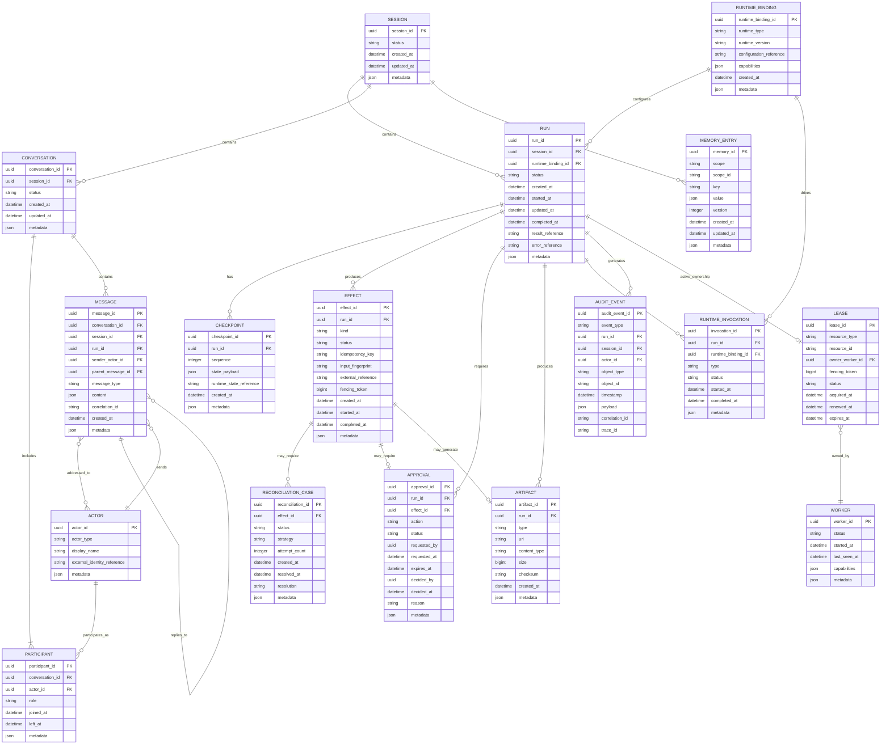
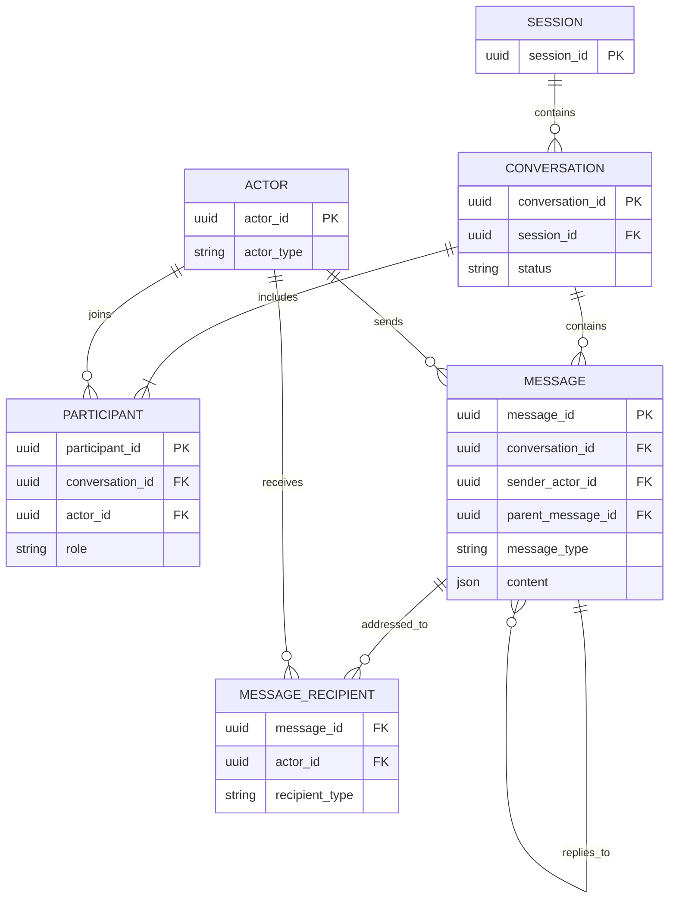
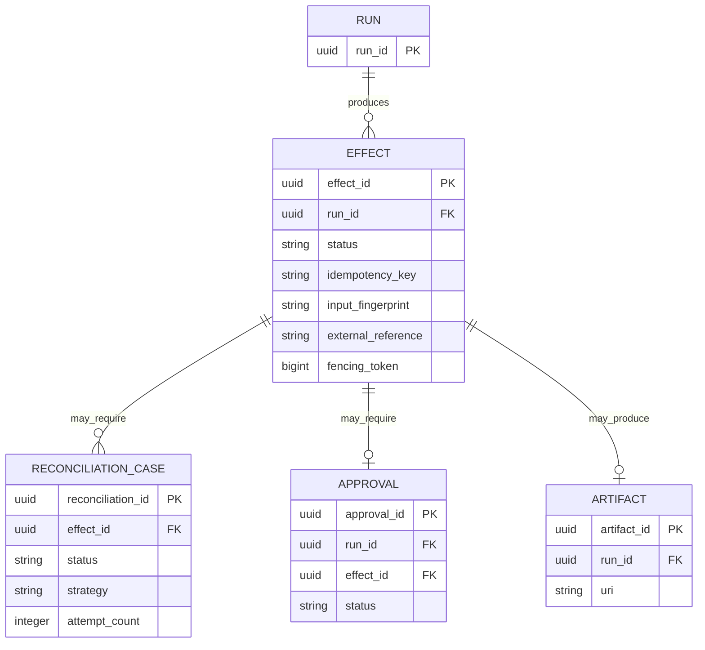
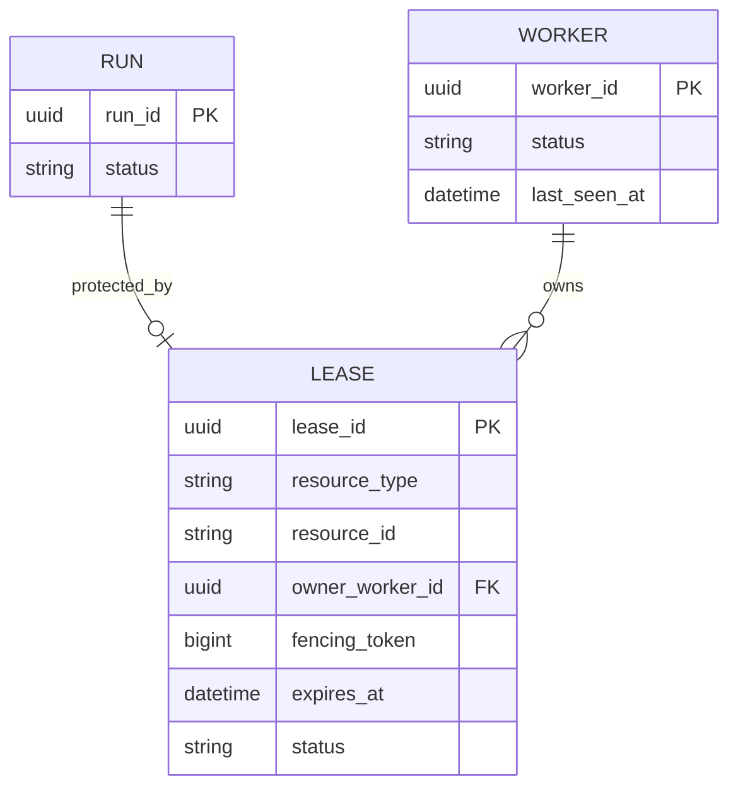
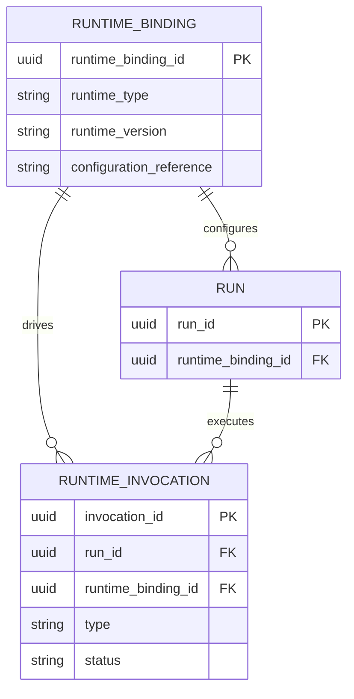
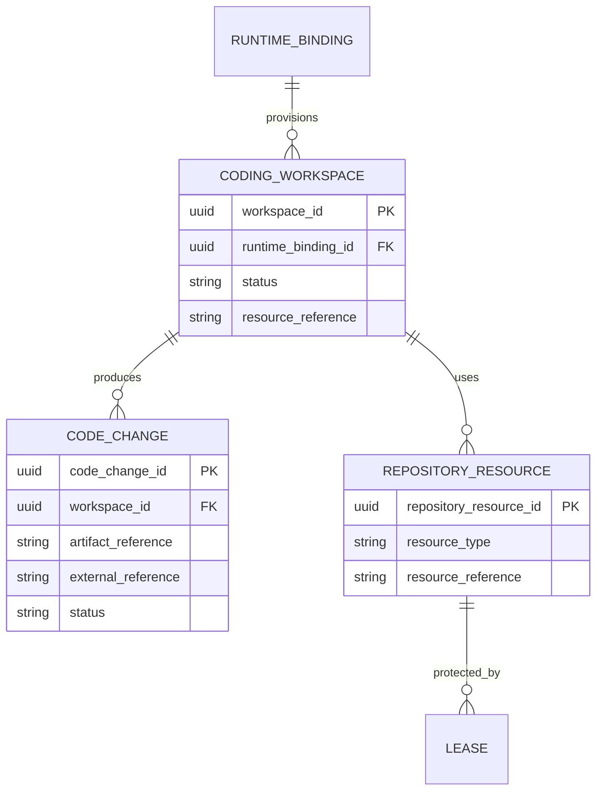

# PyAgentsKit — ERD (Entity Relationship Diagram)

**Document :** `../architecture/08_PYAGENTSKIT_ERD.md`  
**Version :** 1.0  
**Date :** 19 octobre 2026  
**Statut :** Modèle conceptuel / logique de données  
**Projet :** PyAgentsKit  

**Documents de référence :**
- `../foundation/00_PYAGENTSKIT_DEFINITION_DU_BESOIN.md`
- `../foundation/01_PYAGENTSKIT_ANALYSE_DU_BESOIN.md`
- `../foundation/02_PYAGENTSKIT_PARTIES_PRENANTES_ET_CAS_D_USAGE.md`
- `../foundation/03_PYAGENTSKIT_EXIGENCES_FONCTIONNELLES.md`
- `../foundation/04_PYAGENTSKIT_EXIGENCES_NON_FONCTIONNELLES.md`
- `../architecture/05_PYAGENTSKIT_PRINCIPES_ARCHITECTURAUX.md`
- `../domain/06_PYAGENTSKIT_OBJETS_METIERS.md`
- `../domain/07_PYAGENTSKIT_ENTITES.md`

---

# 1. Objet du document

Ce document décrit l’**Entity Relationship Diagram (ERD)** de PyAgentsKit.

Il formalise :

- les entités ;
- leurs identifiants ;
- leurs attributs structurants ;
- leurs relations ;
- leurs cardinalités ;
- les dépendances obligatoires et optionnelles ;
- les agrégats candidats ;
- les contraintes d’intégrité métier ;
- les zones encore ouvertes avant schéma physique PostgreSQL.

Ce document reste volontairement au niveau **conceptuel / logique**.

Il ne fixe pas encore :

- les types SQL exacts ;
- les index ;
- les contraintes physiques finales ;
- les stratégies de partitionnement ;
- les choix de normalisation détaillés ;
- les migrations.

---

# 2. Principes de modélisation

L’ERD suit les principes suivants :

```text
1. identité stable des entités
2. relations explicites
3. séparation domaine / infrastructure
4. effet externe modélisé explicitement
5. conversation distincte du run
6. message distinct de runtime event et audit event
7. ownership explicite via Lease
8. audit append-oriented
9. adapters et runtimes externes non fusionnés avec le domaine
10. coding-agent specifics hors du core
```

---

# 3. Vue générale du modèle

```text
Session
├── Conversation
│   ├── Participant
│   │   └── Actor
│   └── Message
│       ├── sender Actor
│       ├── recipients Actor[]
│       ├── parent Message?
│       └── Artifact*
│
├── Run
│   ├── Checkpoint
│   ├── Effect
│   │   └── ReconciliationCase
│   ├── Approval
│   ├── Artifact
│   ├── RuntimeInvocation
│   ├── Lease
│   │   └── Worker
│   └── AuditEvent
│
└── MemoryEntry

Run
└── RuntimeBinding
```

---

# 4. ERD Mermaid — vue globale



---

# 5. Entité `Session`

## Clé primaire

```text
session_id
```

## Relations

```text
Session 1 ───── 0..N Run
Session 1 ───── 0..N Conversation
Session 1 ───── 0..N MemoryEntry
```

## Rôle

Point d’ancrage durable du contexte.

---

# 6. Entité `Conversation`

## Clé primaire

```text
conversation_id
```

## Clé étrangère

```text
session_id → Session.session_id
```

## Relations

```text
Conversation 1 ───── 1..N Participant
Conversation 1 ───── 0..N Message
```

## Invariant

Une conversation doit appartenir à une session ou à un contexte explicitement modélisé.

Dans cette v1.0, le modèle privilégie :

```text
Conversation → Session
```

comme relation standard.

---

# 7. Entité `Actor`

## Clé primaire

```text
actor_id
```

## Types

```text
HUMAN
AGENT
SYSTEM
SERVICE
WORKER
SCHEDULER
ADMINISTRATOR
```

## Relations

```text
Actor 1 ───── 0..N Participant
Actor 1 ───── 0..N Message as sender
Actor N ───── N Message as recipient
Actor 1 ───── 0..N ApprovalDecision
Actor 1 ───── 0..N AuditEvent
```

## Point ouvert

`Actor` peut ultérieurement devenir :

```text
external identity reference
```

plutôt qu’une entité pleinement gérée par PyAgentsKit.

---

# 8. Entité `Participant`

## Clé primaire

```text
participant_id
```

## Clés étrangères

```text
conversation_id → Conversation
actor_id → Actor
```

## Relation

```text
Conversation 1 ───── 1..N Participant
Actor        1 ───── 0..N Participant
```

## Contrainte recommandée

Un même actor ne devrait pas être dupliqué plusieurs fois dans la même conversation avec le même rôle actif.

---

# 9. Entité `Message`

## Clé primaire

```text
message_id
```

## Clés étrangères

```text
conversation_id → Conversation
session_id      → Session
run_id?         → Run
sender_actor_id → Actor
parent_message_id? → Message
```

## Destinataires

La relation `Message ↔ Actor` est naturellement N:N.

Une table logique d’association pourra être nécessaire :

```text
MESSAGE_RECIPIENT
```

avec :

```text
message_id
actor_id
recipient_role?
delivery_metadata?
```

## Relations

```text
Conversation 1 ───── 0..N Message
Actor        1 ───── 0..N Message as sender
Message      N ───── N Actor as recipients
Message      0..1 ── 0..N Message as parent/replies
```

## Invariant

```text
Message != Approval
Message != RuntimeEvent
Message != AuditEvent
```

---

# 10. Table logique `MessageRecipient`

Le modèle relationnel physique pourra introduire :

```text
MESSAGE_RECIPIENT
```

## Attributs

```text
message_id FK
actor_id FK
recipient_type?
created_at
metadata
```

## Clé candidate

```text
(message_id, actor_id)
```

---

# 11. Entité `Run`

## Clé primaire

```text
run_id
```

## Clés étrangères

```text
session_id? → Session
runtime_binding_id → RuntimeBinding
```

## Relations

```text
Run 1 ───── 0..N Checkpoint
Run 1 ───── 0..N Effect
Run 1 ───── 0..N Approval
Run 1 ───── 0..N Artifact
Run 1 ───── 0..N RuntimeInvocation
Run 1 ───── 0..N AuditEvent
Run 1 ───── 0..1 active Lease
```

---

# 12. Entité `Checkpoint`

## Clé primaire

```text
checkpoint_id
```

## Clé étrangère

```text
run_id → Run
```

## Contrainte candidate

```text
UNIQUE(run_id, sequence)
```

## Relation

```text
Run 1 ───── 0..N Checkpoint
```

---

# 13. Entité `MemoryEntry`

## Clé primaire

```text
memory_id
```

## Modèle de scope

Une entrée mémoire peut être liée à :

```text
session
agent
tenant
workspace
custom
```

via :

```text
scope
scope_id
```

## Contrainte candidate

```text
UNIQUE(scope, scope_id, key)
```

si la mémoire est modélisée en key/value versionnée.

---

# 14. Entité `Effect`

## Clé primaire

```text
effect_id
```

## Clé étrangère

```text
run_id → Run
```

## Relations

```text
Run    1 ───── 0..N Effect
Effect 1 ───── 0..N ReconciliationCase
Effect 1 ───── 0..1 Approval
Effect 1 ───── 0..1 Artifact / result reference
```

## Contraintes candidates

```text
UNIQUE(idempotency_key)
```

ou :

```text
UNIQUE(run_id, idempotency_key)
```

selon la portée retenue.

## Règle

La portée exacte de l’idempotency key devra être décidée explicitement.

---

# 15. Entité `ReconciliationCase`

## Clé primaire

```text
reconciliation_id
```

## Clé étrangère

```text
effect_id → Effect
```

## Relation

```text
Effect 1 ───── 0..N ReconciliationCase
```

Plusieurs tentatives de reconciliation peuvent être conservées.

---

# 16. Entité `Approval`

## Clé primaire

```text
approval_id
```

## Clés étrangères

```text
run_id → Run
effect_id? → Effect
requested_by → Actor
decided_by? → Actor
```

## Relations

```text
Run    1 ───── 0..N Approval
Effect 1 ───── 0..1 Approval
Actor  1 ───── 0..N Approval requested
Actor  1 ───── 0..N Approval decided
```

---

# 17. Entité `Artifact`

## Clé primaire

```text
artifact_id
```

## Clé étrangère

```text
run_id → Run
```

## Relation

```text
Run 1 ───── 0..N Artifact
```

## Extension future

Un artifact pourrait aussi être attaché à :

```text
Message
Session
Effect
```

sans nécessairement appartenir physiquement à ces tables.

Une table générique de liaison pourra être envisagée :

```text
ARTIFACT_LINK
```

---

# 18. Entité `Lease`

## Clé primaire

```text
lease_id
```

## Clé étrangère

```text
owner_worker_id → Worker
```

## Ressource protégée

Le lease cible :

```text
resource_type
resource_id
```

ce qui permet de coordonner :

```text
run
repository
branch
workspace
external_job
custom_resource
```

## Contrainte métier

À un instant donné :

```text
1 ressource protégée
→ au plus 1 lease actif valide
```

## Contrainte physique candidate

Selon PostgreSQL :

```text
partial unique index
```

sur :

```text
(resource_type, resource_id)
WHERE status = 'ACTIVE'
```

à confirmer dans le schéma physique.

---

# 19. Entité `Worker`

## Clé primaire

```text
worker_id
```

## Relations

```text
Worker 1 ───── 0..N Lease
```

## Rôle

Le worker n’est pas l’owner par nature.

Il devient owner lorsqu’un lease valide lui est attribué.

---

# 20. Entité `RuntimeBinding`

## Clé primaire

```text
runtime_binding_id
```

## Relations

```text
RuntimeBinding 1 ───── 0..N Run
RuntimeBinding 1 ───── 0..N RuntimeInvocation
```

## Rôle

Découple le domaine PyAgentsKit du runtime externe.

Exemples :

```text
LangGraph
OpenAI Agents SDK
Claude Agent SDK
Codex
Claude Code
OpenCode
agy
Custom Runtime
```

---

# 21. Entité `RuntimeInvocation`

## Clé primaire

```text
invocation_id
```

## Clés étrangères

```text
run_id → Run
runtime_binding_id → RuntimeBinding
```

## Types

```text
START
RESUME
CONTINUE
CANCEL
```

---

# 22. Entité `AuditEvent`

## Clé primaire

```text
audit_event_id
```

## Clés étrangères optionnelles

```text
run_id?
session_id?
actor_id?
```

## Référence polymorphe

```text
object_type
object_id
```

peut permettre d’auditer :

```text
Run
Effect
Approval
Lease
Conversation
Message
Artifact
```

## Principe

Audit append-oriented.

---

# 23. ERD — conversation détaillée



---

# 24. ERD — effect safety



---

# 25. ERD — coordination distribuée



---

# 26. ERD — runtime integration



---

# 27. Agrégats et frontières transactionnelles candidates

## 27.1 `Run` Aggregate

```text
Run
└── Checkpoint references
```

Le run ne devrait probablement pas encapsuler physiquement :

```text
Effect
Approval
Lease
```

afin d’éviter des transactions trop larges.

---

## 27.2 `Conversation` Aggregate

```text
Conversation
├── Participant
└── Message references
```

Les messages peuvent être appendés indépendamment.

---

## 27.3 `Effect` Aggregate

```text
Effect
├── IdempotencyKey
├── InputFingerprint
├── ExternalReference
└── ReconciliationCase*
```

---

## 27.4 `Approval` Aggregate

```text
Approval
└── ApprovalDecision
```

---

## 27.5 `Lease` Aggregate

```text
Lease
├── ResourceIdentity
└── FencingToken
```

---

# 28. Relations obligatoires vs optionnelles

| Source | Relation | Cible | Cardinalité | Obligatoire |
|---|---|---|---:|---|
| Session | contains | Run | 1:N | non côté Run |
| Session | contains | Conversation | 1:N | oui côté Conversation |
| Conversation | contains | Message | 1:N | oui côté Message |
| Conversation | includes | Participant | 1:N | oui |
| Participant | references | Actor | N:1 | oui |
| Message | sender | Actor | N:1 | oui |
| Message | recipients | Actor | N:N | oui |
| Message | parent | Message | N:1 | non |
| Run | uses | RuntimeBinding | N:1 | oui |
| Run | has | Checkpoint | 1:N | non |
| Run | produces | Effect | 1:N | non |
| Run | requires | Approval | 1:N | non |
| Run | produces | Artifact | 1:N | non |
| Run | owns | Lease | 1:0..1 active | non |
| Lease | owned_by | Worker | N:1 | oui |
| Effect | reconciliation | ReconciliationCase | 1:N | non |
| Effect | approval | Approval | 1:0..1 | non |
| Run | audit | AuditEvent | 1:N | non |

---

# 29. Contraintes d’unicité candidates

```text
Checkpoint:
UNIQUE(run_id, sequence)

MessageRecipient:
UNIQUE(message_id, actor_id)

MemoryEntry:
UNIQUE(scope, scope_id, key)

Effect:
UNIQUE(idempotency_scope, idempotency_key)
à définir précisément

Participant:
UNIQUE(conversation_id, actor_id, active_role?)
à confirmer

Lease:
UNIQUE active(resource_type, resource_id)
via index partiel probable
```

---

# 30. Contraintes de référence

## Suppression logique recommandée

Pour les entités auditables :

```text
Run
Effect
Approval
Lease
Conversation
Message
```

préférer :

```text
soft deletion / archived status
```

ou conservation historique plutôt que suppression physique immédiate.

---

# 31. Relations polymorphes à traiter avec prudence

Certaines relations candidates sont polymorphes :

```text
AuditEvent.object_type/object_id
Lease.resource_type/resource_id
MemoryEntry.scope/scope_id
Artifact attachment target
```

Avantages :

```text
flexibilité
extensibilité
```

Inconvénients :

```text
FK relationnelles plus faibles
validation applicative nécessaire
requêtes plus complexes
```

Ces points devront faire l’objet d’ADR.

---

# 32. Normalisation recommandée

## Normaliser explicitement

```text
Run
Session
Conversation
Message
Actor
Effect
Approval
Lease
Worker
Artifact
RuntimeBinding
```

## JSON acceptable pour

```text
metadata
capabilities
content structuré
payload audit
configuration opaque
```

## Éviter

Un unique champ JSON contenant tout le domaine.

---

# 33. Données append-oriented

Les entités ou tables suivantes doivent tendre vers une logique append-oriented :

```text
Message
AuditEvent
Checkpoint
RuntimeInvocation
Reconciliation attempt
```

selon les décisions finales.

---

# 34. Données mutation-oriented

Les entités suivantes ont un état courant mutable mais auditable :

```text
Run
Conversation
Effect
Approval
Lease
Worker
RuntimeBinding
MemoryEntry
```

---

# 35. Index logiques candidats

Sans fixer encore le SQL :

```text
Run:
- status
- session_id
- runtime_binding_id

Conversation:
- session_id
- status

Message:
- conversation_id
- created_at
- correlation_id
- sender_actor_id

Effect:
- run_id
- status
- idempotency_key
- external_reference

Approval:
- run_id
- status
- expires_at

Lease:
- resource_type + resource_id
- owner_worker_id
- expires_at
- status

AuditEvent:
- run_id
- session_id
- object_type + object_id
- timestamp

Worker:
- status
- last_seen_at
```

---

# 36. Modèle logique conversationnel

```text
SESSION
  PK session_id

CONVERSATION
  PK conversation_id
  FK session_id

PARTICIPANT
  PK participant_id
  FK conversation_id
  FK actor_id

ACTOR
  PK actor_id

MESSAGE
  PK message_id
  FK conversation_id
  FK sender_actor_id
  FK parent_message_id?

MESSAGE_RECIPIENT
  PK/FK message_id
  PK/FK actor_id
```

---

# 37. Modèle logique durable execution

```text
RUN
  PK run_id
  FK session_id?
  FK runtime_binding_id

CHECKPOINT
  PK checkpoint_id
  FK run_id

RUNTIME_BINDING
  PK runtime_binding_id

RUNTIME_INVOCATION
  PK invocation_id
  FK run_id
  FK runtime_binding_id
```

---

# 38. Modèle logique effect safety

```text
EFFECT
  PK effect_id
  FK run_id

RECONCILIATION_CASE
  PK reconciliation_id
  FK effect_id

APPROVAL
  PK approval_id
  FK run_id
  FK effect_id?
```

---

# 39. Modèle logique coordination

```text
WORKER
  PK worker_id

LEASE
  PK lease_id
  FK owner_worker_id
  resource_type
  resource_id
  fencing_token
```

---

# 40. Modèle logique audit

```text
AUDIT_EVENT
  PK audit_event_id
  FK run_id?
  FK session_id?
  FK actor_id?
  object_type
  object_id
```

---

# 41. Mapping entités ↔ stores

| Entité | Store |
|---|---|
| Session | SessionStore |
| Conversation | ConversationStore |
| Message | MessageStore |
| Actor | ActorStore / external IAM |
| Participant | ConversationStore |
| MemoryEntry | MemoryStore |
| Run | RunStore |
| Checkpoint | CheckpointStore / RunStore |
| Effect | EffectStore |
| ReconciliationCase | ReconciliationStore / EffectStore |
| Approval | ApprovalStore |
| Artifact | ArtifactStore |
| Lease | LeaseStore |
| Worker | WorkerRegistry |
| RuntimeBinding | RuntimeStore |
| RuntimeInvocation | RuntimeStore |
| AuditEvent | AuditStore |

---

# 42. Entités hors du schéma central

Les concepts suivants doivent rester hors du core ERD général :

```text
Git repository details
branch internals
worktree internals
prompt templates
LLM messages vendor-specific
vector embeddings
Kubernetes pods
S3 buckets
cloud-specific objects
```

Ils appartiennent aux adapters ou modules spécialisés.

---

# 43. Coding agents — extension ERD optionnelle



Cette extension ne doit pas devenir obligatoire pour les agents généralistes.

---

# 44. Questions ouvertes ERD

## Q-ERD-01

`Actor` doit-il être stocké localement ou uniquement référencé depuis un IAM ?

## Q-ERD-02

`Participant` doit-il avoir sa propre PK ou utiliser :

```text
(conversation_id, actor_id)
```

comme clé composée ?

## Q-ERD-03

`Checkpoint` doit-il être une table séparée ou un sous-modèle de `RunStore` ?

## Q-ERD-04

`ReconciliationCase` doit-il être séparé de `Effect` ?

## Q-ERD-05

`RuntimeInvocation` mérite-t-il une table durable ?

## Q-ERD-06

`MemoryEntry.scope/scope_id` doit-il rester polymorphe ?

## Q-ERD-07

Faut-il une table générique :

```text
RESOURCE
```

pour éviter `resource_type/resource_id` dans `Lease` ?

## Q-ERD-08

Faut-il un modèle générique de liaison pour `Artifact` ?

## Q-ERD-09

Faut-il introduire `SubRun` pour les délégations agent→agent ?

## Q-ERD-10

Faut-il introduire une entité `Task` entre `Run` et `RuntimeInvocation` ?

---

# 45. Décisions à prendre avant schéma PostgreSQL

Avant `DDL`, il faut décider :

```text
1. UUID vs ULID
2. Actor local vs external IAM
3. scope de l’idempotency key
4. CheckpointStore séparé ou non
5. ReconciliationCase séparé ou non
6. RuntimeInvocation persistée ou non
7. stratégie des relations polymorphes
8. stratégie soft delete / archival
9. optimistic locking / version columns
10. stratégie de tenant / namespace
11. JSONB vs colonnes typées pour metadata
12. index partiels des leases actifs
13. modèle des recipients de Message
14. table de liens Artifact
```

---

# 46. Invariants relationnels globaux

## ERD-INV-01

Tout `Message` appartient à une `Conversation`.

## ERD-INV-02

Toute `Conversation` appartient à une `Session` dans le modèle standard.

## ERD-INV-03

Tout `Effect` appartient à un `Run`.

## ERD-INV-04

Toute `Approval` appartient à un `Run`.

## ERD-INV-05

Tout `Checkpoint` appartient à un `Run`.

## ERD-INV-06

Tout `Lease` possède un `Worker` owner.

## ERD-INV-07

Un seul lease actif valide peut protéger une ressource donnée.

## ERD-INV-08

Un `Effect SUCCEEDED` conserve son identité et son résultat.

## ERD-INV-09

Un `AuditEvent` déjà persisté ne doit pas être modifié silencieusement.

## ERD-INV-10

Une référence externe n’est jamais utilisée comme clé primaire PyAgentsKit.

---

# 47. ERD cible simplifié

```text
                        SESSION
                           │
            ┌──────────────┼──────────────┐
            ▼              ▼              ▼
     CONVERSATION         RUN        MEMORY_ENTRY
            │              │
      ┌─────┴─────┐        ├── CHECKPOINT
      ▼           ▼        ├── EFFECT ── RECONCILIATION_CASE
 PARTICIPANT    MESSAGE     ├── APPROVAL
      │           │        ├── ARTIFACT
      └── ACTOR ──┘        ├── RUNTIME_INVOCATION
                           ├── AUDIT_EVENT
                           └── LEASE
                                │
                                ▼
                              WORKER

                           RUN
                            │
                            ▼
                     RUNTIME_BINDING
```

---

# 48. Résumé

L’ERD de PyAgentsKit repose sur cinq axes structurants :

```text
CONTEXT
Session / Conversation / Message / Memory

EXECUTION
Run / Checkpoint / RuntimeInvocation

EFFECT SAFETY
Effect / ReconciliationCase / Approval

DISTRIBUTED OWNERSHIP
Lease / Worker

TRACEABILITY
AuditEvent / Artifact / Actor
```

Le modèle est conçu pour permettre :

```text
reprise
audit
multi-worker
human-in-the-loop
agent-to-agent messaging
effect safety
runtime neutrality
```

sans coupler le domaine à :

```text
PostgreSQL
LangGraph
Claude Code
Codex
Kubernetes
S3
```

Le prochain document naturel après cet ERD pourra être :

```text
../domain/09_PYAGENTSKIT_VALUE_OBJECTS.md
```

puis :

```text
10_PYAGENTSKIT_SCHEMA_POSTGRESQL.md
```

pour passer du modèle logique au modèle physique.
