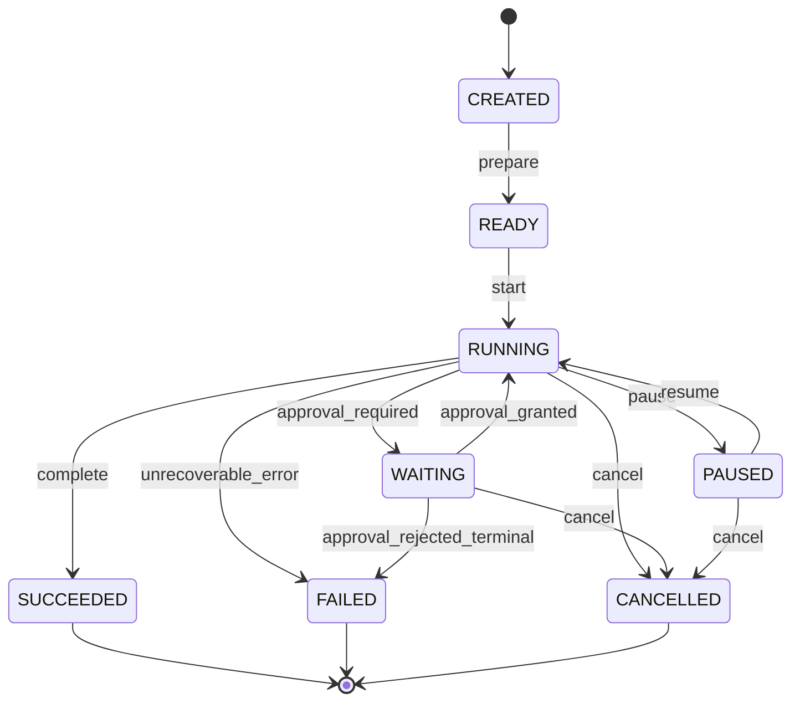
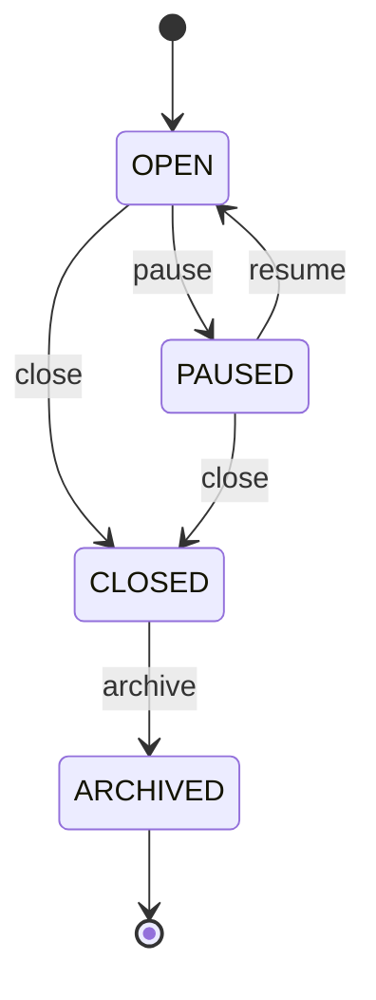
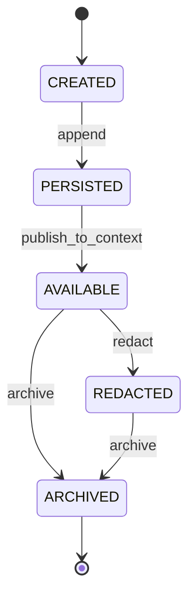
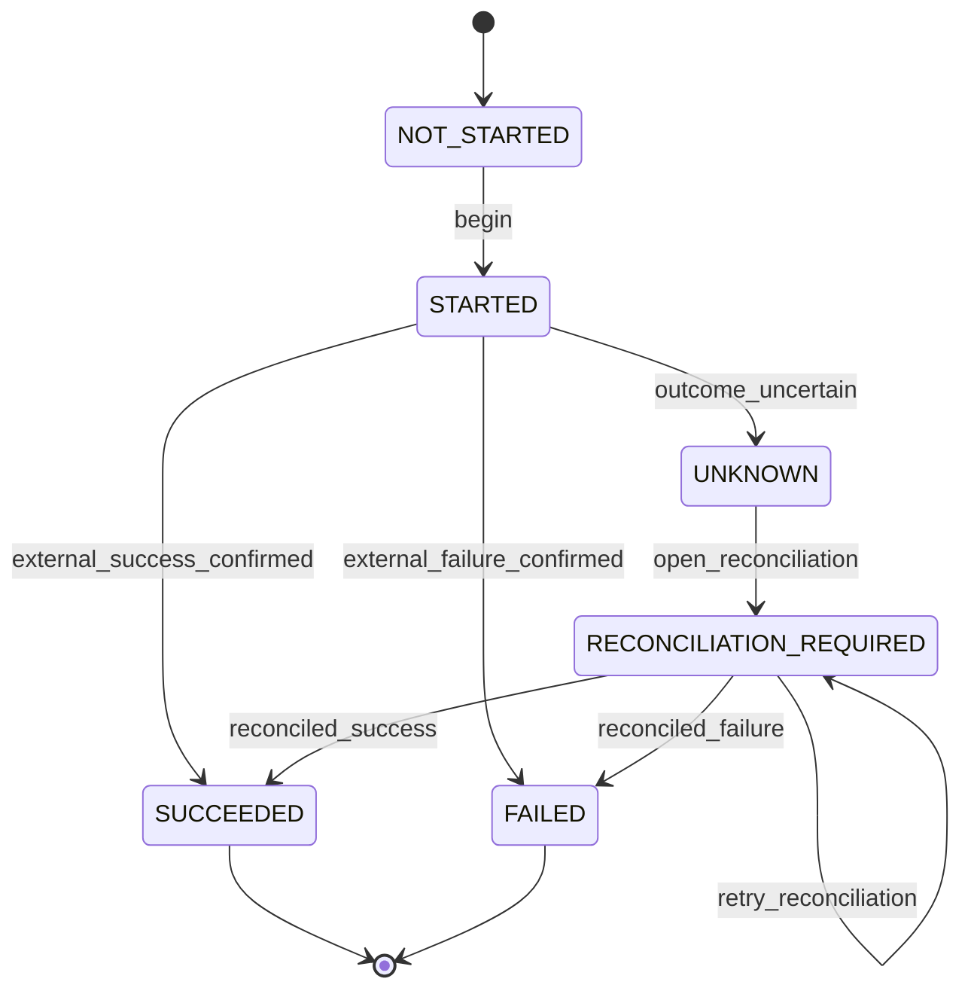
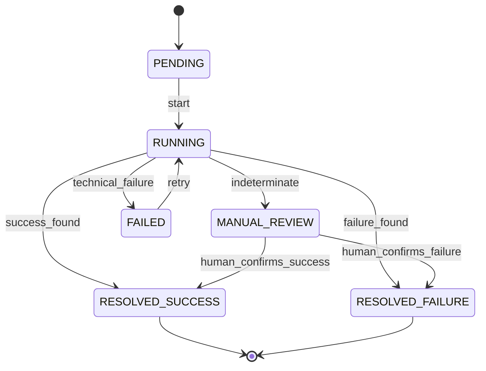
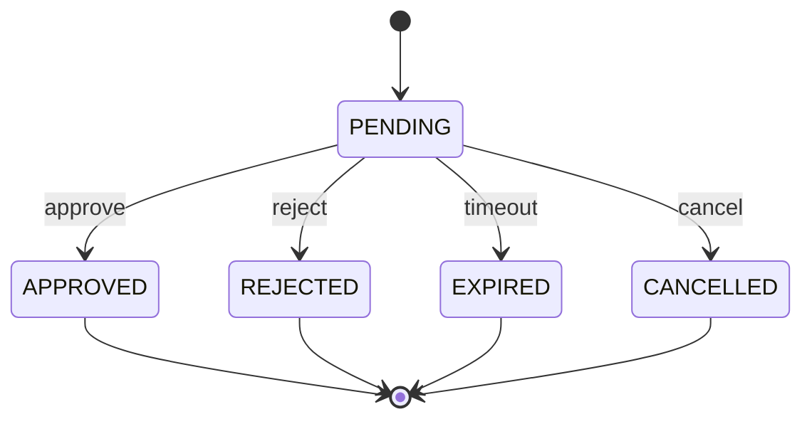
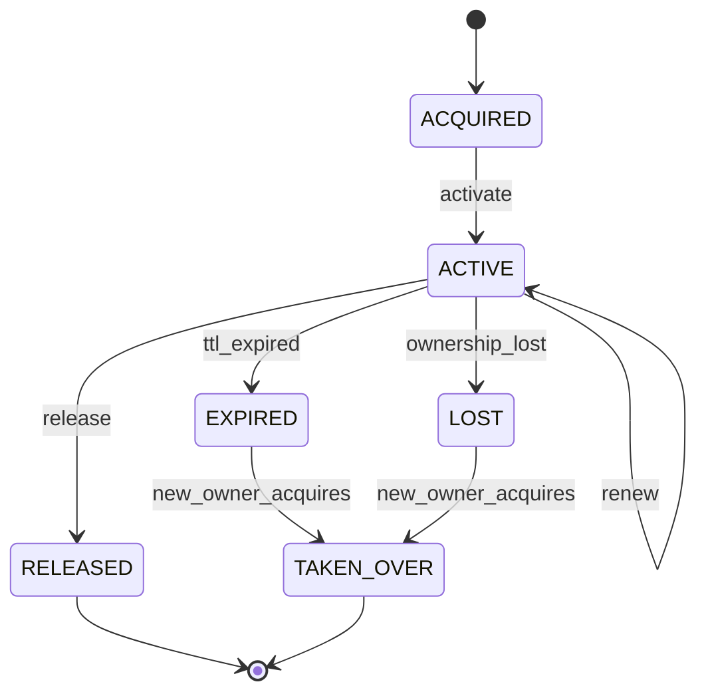
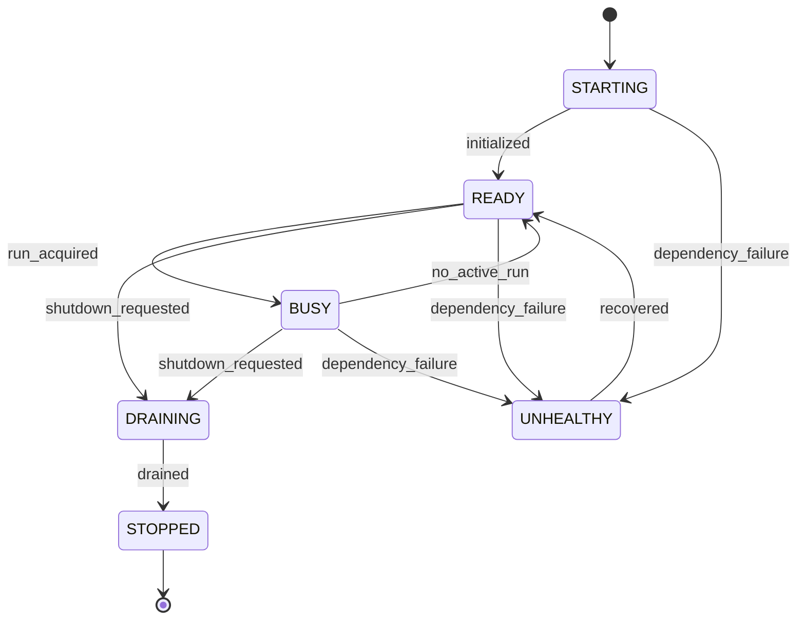
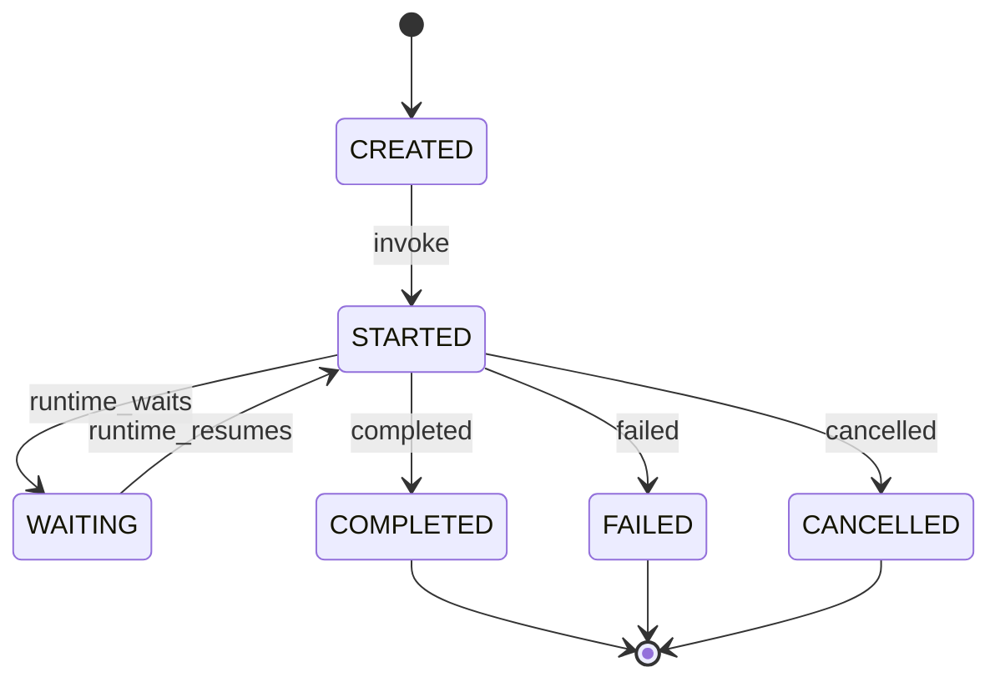
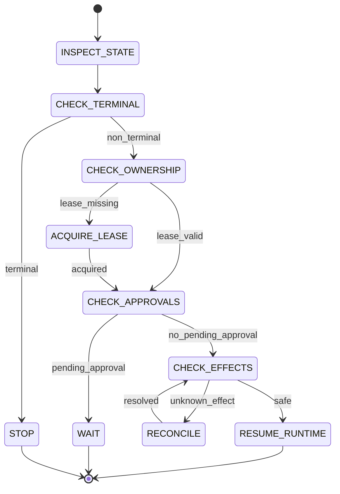

# PyAgentsKit — États et cycles de vie

**Document :** `../domain/10_PYAGENTSKIT_ETATS_ET_CYCLES_DE_VIE.md`  
**Version :** 1.0  
**Date :** 19 octobre 2026  
**Statut :** Spécification des machines à états  
**Projet :** PyAgentsKit  

**Documents de référence :**
- `../foundation/00_PYAGENTSKIT_DEFINITION_DU_BESOIN.md`
- `../foundation/01_PYAGENTSKIT_ANALYSE_DU_BESOIN.md`
- `../foundation/02_PYAGENTSKIT_PARTIES_PRENANTES_ET_CAS_D_USAGE.md`
- `../foundation/03_PYAGENTSKIT_EXIGENCES_FONCTIONNELLES.md`
- `../foundation/04_PYAGENTSKIT_EXIGENCES_NON_FONCTIONNELLES.md`
- `../architecture/05_PYAGENTSKIT_PRINCIPES_ARCHITECTURAUX.md`
- `../domain/06_PYAGENTSKIT_OBJETS_METIERS.md`
- `../domain/07_PYAGENTSKIT_ENTITES.md`
- `../architecture/08_PYAGENTSKIT_ERD.md`
- `../domain/PYAGENTSKIT_MODELE_CONCEPTUEL_DU_DOMAINE.md`

---

# 1. Objet du document

Ce document définit les **états métier**, les **transitions**, les **gardes**, les **événements déclencheurs** et les **états terminaux** des principaux objets de PyAgentsKit.

L’objectif est de garantir que :

- les transitions soient explicites ;
- les reprises soient déterministes ;
- les états ambigus ne soient pas masqués ;
- les effets externes ne soient pas rejoués implicitement ;
- les approvals bloquent effectivement l’exécution lorsqu’elles sont requises ;
- les workers obsolètes soient rendus inoffensifs ;
- les conversations et messages restent cohérents ;
- les transitions critiques soient auditables.

---

# 2. Principes généraux de cycle de vie

## 2.1 Une transition est une opération métier

Une transition ne doit pas être réduite à :

```python
entity.status = "SUCCEEDED"
```

Elle doit être réalisée par une opération validant :

```text
current state
requested transition
guards
invariants
side effects
audit events
```

---

## 2.2 États explicites

Éviter les états dérivés de combinaisons ambiguës comme :

```text
is_running = false
is_done = false
error = null
```

Préférer :

```text
WAITING
```

ou :

```text
PAUSED
```

selon le sens métier.

---

## 2.3 États terminaux

Un état terminal est un état qui ne doit pas redevenir actif implicitement.

Exemples :

```text
Run:
SUCCEEDED
FAILED
CANCELLED

Approval:
APPROVED
REJECTED
EXPIRED
CANCELLED
```

---

## 2.4 Reprise explicite

Une reprise n’est pas un simple redémarrage du processus.

Elle doit réévaluer :

```text
run state
checkpoint
lease
approvals
effects
runtime state
```

---

# 3. Conventions de transition

Notation utilisée :

```text
STATE_A
  -- event [guard] / action -->
STATE_B
```

Exemple :

```text
RUNNING
  -- approval_required -->
WAITING
```

---

# 4. Cycle de vie du `Run`

## 4.1 États

```text
CREATED
READY
RUNNING
WAITING
PAUSED
SUCCEEDED
FAILED
CANCELLED
```

## 4.2 États terminaux

```text
SUCCEEDED
FAILED
CANCELLED
```

## 4.3 Diagramme



---

# 5. Transitions du `Run`

| Source | Événement | Cible | Garde |
|---|---|---|---|
| CREATED | prepare | READY | configuration valide |
| READY | start | RUNNING | lease acquis si requis |
| RUNNING | approval_required | WAITING | approval créée |
| RUNNING | pause | PAUSED | checkpoint possible |
| RUNNING | complete | SUCCEEDED | aucun blocker |
| RUNNING | unrecoverable_error | FAILED | erreur terminale |
| RUNNING | cancel | CANCELLED | annulation autorisée |
| WAITING | approval_granted | RUNNING | approval valide |
| WAITING | approval_rejected_terminal | FAILED | rejet terminal |
| WAITING | cancel | CANCELLED | annulation autorisée |
| PAUSED | resume | RUNNING | recovery checks OK |
| PAUSED | cancel | CANCELLED | annulation autorisée |

---

# 6. Invariants du `Run`

```text
RUN-LC-INV-01
Un Run terminal ne redevient pas actif implicitement.

RUN-LC-INV-02
Un Run RUNNING distribué doit avoir un ownership valide.

RUN-LC-INV-03
Un Run WAITING ne doit pas progresser tant que son blocker n’est pas résolu.

RUN-LC-INV-04
Un Run ne peut être SUCCEEDED si un Effect critique reste UNKNOWN.

RUN-LC-INV-05
Toute reprise doit inspecter approvals et effects.
```

---

# 7. Transition vers `WAITING`

`WAITING` est un état volontairement générique.

Il peut être provoqué par :

```text
approval pending
external event pending
human input pending
reconciliation pending
dependency unavailable
```

La cause réelle doit être explicitement portée par :

```text
waiting_reason
blocker_reference
metadata
```

---

# 8. Cycle de vie du `Conversation`

## États

```text
OPEN
PAUSED
CLOSED
ARCHIVED
```

## Diagramme



---

# 9. Invariants de la `Conversation`

```text
CONV-LC-INV-01
Une conversation ARCHIVED ne reçoit plus de nouveaux messages.

CONV-LC-INV-02
Une conversation CLOSED n’accepte pas de nouveau message sauf réouverture explicite si cette capacité est introduite.

CONV-LC-INV-03
PAUSED suspend l’activité conversationnelle sans supprimer l’historique.
```

---

# 10. Cycle de vie du `Message`

Le `Message` est principalement append-oriented.

Il ne doit pas être surmodélisé comme un workflow complet.

## États conceptuels minimaux

```text
CREATED
PERSISTED
AVAILABLE
REDACTED
ARCHIVED
```

`DELIVERED` ne doit pas être obligatoire dans le core car PyAgentsKit n’est pas un broker de messages.

## Diagramme



---

# 11. Sémantique du `Message`

Un message persistant peut exister sans connaissance du transport.

PyAgentsKit connaît :

```text
message_id
conversation_id
sender
recipients
content
correlation
```

mais ne doit pas exiger :

```text
Kafka offset
NATS subject
WebSocket delivery ack
```

---

# 12. Déduplication des messages

Une future évolution peut introduire :

```text
message_deduplication_key
```

pour protéger :

```text
runtime replay
transport redelivery
agent-to-agent duplicate emission
```

Principe :

> **un replay technique ne doit pas devenir automatiquement un nouveau message logique.**

---

# 13. Cycle de vie de l’`Effect`

## États

```text
NOT_STARTED
STARTED
SUCCEEDED
FAILED
UNKNOWN
RECONCILIATION_REQUIRED
```

## États terminaux

```text
SUCCEEDED
FAILED
```

`UNKNOWN` n’est pas terminal.

## Diagramme



---

# 14. Invariants de l’`Effect`

```text
EFF-LC-INV-01
SUCCEEDED ne doit pas être rejoué implicitement.

EFF-LC-INV-02
UNKNOWN ne doit pas être assimilé à FAILED.

EFF-LC-INV-03
STARTED doit être persisté avant un effet critique lorsque la stratégie l’exige.

EFF-LC-INV-04
Une idempotency key doit rester stable pour un même effet logique.

EFF-LC-INV-05
Un effet protégé nécessite un ownership valide.

EFF-LC-INV-06
Le fencing token utilisé doit être courant.
```

---

# 15. `EffectIntent` avant `STARTED`

Pour certains effets critiques :

```text
EffectIntent persisted
↓
external call
↓
Effect STARTED / outcome
```

Cette séparation permet de distinguer :

```text
intention connue
vs
effet réellement lancé
```

---

# 16. Cycle de vie de `ReconciliationCase`

## États

```text
PENDING
RUNNING
RESOLVED_SUCCESS
RESOLVED_FAILURE
MANUAL_REVIEW
FAILED
```

## Diagramme



---

# 17. Relation `Effect` / `ReconciliationCase`

```text
Effect UNKNOWN
   ↓
ReconciliationCase PENDING
   ↓
RUNNING
   ↓
resolution
   ↓
Effect SUCCEEDED / FAILED
```

Le `ReconciliationCase` ne doit pas modifier directement l’effet sans passer par une opération métier contrôlée.

---

# 18. Cycle de vie de l’`Approval`

## États

```text
PENDING
APPROVED
REJECTED
EXPIRED
CANCELLED
```

## États terminaux

```text
APPROVED
REJECTED
EXPIRED
CANCELLED
```

## Diagramme



---

# 19. Invariants de l’`Approval`

```text
APP-LC-INV-01
Une approval terminale est immuable.

APP-LC-INV-02
La décision doit avoir un Actor identifié.

APP-LC-INV-03
Une approval requise bloque le run.

APP-LC-INV-04
Un message libre n’est pas une approval.

APP-LC-INV-05
Une approval expirée ne doit pas être réutilisée.
```

---

# 20. Cycle de vie du `Lease`

## États

```text
ACQUIRED
ACTIVE
LOST
EXPIRED
RELEASED
TAKEN_OVER
```

## Diagramme



---

# 21. Invariants du `Lease`

```text
LEASE-LC-INV-01
Un seul lease actif valide par ressource logique.

LEASE-LC-INV-02
Un takeover produit un nouveau fencing token.

LEASE-LC-INV-03
Un worker avec lease LOST ou EXPIRED ne produit plus d’effet protégé.

LEASE-LC-INV-04
Renew ne prolonge que le lease actuellement possédé.

LEASE-LC-INV-05
L’expiration logique ne nécessite pas la mort du processus.
```

---

# 22. Cycle de vie du `Worker`

## États

```text
STARTING
READY
BUSY
DRAINING
UNHEALTHY
STOPPED
```

## Diagramme



---

# 23. `DRAINING`

`DRAINING` implique :

```text
stop new admissions
continue / checkpoint active work
manage leases
prepare shutdown
```

Un worker `DRAINING` ne doit pas reprendre de nouveau run.

---

# 24. `UNHEALTHY` vs `NOT READY`

Le statut métier du worker peut être complété par des signaux opérationnels :

```text
liveness
readiness
```

Exemple :

```text
process alive
+
PostgreSQL unavailable
=
health may be alive
readiness = false
```

---

# 25. Cycle de vie de `RuntimeInvocation`

## États

```text
CREATED
STARTED
WAITING
COMPLETED
FAILED
CANCELLED
```

## Types

```text
START
RESUME
CONTINUE
CANCEL
```

## Diagramme



---

# 26. Relation `RuntimeInvocation` / `Run`

Une invocation peut échouer sans rendre le run terminal.

Exemple :

```text
RuntimeInvocation FAILED
↓
RecoveryPlanner
↓
new invocation RESUME
↓
Run continues
```

Donc :

```text
Invocation failure
!=
Run failure
```

---

# 27. Cycle de vie du `Artifact`

Le domaine peut rester simple.

## États possibles

```text
CREATED
AVAILABLE
ARCHIVED
DELETED
```

La suppression du contenu binaire ne doit pas nécessairement supprimer l’historique métier.

---

# 28. Cycle de vie de `MemoryEntry`

## États conceptuels

```text
ACTIVE
SUPERSEDED
DELETED
```

ou modèle versionné sans état explicite.

La décision finale dépendra du design du `MemoryStore`.

---

# 29. Cycle de vie de `Session`

## États possibles

```text
OPEN
PAUSED
CLOSED
ARCHIVED
```

Une session peut rester ouverte alors que plusieurs runs successifs sont terminés.

---

# 30. Cycle de vie de `Policy`

Si `Policy` devient une entité :

```text
DRAFT
ACTIVE
DISABLED
ARCHIVED
```

Ce cycle de vie reste optionnel tant que `Policy` n’est pas confirmée comme aggregate root.

---

# 31. Cycle de vie de `Actor`

PyAgentsKit ne doit pas devenir IAM.

Si `Actor` est persisté localement, états minimaux possibles :

```text
ACTIVE
DISABLED
DELETED
```

mais l’autorité réelle peut rester externe.

---

# 32. Recovery lifecycle du `Run`

La reprise peut être vue comme une sous-machine.



---

# 33. Ordre de reprise recommandé

```text
1. charger Run
2. vérifier état terminal
3. charger Checkpoint
4. valider/acquérir Lease
5. charger Approvals
6. inspecter Effects
7. réconcilier les UNKNOWN
8. déterminer NextAction
9. démarrer RuntimeInvocation
10. reprendre
```

---

# 34. `NextAction`

Valeurs candidates :

```text
ACQUIRE_LEASE
WAIT_FOR_APPROVAL
RECONCILE_EFFECT
RESUME_RUNTIME
COMPLETE_RUN
FAIL_RUN
MANUAL_INTERVENTION
```

---

# 35. Cycle de vie multi-agent

Le multi-agent ne nécessite pas un cycle global différent.

Il combine :

```text
Conversation lifecycle
Message lifecycle
Run lifecycle
RuntimeInvocation lifecycle
```

Exemple :

```text
Agent A message
↓
Agent B invocation
↓
Agent B message
↓
Agent A resumes
```

---

# 36. Agent-to-agent delegation

Deux stratégies :

## Stratégie A — même Run

```text
Run R1
 ├── Invocation Agent A
 ├── Invocation Agent B
 └── Invocation Agent A
```

## Stratégie B — Run parent/enfant

```text
Run R1
 └── child Run R2
```

Le cycle de vie doit rester cohérent dans les deux modèles.

---

# 37. Cycle de vie coding agent

Exemple :

```text
Run RUNNING
↓
RuntimeInvocation STARTED
↓
edit files
↓
tests
↓
Effect git_commit
↓
Effect git_push
↓
Approval PENDING
↓
Run WAITING
↓
Approval APPROVED
↓
Run RUNNING
↓
Effect create_pr
↓
Run SUCCEEDED
```

---

# 38. Actions coding à considérer comme effets

```text
git commit
git push
create PR
merge PR
publish package
deploy
terraform apply
```

Leur cycle de vie suit celui de `Effect`.

---

# 39. Transition après crash d’un coding agent

Exemple :

```text
git push
↓
remote accepted
↓
worker crash
```

État correct :

```text
Effect UNKNOWN
↓
ReconciliationCase
↓
inspect remote
↓
SUCCEEDED / FAILED
```

Pas :

```text
retry git push blindly
```

---

# 40. États dérivés interdits

Éviter des états implicites comme :

```text
run has no error
therefore run succeeded
```

ou :

```text
effect timeout
therefore failed
```

ou :

```text
worker alive
therefore owns run
```

Ces inférences sont incorrectes.

---

# 41. Transitions idempotentes

Certaines commandes peuvent être idempotentes.

Exemple :

```text
approve already APPROVED
```

peut :

```text
return current state
```

ou :

```text
reject duplicate command
```

La politique doit être explicite et testée.

---

# 42. Invalid transitions

Exemples à rejeter :

```text
Run SUCCEEDED → RUNNING
Approval APPROVED → REJECTED
Effect SUCCEEDED → STARTED
Lease RELEASED → ACTIVE
Conversation ARCHIVED → OPEN
```

sans opération métier spéciale explicitement définie.

---

# 43. Événements produits par transitions

Chaque transition critique doit pouvoir produire un DomainEvent.

Exemples :

```text
Run RUNNING → WAITING
→ RunWaiting

Effect STARTED → UNKNOWN
→ EffectUnknown

Lease ACTIVE → LOST
→ LeaseLost

Approval PENDING → APPROVED
→ ApprovalApproved
```

---

# 44. Audit des transitions

Les transitions suivantes doivent être auditables :

```text
Run terminal transitions
Effect transitions
Approval decisions
Lease ownership changes
Fencing rejection
Conversation archive
Sensitive message actions
```

---

# 45. Persistance des transitions

Principe :

```text
validate
↓
persist new state
↓
persist required audit/event
↓
emit secondary notifications
```

Les notifications secondaires ne doivent pas déterminer la validité de l’état métier.

---

# 46. Transactions critiques

Transactions atomiques recommandées :

```text
Lease acquire + fencing token
Approval decision + state
Effect result + external reference
Run terminal transition + final checkpoint
```

selon le backend.

---

# 47. Outbox recommandée

Pour éviter :

```text
state committed
but event not published
```

une stratégie Outbox peut être utilisée pour certains événements externes.

Elle n’est pas obligatoire dans le domaine mais compatible avec lui.

---

# 48. Gestion des timeouts

Un timeout doit être interprété selon le contexte.

```text
RuntimeInvocation timeout
→ invocation may fail

Effect timeout
→ may become UNKNOWN

Approval timeout
→ may become EXPIRED

Lease timeout
→ lease EXPIRED
```

Un même mot technique produit des conséquences métier différentes.

---

# 49. Gestion des erreurs

Types d’erreurs métier candidates :

```text
InvalidStateTransition
LeaseLostError
FencingRejected
ApprovalRequired
ApprovalExpired
EffectAlreadyCompleted
EffectNeedsReconciliation
RunAlreadyTerminal
ConversationClosed
StoreUnavailable
```

---

# 50. Machine à états et stores

Le store ne doit pas autoriser des mutations arbitraires ignorant la machine à états.

Préférer :

```text
transition(run_id, expected_state, target_state)
```

ou :

```text
save(entity, expected_version)
```

avec contrôle de concurrence.

---

# 51. Optimistic concurrency

Certaines transitions peuvent utiliser :

```text
version
expected_version
compare-and-swap
```

notamment pour :

```text
Run
Effect
Approval
Conversation
MemoryEntry
```

---

# 52. Pessimistic locking

Peut être réservé aux scénarios critiques comme :

```text
lease acquisition
takeover
fencing token generation
```

selon le backend PostgreSQL.

---

# 53. État opérationnel vs métier

Ne pas confondre :

```text
Run.status = RUNNING
```

avec :

```text
worker readiness = false
```

Le premier est métier.

Le second est opérationnel.

---

# 54. État courant vs historique

Chaque entité critique peut disposer :

```text
current state
+
historical events
```

PyAgentsKit n’impose pas Event Sourcing.

---

# 55. Matrice synthétique des états

| Objet | États principaux | Terminaux |
|---|---|---|
| Run | CREATED, READY, RUNNING, WAITING, PAUSED, SUCCEEDED, FAILED, CANCELLED | SUCCEEDED, FAILED, CANCELLED |
| Conversation | OPEN, PAUSED, CLOSED, ARCHIVED | ARCHIVED |
| Message | CREATED, PERSISTED, AVAILABLE, REDACTED, ARCHIVED | ARCHIVED |
| Effect | NOT_STARTED, STARTED, UNKNOWN, RECONCILIATION_REQUIRED, SUCCEEDED, FAILED | SUCCEEDED, FAILED |
| ReconciliationCase | PENDING, RUNNING, MANUAL_REVIEW, RESOLVED_SUCCESS, RESOLVED_FAILURE, FAILED | RESOLVED_SUCCESS, RESOLVED_FAILURE |
| Approval | PENDING, APPROVED, REJECTED, EXPIRED, CANCELLED | APPROVED, REJECTED, EXPIRED, CANCELLED |
| Lease | ACQUIRED, ACTIVE, LOST, EXPIRED, RELEASED, TAKEN_OVER | RELEASED, TAKEN_OVER |
| Worker | STARTING, READY, BUSY, DRAINING, UNHEALTHY, STOPPED | STOPPED |
| RuntimeInvocation | CREATED, STARTED, WAITING, COMPLETED, FAILED, CANCELLED | COMPLETED, FAILED, CANCELLED |
| Artifact | CREATED, AVAILABLE, ARCHIVED, DELETED | ARCHIVED, DELETED |

---

# 56. Guards critiques

## Run start

```text
runtime binding exists
required stores available
lease valid if distributed
```

## Effect execute

```text
run active
effect not terminal
approval satisfied
ownership valid
fencing token valid
```

## Approval approve

```text
status == PENDING
actor authorized
not expired
```

## Lease renew

```text
owner matches
lease active
fencing token current
```

---

# 57. Conditions de blocage

Un run doit rester bloqué si :

```text
pending mandatory approval
unknown critical effect
lease unavailable
store unavailable
manual intervention required
```

---

# 58. Safe degradation

En cas de perte du store critique :

```text
worker
↓
readiness false
↓
stop new admissions
↓
stop protected effects
↓
checkpoint if possible
```

Le système doit préférer :

```text
safe stop
```

à :

```text
unsafe progress
```

---

# 59. Split-brain

Scénario :

```text
Worker A token 41
↓
lease expires
↓
Worker B token 42
↓
Worker A returns
```

Transition logique :

```text
Worker A ownership → LOST
Worker B ownership → ACTIVE
```

et :

```text
token 41
→ FencingRejected
```

---

# 60. Takeover

```text
Lease EXPIRED
↓
new worker acquires
↓
new fencing token
↓
TAKEN_OVER
```

Le takeover doit être audité.

---

# 61. Graceful shutdown

Cycle recommandé :

```text
READY/BUSY
↓
DRAINING
↓
stop admissions
↓
checkpoint / finish active work
↓
release leases
↓
STOPPED
```

---

# 62. Crash shutdown

En cas de crash :

```text
worker disappears
↓
lease expires
↓
new worker takeover
↓
RecoveryPlanner
```

Aucune release propre n’est supposée.

---

# 63. Session longue

Une Session peut survivre à :

```text
Run 1 SUCCEEDED
Run 2 FAILED
Run 3 SUCCEEDED
```

La Session n’est pas terminale automatiquement lorsque le premier run se termine.

---

# 64. Conversation longue

Une Conversation peut traverser plusieurs Runs.

```text
Conversation C1
├── Run R1
├── Run R2
└── Run R3
```

Le cycle de vie conversationnel reste indépendant du cycle de vie des runs.

---

# 65. Message et Run optionnel

Un `Message` peut être lié à un `Run`, mais ce lien n’est pas toujours obligatoire.

Exemples :

```text
message initiant un futur run
message post-run
message hors orchestration
```

---

# 66. RuntimeEvent lifecycle

Les `RuntimeEvent` peuvent être éphémères ou persistés.

Ils ne nécessitent pas forcément une machine à états.

Ils sont normalisés puis éventuellement convertis en :

```text
Message
DomainEvent
AuditEvent
Effect intent
```

selon leur nature.

---

# 67. Domain Event lifecycle

Un DomainEvent est immuable une fois produit.

États possibles côté transport :

```text
CREATED
PUBLISHED
FAILED_TO_PUBLISH
```

mais ces états appartiennent plutôt à l’infrastructure/outbox qu’au domaine métier principal.

---

# 68. AuditEvent lifecycle

Un AuditEvent est append-only.

Cycle conceptuel :

```text
CREATED
↓
PERSISTED
↓
RETAINED / ARCHIVED
```

Pas de modification silencieuse.

---

# 69. PolicyDecision lifecycle

`PolicyDecision` est un Value Object calculé.

Il n’a pas nécessairement un cycle de vie durable.

Valeurs :

```text
ALLOW
DENY
REQUIRE_APPROVAL
DEFER
```

---

# 70. RecoveryPlan lifecycle

`RecoveryPlan` est calculé à partir de l’état courant.

Il peut être :

```text
CREATED
APPLIED
SUPERSEDED
```

ou rester un Value Object non persisté.

Décision à confirmer.

---

# 71. Cohérence inter-agrégats

Les transitions entre agrégats doivent éviter les mutations cachées.

Exemple :

```text
Approval APPROVED
```

ne doit pas modifier directement le Run en mémoire sans passer par une orchestration explicite.

Flux recommandé :

```text
ApprovalApproved event
↓
application service
↓
Run resume command
```

---

# 72. Eventual consistency acceptable

Exemples :

```text
approval approved
↓
audit projection updated quelques ms plus tard
```

acceptable.

Mais :

```text
approval approved
↓
run resumes before approval persisted
```

non acceptable.

---

# 73. Matrice transition → événement

| Transition | Événement |
|---|---|
| Run CREATED → READY | RunReady |
| Run READY → RUNNING | RunStarted |
| Run RUNNING → WAITING | RunWaiting |
| Run WAITING → RUNNING | RunResumed |
| Run RUNNING → SUCCEEDED | RunSucceeded |
| Effect STARTED → UNKNOWN | EffectUnknown |
| Effect UNKNOWN → RECONCILIATION_REQUIRED | ReconciliationOpened |
| Approval PENDING → APPROVED | ApprovalApproved |
| Lease ACTIVE → LOST | LeaseLost |
| Lease EXPIRED → TAKEN_OVER | LeaseTakenOver |
| Worker READY → DRAINING | WorkerDraining |
| Conversation OPEN → CLOSED | ConversationClosed |

---

# 74. Critères de test des machines à états

Chaque machine doit disposer de tests couvrant :

```text
happy path
invalid transition
terminal state
concurrent transition
duplicate command
recovery after crash
event generation
audit generation
```

---

# 75. Property-based tests recommandés

Exemples :

```text
A terminal Run never becomes active again.
A SUCCEEDED Effect never transitions to STARTED.
A stale fencing token is always rejected.
An Approval terminal state never changes.
```

---

# 76. Tests multi-processus

Les transitions distribuées doivent être validées avec :

```text
2+ workers
real PostgreSQL
concurrent lease acquisition
lease renewal
takeover
stale worker return
```

---

# 77. Fault injection

Scénarios :

```text
SIGTERM during RUNNING
SIGKILL after Effect STARTED
pause > lease TTL
database outage
timeout after external success
network partition
```

---

# 78. Questions ouvertes

```text
Q-LC-01 WAITING doit-il être subdivisé en plusieurs états métier ?
Q-LC-02 Message doit-il réellement porter un status persistant ?
Q-LC-03 FAILED Run doit-il être terminal ou permettre une transition explicite RECOVERING ?
Q-LC-04 Faut-il ajouter RECOVERING au Run ?
Q-LC-05 ReconciliationCase FAILED doit-il être terminal ou retryable ?
Q-LC-06 Lease TAKEN_OVER doit-il être état ou AuditEvent seulement ?
Q-LC-07 Worker BUSY est-il nécessaire avec plusieurs runs concurrents ?
Q-LC-08 RuntimeInvocation WAITING est-il nécessaire pour tous les adapters ?
Q-LC-09 Conversation CLOSED peut-elle être réouverte ?
Q-LC-10 Faut-il un état SUSPENDED distinct de PAUSED ?
```

---

# 79. Évolutions possibles

Une future version pourrait introduire :

```text
Run.RECOVERING
Run.SUSPENDED
Effect.CANCELLED
Approval.REVOKED
Conversation.REOPENED
Worker.DEGRADED
```

uniquement si des cas d’usage réels le justifient.

---

# 80. Definition of Done

La spécification des cycles de vie est considérée complète lorsque :

1. chaque entité critique possède ses états définis ;
2. chaque transition importante possède une garde ;
3. les états terminaux sont identifiés ;
4. les invalid transitions sont rejetées ;
5. les transitions critiques génèrent des événements ;
6. les transitions distribuées sont testées ;
7. les crashs ne créent pas de replay implicite ;
8. les effects UNKNOWN passent par reconciliation ;
9. les approvals bloquent réellement le run ;
10. les leases protègent l’ownership ;
11. les fencing tokens obsolètes sont rejetés ;
12. les conversations restent indépendantes des runs ;
13. les messages restent indépendants du transport.

---

# 81. Résumé

Les cycles de vie de PyAgentsKit reposent sur cinq règles essentielles :

```text
1. explicit state
2. guarded transitions
3. terminal states are stable
4. recovery is deliberate
5. ambiguous external effects are reconciled
```

La logique centrale peut être résumée ainsi :

```text
Run
  ↓
RuntimeInvocation
  ↓
Effect
  ↓
Approval / Policy
  ↓
Lease / Fencing
  ↓
External System
```

avec :

```text
Conversation / Message
```

comme contexte durable transverse, et :

```text
AuditEvent
```

comme trace persistante des transitions critiques.

Le principe directeur est :

> **PyAgentsKit ne doit jamais déduire implicitement qu’une exécution est sûre ; il doit pouvoir le démontrer par son état, son ownership, ses effets, ses approvals et son historique.**
