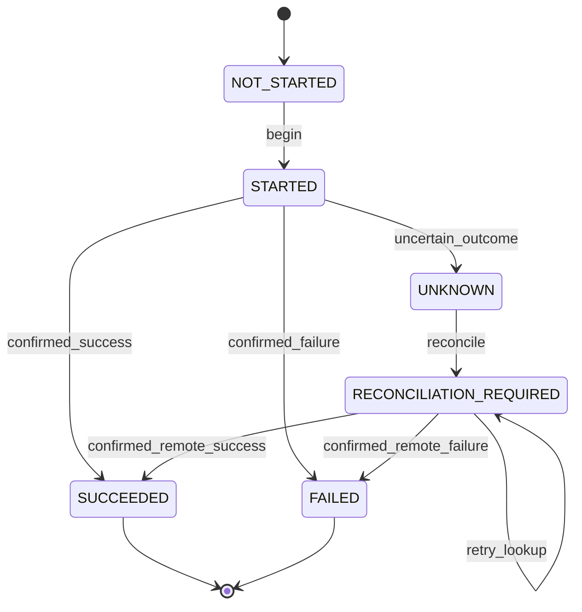

# PyAgentsKit — Effects & Side-Effect Safety

**Document :** `../runtime/13_PYAGENTSKIT_EFFECTS_AND_SIDE_EFFECT_SAFETY.md`  
**Version :** 1.0  
**Date :** 19 octobre 2026  
**Statut :** Spécification métier et technique — Effect Safety  
**Projet :** PyAgentsKit  

**Documents de référence :**
- `../foundation/00_PYAGENTSKIT_DEFINITION_DU_BESOIN.md`
- `../foundation/01_PYAGENTSKIT_ANALYSE_DU_BESOIN.md`
- `../foundation/02_PYAGENTSKIT_PARTIES_PRENANTES_ET_CAS_D_USAGE.md`
- `../foundation/03_PYAGENTSKIT_EXIGENCES_FONCTIONNELLES.md`
- `../foundation/04_PYAGENTSKIT_EXIGENCES_NON_FONCTIONNELLES.md`
- `../architecture/05_PYAGENTSKIT_PRINCIPES_ARCHITECTURAUX.md`
- `../domain/06_PYAGENTSKIT_OBJETS_METIERS.md`
- `../domain/07_PYAGENTSKIT_ENTITES.md`
- `../architecture/08_PYAGENTSKIT_ERD.md`
- `../domain/PYAGENTSKIT_MODELE_CONCEPTUEL_DU_DOMAINE.md`
- `../domain/10_PYAGENTSKIT_ETATS_ET_CYCLES_DE_VIE.md`
- `../architecture/11_PYAGENTSKIT_ARCHITECTURE_CIBLE.md`
- `../runtime/12_PYAGENTSKIT_AGENT_RUNTIME_ADAPTER_SPECIFICATION.md`

---

# 1. Objet du document

Ce document définit le modèle de **Side-Effect Safety** de PyAgentsKit.

L’objectif est de répondre à une question centrale :

> **Comment permettre à un agent d’agir sur des systèmes réels sans provoquer de doublons, de replays implicites, d’effets concurrents ou d’exécutions non maîtrisées après incident ?**

Les cas concernés incluent :

```text
envoyer un email
créer une facture
déclencher un paiement
mettre à jour un ERP
écrire en base
publier un package
git push
créer une pull request
merge
déployer
terraform apply
```

---

# 2. Principe directeur

Un appel d’outil n’est pas nécessairement un simple appel de fonction.

Dès qu’une action produit une conséquence durable ou observable hors du processus local, elle devient potentiellement un **Effect**.

```text
pure computation
→ pas forcément Effect

read-only call
→ pas forcément Effect

external write
→ Effect

critical irreversible action
→ Protected Effect
```

---

# 3. Pourquoi les effets sont difficiles

Le problème n’est pas uniquement :

```text
l’appel réussit
ou
l’appel échoue
```

Le cas réellement difficile est :

```text
PyAgentsKit envoie la requête
↓
le système externe l’exécute
↓
la réponse est perdue
↓
le worker crash
```

Localement :

```text
outcome = UNKNOWN
```

Mais dans le système externe :

```text
effect may already exist
```

Un retry aveugle peut alors dupliquer l’action.

---

# 4. Anti-promesse : pas de `exactly-once` universel

PyAgentsKit ne doit pas promettre :

```text
exactly-once execution
```

comme garantie générale.

Cette garantie n’est pas possible face à un système externe arbitraire ne supportant ni :

- idempotency keys ;
- transactions partagées ;
- fencing ;
- lookup par référence stable ;
- reconciliation.

Terminologie préférée :

```text
idempotent execution
effect deduplication
replay-safe execution
fencing-aware execution
reconciliation
at-most-once protected invocation
```

selon le contexte.

---

# 5. Les cinq mécanismes fondamentaux

La sûreté des effets repose sur cinq mécanismes combinables :

```text
1. Durable Intent
2. Idempotency
3. Deduplication
4. Fencing
5. Reconciliation
```

Aucun de ces mécanismes ne suffit seul dans tous les cas.

---

# 6. Modèle conceptuel de l’`Effect`

```text
Effect
├── effect_id
├── run_id
├── kind
├── status
├── risk_level
├── idempotency_key
├── input_fingerprint
├── external_reference
├── ownership_context
├── fencing_token
├── created_at
├── started_at
├── completed_at
├── metadata
└── reconciliation_state
```

---

# 7. États de l’`Effect`

```text
NOT_STARTED
STARTED
SUCCEEDED
FAILED
UNKNOWN
RECONCILIATION_REQUIRED
```

## Principe

```text
UNKNOWN != FAILED
```

---

# 8. Cycle de vie de l’effet



---

# 9. `EffectIntent`

Avant certains effets critiques, PyAgentsKit doit pouvoir persister une intention.

```text
EffectIntent persisted
↓
external call
↓
Effect result persisted
```

Cette intention signifie :

> **PyAgentsKit a décidé d’exécuter cet effet logique, avec ces paramètres, sous cette identité.**

---

# 10. Pourquoi persister l’intention

Scénario :

```text
worker decides to publish package
↓
worker crashes before network call
```

Avec `EffectIntent` :

```text
effect exists
status = NOT_STARTED
```

Sans intention persistée :

```text
aucune trace fiable de ce qui était prévu
```

---

# 11. `EffectOutcome`

Un résultat d’effet peut être :

```text
SUCCESS
FAILURE
UNKNOWN
RECONCILED_SUCCESS
RECONCILED_FAILURE
MANUAL_RESOLUTION
```

Le résultat doit être distingué :

```text
du payload externe
de l’état du run
du statut du tool call
```

---

# 12. `IdempotencyKey`

## Définition

Une `IdempotencyKey` identifie une intention logique unique.

Exemple :

```text
run-123:send-invoice:customer-42
```

ou :

```text
effect_01J...
```

---

# 13. Scope de l’idempotency key

Le scope doit être explicite.

Possibilités :

```text
global
per tenant
per run
per tool
per external system
```

Recommandation :

```text
namespace + effect kind + logical identity
```

afin d’éviter les collisions.

---

# 14. Idempotency côté PyAgentsKit

PyAgentsKit doit pouvoir empêcher deux exécutions internes concurrentes du même effet logique.

Exemple :

```text
EffectStore
UNIQUE(idempotency_scope, idempotency_key)
```

ou mécanisme équivalent.

---

# 15. Idempotency côté système externe

Lorsque le système externe supporte nativement une clé d’idempotence :

```text
Stripe-style idempotency
API request key
client transaction id
deduplication token
```

PyAgentsKit doit la propager.

C’est une protection plus forte que la déduplication locale seule.

---

# 16. `InputFingerprint`

Une même clé ne doit pas pouvoir être utilisée avec des inputs différents sans détection.

Exemple :

```text
key = invoice-42
input A = amount 100
input B = amount 250
```

Ce conflit doit produire :

```text
IdempotencyConflict
```

et non exécuter silencieusement le second effet.

---

# 17. Calcul du fingerprint

Conceptuellement :

```text
canonicalize relevant input
↓
hash
↓
input_fingerprint
```

La canonicalisation doit être stable.

Le domaine ne doit pas imposer un algorithme cryptographique particulier au niveau conceptuel.

---

# 18. Déduplication locale

Avant exécution :

```text
lookup by idempotency key
```

Cas :

```text
no existing effect
→ create

existing SUCCEEDED
→ reuse result

existing STARTED
→ inspect ownership / recovery

existing UNKNOWN
→ reconcile

existing FAILED
→ retry only if policy allows
```

---

# 19. Reuse d’un résultat précédent

Un effet déjà `SUCCEEDED` peut retourner son résultat enregistré.

```text
resume run
↓
effect lookup
↓
status = SUCCEEDED
↓
reuse outcome
```

sans réexécuter l’action externe.

---

# 20. Collision sémantique

Un effet existant avec :

```text
same idempotency key
different fingerprint
```

doit être considéré comme conflit.

Erreur candidate :

```text
EffectIdentityConflict
```

---

# 21. Protected Effect

Un `ProtectedEffect` est un effet nécessitant des contrôles supplémentaires.

Exemples :

```text
payment
production deploy
merge pull request
package publish
infra apply
user account deletion
```

---

# 22. Critères de protection

Un effet peut devenir protégé selon :

```text
risk level
environment
tool type
resource
actor
policy
amount
tenant
```

---

# 23. `EffectRiskLevel`

Valeurs candidates :

```text
LOW
MEDIUM
HIGH
CRITICAL
```

---

# 24. Exemples de classification

```text
read API
→ LOW

send internal notification
→ MEDIUM

git push
→ HIGH

production deploy
→ CRITICAL
```

La classification reste configurable.

---

# 25. Pipeline d’exécution protégé

```text
Effect requested
↓
classify risk
↓
evaluate policy
↓
check approval
↓
check ownership
↓
check fencing
↓
persist intent
↓
execute
↓
persist outcome
↓
audit
```

---

# 26. `ProtectedEffectContext`

Structure conceptuelle :

```text
run_id
effect_id
idempotency_key
correlation_context
ownership_context
approval_reference?
risk_level
policy_decision
```

---

# 27. Ownership

Un effet protégé exécuté en environnement distribué doit être associé à un ownership valide.

```text
Worker
↓
Lease
↓
OwnershipContext
↓
ProtectedEffect
```

---

# 28. `OwnershipContext`

Contenu conceptuel :

```text
worker_id
lease_id
resource_id
fencing_token
expires_at
```

---

# 29. Fencing

Le fencing empêche un worker obsolète de produire un effet après takeover.

```text
Worker A token 41
↓
lease expires

Worker B token 42
↓
takes over

Worker A returns
↓
token 41 rejected
```

---

# 30. Fencing et systèmes externes

Le niveau de protection dépend du système cible.

## Niveau fort

Le système externe accepte un fencing token et rejette les anciens.

## Niveau intermédiaire

Le wrapper interne vérifie le fencing avant appel.

## Niveau faible

La vérification n’existe que côté PyAgentsKit.

La documentation doit distinguer ces niveaux.

---

# 31. Fencing grade

Classification candidate :

```text
NONE
LOCAL_GUARD
STORE_GUARD
REMOTE_GUARD
```

---

# 32. Reconciliation

La reconciliation répond à la question :

> **Que s’est-il réellement passé dans le système externe ?**

Elle est obligatoire lorsqu’un effet est :

```text
UNKNOWN
```

et qu’un retry pourrait être dangereux.

---

# 33. `ReconciliationCase`

Structure :

```text
reconciliation_id
effect_id
status
strategy
attempt_count
created_at
resolved_at
resolution
metadata
```

---

# 34. Stratégies de reconciliation

```text
lookup by external reference
lookup by idempotency key
lookup by business key
query remote status
inspect remote resource
search audit trail
manual review
```

---

# 35. Exemple paiement

```text
POST /payments
↓
timeout
↓
Effect UNKNOWN
↓
GET /payments?client_reference=...
↓
payment found
↓
Effect SUCCEEDED
```

---

# 36. Exemple email

Si l’email provider retourne un `message_id` :

```text
send
↓
connection lost
↓
lookup delivery by message/client reference
```

Si aucun lookup n’est possible :

```text
manual policy
or
best-effort duplicate tolerance
```

La garantie est plus faible.

---

# 37. Exemple Git push

```text
git push
↓
remote accepted
↓
worker crash
↓
Effect UNKNOWN
↓
inspect remote branch SHA
↓
expected commit present
↓
SUCCEEDED
```

---

# 38. Exemple PR

```text
create PR
↓
timeout
↓
lookup open PR by branch/head reference
↓
PR exists
↓
SUCCEEDED
external_reference = PR number
```

---

# 39. Exemple package publish

```text
publish package v1.4.0
↓
timeout
↓
query package registry
↓
version exists with expected checksum
↓
SUCCEEDED
```

---

# 40. Exemple deployment

```text
deploy
↓
connection lost
↓
query deployment platform
↓
deployment id/state
↓
reconcile
```

---

# 41. Exemple Terraform apply

`terraform apply` est critique car il peut partiellement modifier plusieurs ressources.

Le modèle doit conserver :

```text
plan reference
workspace/environment
execution id
result state
```

et privilégier :

```text
remote state inspection
```

avant toute répétition.

---

# 42. Reconciliation automatique vs manuelle

## Automatique

Possible si :

```text
remote lookup available
stable business key
external reference
clear observable outcome
```

## Manuelle

Nécessaire si :

```text
remote state ambiguous
no lookup API
multiple possible matches
high-risk effect
```

---

# 43. Manual Review

Un effet peut produire :

```text
ReconciliationCase = MANUAL_REVIEW
```

Le run peut alors passer :

```text
WAITING
```

jusqu’à décision humaine.

---

# 44. Retry

Le retry n’est jamais une politique universelle.

Avant retry :

```text
is operation idempotent?
is previous outcome known?
is fencing valid?
is approval still valid?
is retry budget available?
```

---

# 45. Safe retry

Exemples :

```text
GET request
status lookup
idempotent PUT
external POST with same idempotency key
```

---

# 46. Unsafe retry

Exemples :

```text
bank transfer without idempotency
email without dedup
package publish with unknown previous outcome
terraform apply after partial timeout
```

---

# 47. Retry budget

Configuration possible :

```text
max_attempts
max_elapsed_time
backoff
jitter
retryable_errors
```

---

# 48. Retry vs Reconciliation

Ordre recommandé :

```text
known failure
→ retry may be allowed

unknown outcome
→ reconcile first
```

---

# 49. Timeout semantics

Un timeout ne signifie pas toujours échec.

```text
request timeout before send
→ likely safe failure

timeout after send
→ possibly UNKNOWN
```

Le client externe doit exposer autant que possible la phase de l’erreur.

---

# 50. Failure taxonomy

Types candidats :

```text
EffectRejected
EffectExecutionError
EffectTimeout
EffectOutcomeUnknown
EffectAlreadyCompleted
EffectIdentityConflict
EffectNeedsReconciliation
EffectFencingRejected
EffectApprovalRequired
EffectRetryExhausted
```

---

# 51. Transactions locales

PyAgentsKit peut garantir une transaction locale sur ses propres données.

Exemple :

```text
effect state
+
audit event
+
outbox event
```

dans PostgreSQL.

---

# 52. Limite transactionnelle externe

PyAgentsKit ne peut pas faire une transaction ACID unique couvrant arbitrairement :

```text
PostgreSQL
+
ERP
+
GitHub
+
email provider
```

La cohérence inter-systèmes nécessite :

```text
idempotency
reconciliation
sagas
compensation
```

selon le cas.

---

# 53. Outbox Pattern

Pour publier un événement après une transition locale :

```text
transaction:
  save Effect
  save OutboxRecord
commit
```

puis :

```text
OutboxPublisher
↓
event bus / webhook
```

---

# 54. Inbox Pattern

Pour consommer des commandes ou événements externes pouvant être redélivrés :

```text
InboxRecord
```

peut dédupliquer :

```text
external_message_id
```

avant traitement.

---

# 55. Saga / compensation

Certains workflows nécessitent des effets compensatoires.

Exemple :

```text
reserve stock
↓
charge payment
↓
shipping fails
↓
refund payment
```

La compensation est :

```text
nouvel Effect
```

et non :

```text
annulation magique de l’historique
```

---

# 56. Compensation ≠ rollback

Un effet externe déjà produit ne peut souvent pas être rollbacké au sens transactionnel.

Il faut modéliser :

```text
forward recovery
```

ou :

```text
compensating effect
```

---

# 57. `CompensationEffect`

Extension candidate :

```text
Effect
parent_effect_id
kind = compensation
```

Pas nécessairement un nouveau type d’entité.

---

# 58. At-most-once local

PyAgentsKit peut viser :

```text
at-most-once local admission
```

pour un effect logical ID grâce à :

```text
EffectStore
unique key
lease
fencing
```

Mais cela ne garantit pas à lui seul l’at-most-once dans le système distant.

---

# 59. At-least-once transport

Un bus externe peut redélivrer.

PyAgentsKit doit alors compter sur :

```text
deduplication
idempotency
```

plutôt que supposer un transport exactly-once.

---

# 60. `ExternalReference`

Une référence externe stable doit être conservée dès qu’elle existe.

Exemples :

```text
payment_id
invoice_id
commit_sha
pr_number
deployment_id
package_version
message_id
```

---

# 61. External reference integrity

Une référence externe doit être associée à :

```text
effect_id
effect kind
external system
```

afin d’éviter les collisions de namespace.

---

# 62. Effect target

Concept candidate :

```text
EffectTarget
├── system
├── resource_type
├── resource_id?
└── environment?
```

Exemples :

```text
GitHub / repository
ERP / invoice API
AWS / production account
```

---

# 63. External system identity

Un effet doit idéalement connaître :

```text
external_system_id
```

ou une référence logique équivalente.

Cela facilite :

```text
policy
audit
reconciliation
metrics
```

---

# 64. Policy engine

Avant exécution :

```text
PolicyEvaluator
```

peut retourner :

```text
ALLOW
DENY
REQUIRE_APPROVAL
DEFER
```

---

# 65. Exemples de policies

```text
production deploy
→ REQUIRE_APPROVAL

git push to feature branch
→ ALLOW

git push to main
→ DENY

payment > 10 000
→ REQUIRE_APPROVAL
```

---

# 66. Approval validity

L’approval doit correspondre précisément à l’effet autorisé.

Lier à :

```text
effect_id
action fingerprint
risk level
resource
environment
```

pour éviter une approval trop large.

---

# 67. Approval expiration

Une approval peut expirer avant exécution.

Avant l’effet :

```text
approval still valid?
```

doit être vérifié.

---

# 68. Approval revocation

Une future extension peut introduire :

```text
REVOKED
```

si besoin.

Mais une approval déjà utilisée pour un effet réussi ne peut pas annuler rétroactivement cet effet.

---

# 69. Audit

Tout effet protégé doit être auditable.

Événements candidats :

```text
EffectIntended
EffectStarted
EffectSucceeded
EffectFailed
EffectUnknown
EffectReconciliationOpened
EffectReconciled
EffectFencingRejected
EffectApprovalRequired
```

---

# 70. Audit payload

Doit contenir autant que possible :

```text
effect_id
run_id
kind
actor
worker
risk_level
policy_decision
approval_id?
fencing_token?
external_reference?
timestamp
```

sans secrets.

---

# 71. Observability

Métriques :

```text
effects_started_total
effects_succeeded_total
effects_failed_total
effects_unknown_total
effects_reconciled_total
effects_manual_review_total
effect_fencing_rejections_total
effect_idempotency_conflicts_total
```

---

# 72. Latence

Mesures utiles :

```text
effect_prepare_latency
effect_execution_latency
reconciliation_latency
approval_wait_latency
```

---

# 73. Cardinalité métrique

Ne pas utiliser :

```text
effect_id
run_id
external_reference
```

comme labels Prometheus.

Les IDs appartiennent aux logs/traces.

---

# 74. Tracing

Spans candidats :

```text
effect.prepare
effect.execute
effect.persist_outcome
effect.reconcile
effect.approval_wait
effect.fencing_check
```

---

# 75. Tool Gateway

Composant recommandé :

```text
ToolGateway
```

Il reçoit les demandes d’outils des runtime adapters.

---

# 76. Flux Tool Gateway

```text
Runtime
↓
Adapter
↓
ToolGateway
↓
ToolClassifier
↓
EffectExecutionService
↓
ToolProvider
```

---

# 77. Tool vs Effect

Classification :

```text
ToolInvocation
```

peut rester transitoire.

Un `Effect` est créé uniquement si l’appel produit un effet durable ou sensible.

---

# 78. Pure tools

Exemples :

```text
calculate
parse
transform
format
local validation
```

ne nécessitent généralement pas `EffectStore`.

---

# 79. Read tools

Exemples :

```text
GET API
SELECT DB
read file
```

peuvent être retriables plus librement, mais peuvent encore nécessiter :

```text
auth
audit
rate limit
```

---

# 80. Write tools

```text
POST
UPDATE
DELETE
git push
publish
deploy
```

doivent être évalués pour promotion en `Effect`.

---

# 81. Critical effect classification

Critères possibles :

```text
financial impact
production impact
irreversibility
security impact
user-facing impact
legal impact
shared resource mutation
```

---

# 82. Effect registry

Extension possible :

```text
EffectPolicyRegistry
```

mapping :

```text
tool/action
→ effect kind
→ risk
→ approval policy
→ reconciler
```

---

# 83. Declarative policy example

```text
tool: github.merge_pull_request
effect_kind: merge_pr
risk: HIGH
approval: REQUIRED
reconciler: GitHubPRReconciler
fencing: LOCAL_GUARD
```

---

# 84. Dynamic classification

La classification peut dépendre des inputs.

Exemple :

```text
deploy(environment="dev")
→ MEDIUM

deploy(environment="prod")
→ CRITICAL
```

---

# 85. Batch effects

Un appel peut produire plusieurs effets.

Exemple :

```text
send 100 emails
```

Deux modèles :

```text
1 parent Effect + 100 child Effects
```

ou :

```text
100 Effects
```

selon la granularité souhaitée.

---

# 86. Granularité recommandée

Un effet doit être l’unité minimale pour laquelle on veut :

```text
idempotency
reconciliation
audit
approval
```

---

# 87. Parent/child effects

Extension possible :

```text
parent_effect_id
```

pour modéliser :

```text
batch
compound operation
compensation
workflow step
```

---

# 88. Parallel effects

Des effects indépendants peuvent s’exécuter en parallèle.

Ils doivent conserver :

```text
separate IDs
separate idempotency
separate outcomes
```

---

# 89. Concurrency conflicts

Deux effects peuvent viser la même ressource.

Exemple :

```text
two agents edit same record
```

Une coordination supplémentaire peut être nécessaire :

```text
resource lease
optimistic concurrency
application lock
```

---

# 90. Effect ordering

Certains effects nécessitent un ordre.

Exemple :

```text
create invoice
↓
send invoice email
```

Le second doit référencer le résultat du premier.

---

# 91. Dependency model

Extension candidate :

```text
EffectDependency
```

ou metadata :

```text
depends_on_effect_ids
```

Ne pas introduire une DAG engine générale sans besoin.

---

# 92. Partial success

Pour un compound effect :

```text
step A succeeded
step B failed
```

Ne pas réduire à :

```text
FAILED
```

si cette simplification masque un effet déjà produit.

Préférer des effects distincts.

---

# 93. Bulk external APIs

Si une API bulk accepte plusieurs items :

```text
one external request
multiple business effects
```

le modèle doit permettre de tracer :

```text
request effect
+
individual outcomes
```

si nécessaire.

---

# 94. Side effect provenance

Chaque effect doit pouvoir répondre :

```text
qui l’a déclenché ?
quel run ?
quel message ?
quel runtime ?
quel worker ?
quelle approval ?
```

---

# 95. Correlation context

Champs potentiels :

```text
run_id
session_id
conversation_id
message_id
runtime_invocation_id
trace_id
```

---

# 96. Effect source

Concept candidate :

```text
EffectSource
```

Types :

```text
runtime_tool
human_command
system_event
recovery
scheduler
```

---

# 97. Replay behavior

Lors d’un replay logique d’un run :

```text
pure computations
→ may replay

messages
→ deduplicate logically

effects
→ never replay blindly
```

---

# 98. Replay-safe checkpointing

Un checkpoint doit permettre de savoir :

```text
which effects already completed
which effects unresolved
which approvals pending
```

---

# 99. Crash before effect

```text
Effect NOT_STARTED
↓
worker crash
```

Après reprise :

```text
safe to execute
```

si :

```text
no evidence of external call
```

et si l’intention a bien été persistée.

---

# 100. Crash during effect

```text
Effect STARTED
↓
worker crash
```

Après reprise :

```text
UNKNOWN
or
reconciliation required
```

selon les preuves disponibles.

---

# 101. Crash after effect confirmation

```text
remote success
↓
local result persisted
↓
worker crash
```

Après reprise :

```text
reuse SUCCEEDED
```

---

# 102. Crash after remote success but before local persistence

Cas le plus dangereux :

```text
remote success
↓
worker crashes
↓
local status still STARTED
```

Le recovery doit traiter :

```text
STARTED stale
```

comme potentiel :

```text
UNKNOWN
```

pas comme échec sûr.

---

# 103. Stale STARTED detection

Critères possibles :

```text
worker lost
lease expired
effect timeout exceeded
no active invocation
```

Le recovery peut ouvrir une reconciliation.

---

# 104. Effect recovery decision

Pseudo-logique :

```text
if SUCCEEDED:
    reuse

elif FAILED:
    retry only if policy allows

elif UNKNOWN:
    reconcile

elif STARTED and owner lost:
    reconcile or mark UNKNOWN

elif NOT_STARTED:
    execute
```

---

# 105. Cancellation

Un effet déjà déclenché peut être non cancellable.

Le run peut être annulé alors qu’un effet continue côté externe.

Le modèle doit alors distinguer :

```text
Run CANCELLED
Effect still UNKNOWN / SUCCEEDED
```

---

# 106. Cancellation is not rollback

Annuler un run n’annule pas magiquement les effets déjà produits.

---

# 107. Compensating cancellation

Si nécessaire :

```text
Run cancel
↓
create compensation Effect
```

Exemple :

```text
refund payment
```

---

# 108. External consistency levels

Classification candidate :

```text
LEVEL 0 — no protection
LEVEL 1 — local dedup
LEVEL 2 — external idempotency
LEVEL 3 — external lookup/reconciliation
LEVEL 4 — remote fencing/transaction-like protection
```

---

# 109. Effect Safety Profile

Chaque integration peut déclarer son niveau.

Exemple :

```text
GitHub PR creation
→ external lookup + business key
→ LEVEL 3

Stripe payment with idempotency
→ LEVEL 2/3

custom legacy API
→ LEVEL 1
```

---

# 110. Safety downgrade visibility

Si une integration ne permet pas une garantie forte, cela doit être visible.

Exemple :

```text
safety_profile = BEST_EFFORT
```

et non caché.

---

# 111. Adapter responsibility

Le runtime adapter doit :

```text
surface tool calls
not hide retries
propagate correlation
honor PyAgentsKit decision
```

lorsqu’il supporte l’interception.

---

# 112. Runtime-native uncontrolled effects

Certains runtimes peuvent agir sans interception.

Dans ce cas, l’adapter doit signaler :

```text
control_level = PARTIAL
```

PyAgentsKit ne doit pas prétendre offrir une protection qu’il ne peut pas imposer.

---

# 113. SideEffectControlLevel

Valeurs candidates :

```text
OBSERVE_ONLY
LOCAL_CONTROL
FULL_TOOL_CONTROL
```

---

# 114. Security

Les inputs et outputs d’effets peuvent contenir des secrets.

Ils doivent supporter :

```text
redaction
field filtering
encrypted backend
retention policy
```

---

# 115. Sensitive data

Ne pas stocker par défaut :

```text
password
access token
private key
full credit card data
secret environment value
```

dans :

```text
Effect.metadata
AuditEvent.payload
logs
```

---

# 116. Effect payload persistence

Trois niveaux possibles :

```text
NONE
METADATA_ONLY
FULL_PAYLOAD
```

configurables selon sécurité et besoin de recovery.

---

# 117. Payload reference

Pour gros payloads :

```text
Artifact
```

ou stockage externe.

L’Effect conserve :

```text
payload_reference
```

---

# 118. Data retention

Les effects peuvent avoir des durées de conservation longues pour audit.

Le contenu sensible peut avoir une rétention plus courte que les metadata.

---

# 119. Multi-tenancy

Les idempotency keys et references doivent être tenant-safe.

Éviter :

```text
same idempotency key
across tenants
```

sans namespace.

---

# 120. Effect Store

Port conceptuel :

```python
class EffectStore(Protocol):
    async def create(...)
    async def get(...)
    async def find_by_idempotency_key(...)
    async def transition(...)
    async def list_unresolved(...)
    async def attach_external_reference(...)
```

---

# 121. Atomic effect creation

La réservation d’une idempotency key doit être atomique.

Deux workers concurrents :

```text
same logical effect
```

doivent obtenir :

```text
one winner
one conflict/reuse
```

---

# 122. Effect version

Une colonne/version logique peut supporter :

```text
optimistic concurrency
```

pour les transitions.

---

# 123. Transition API

Concept :

```text
transition(
    effect_id,
    expected_state,
    new_state,
    expected_version
)
```

---

# 124. Invalid transitions

Rejeter :

```text
SUCCEEDED → STARTED
FAILED → SUCCEEDED
```

sans opération explicite de reconciliation ou correction métier.

---

# 125. Manual correction

Une correction humaine de statut ne doit pas être un simple `UPDATE`.

Elle doit produire :

```text
ManualEffectResolution
```

avec audit.

---

# 126. Effect execution protocol

Pseudo-protocole :

```text
1. resolve logical effect identity
2. create/reserve effect
3. validate existing state
4. validate policy
5. validate approval
6. validate ownership
7. validate fencing
8. persist intent
9. execute external call
10. classify outcome
11. persist outcome
12. attach external reference
13. emit audit/domain event
```

---

# 127. Effect execution result

Structure conceptuelle :

```text
effect_id
status
external_reference?
result_reference?
reused_existing_result
reconciliation_required
```

---

# 128. Reused result

Un résultat peut indiquer :

```text
reused_existing_result = true
```

pour rendre la déduplication observable.

---

# 129. Tool result vs Effect result

`ToolInvocationResult` peut contenir un payload runtime.

`EffectOutcome` contient la vérité de fiabilité.

Ils ne doivent pas être confondus.

---

# 130. ExternalReference uniqueness

Certaines references peuvent être uniques par système.

Exemple :

```text
(package_registry, package_name, version)
```

Le store peut offrir des index adaptés.

---

# 131. Reconciliation Port

Concept :

```python
class ReconciliationPort(Protocol):
    async def reconcile(
        self,
        effect: Effect,
    ) -> ReconciliationResult:
        ...
```

---

# 132. `ReconciliationResult`

Valeurs :

```text
CONFIRMED_SUCCESS
CONFIRMED_FAILURE
STILL_UNKNOWN
MANUAL_REVIEW
```

---

# 133. Reconciliation retries

Les retries de reconciliation sont différents des retries d’effet.

Ils interrogent l’état externe sans reproduire l’action.

Ils sont donc généralement plus sûrs.

---

# 134. Reconciliation backoff

Configurer :

```text
max attempts
interval
backoff
deadline
manual review threshold
```

---

# 135. Reconciliation backlog

Le runtime doit mesurer :

```text
open reconciliation cases
oldest unresolved age
manual review count
```

---

# 136. Stuck effects

Un effect est potentiellement stuck si :

```text
STARTED too long
UNKNOWN too long
RECONCILIATION_REQUIRED too long
```

Alertes recommandées.

---

# 137. Incident runbook

Runbook minimal :

```text
1. inspect effect
2. inspect external reference
3. inspect owning worker/lease
4. inspect audit timeline
5. run reconciliation
6. avoid manual retry until status known
7. document resolution
```

---

# 138. Duplicate-effect suspicion

Si un doublon est suspecté :

```text
freeze further retries
compare idempotency keys
inspect external references
inspect remote state
resolve manually if needed
```

---

# 139. Effect timeline

Vue opérateur :

```text
INTENDED
↓
STARTED
↓
UNKNOWN
↓
RECONCILIATION_REQUIRED
↓
SUCCEEDED
```

avec timestamps et actors.

---

# 140. CLI candidates

```text
pyagentskit effect inspect <id>
pyagentskit effect list --status UNKNOWN
pyagentskit effect reconcile <id>
pyagentskit effect timeline <id>
pyagentskit effect resolve-manually <id>
```

---

# 141. API candidates

```text
GET /effects/{id}
GET /effects?status=UNKNOWN
POST /effects/{id}/reconcile
POST /effects/{id}/manual-resolution
```

---

# 142. Domain Events

```text
EffectIntended
EffectStarted
EffectSucceeded
EffectFailed
EffectUnknown
EffectReconciliationRequested
EffectReconciled
EffectManualReviewRequired
EffectFencingRejected
EffectIdempotencyConflict
```

---

# 143. Integration Events

Certains DomainEvents peuvent être publiés externement :

```text
effect.succeeded
effect.failed
effect.manual_review_required
```

via Outbox.

---

# 144. Property-based invariants

Exemples :

```text
A SUCCEEDED Effect never transitions to STARTED.
An UNKNOWN Effect is never auto-converted to FAILED.
Same idempotency key + different fingerprint always conflicts.
A stale fencing token never authorizes a protected effect.
```

---

# 145. Unit tests

Couvrir :

```text
state transitions
idempotency
fingerprint conflicts
policy
approval
fencing validation
reconciliation decision
```

---

# 146. Integration tests

Avec PostgreSQL réel :

```text
concurrent effect creation
unique idempotency
state transition CAS
stale worker
takeover
```

---

# 147. External adapter tests

Avec fake ou sandbox external system :

```text
success
confirmed failure
timeout before send
timeout after remote success
remote duplicate
lookup reconciliation
```

---

# 148. Crash tests

Scénarios critiques :

```text
crash before effect
crash just after external call
crash after external success
crash before local persistence
crash after local persistence
```

---

# 149. Multi-worker tests

```text
Worker A effect reservation
Worker B same effect reservation
Worker A loses lease
Worker B takeover
Worker A returns
stale token rejected
```

---

# 150. Load tests

Mesurer :

```text
effect reservation throughput
EffectStore latency
reconciliation throughput
contention on idempotency keys
fencing validation cost
```

---

# 151. Acceptance criteria

Le modèle Effect Safety est considéré opérationnel si :

1. un effet possède une identité stable ;
2. une intention peut être persistée avant exécution ;
3. une idempotency key peut être réservée atomiquement ;
4. les collisions de fingerprint sont détectées ;
5. un effet `SUCCEEDED` n’est pas rejoué ;
6. un effet `UNKNOWN` passe par reconciliation ;
7. un worker obsolète est rejeté via fencing lorsque supporté ;
8. les approvals sont vérifiés avant effets protégés ;
9. les références externes sont conservées ;
10. les crashes autour de l’appel externe sont testés ;
11. les states transitions sont auditables ;
12. les garanties réelles de chaque integration sont documentées.

---

# 152. Safety guarantees by capability

| Capacité externe | Garantie possible |
|---|---|
| aucune | best effort local |
| idempotency key | forte déduplication d’appel |
| remote lookup | reconciliation automatique |
| stable business key | reconciliation/dédup |
| fencing support | rejet des writers obsolètes |
| transaction API | cohérence renforcée |

---

# 153. Safety Matrix

```text
                    Local Dedup   External Idempotency   Reconcile   Fencing
READ                     ✓               n/a                n/a        n/a
EMAIL                    ✓               ?                  ?          -
PAYMENT                  ✓               ✓                  ✓          ?
GIT PUSH                 ✓               partly             ✓          local
PACKAGE PUBLISH          ✓               limited            ✓          local
DEPLOY                    ✓               provider-specific  ✓          possible
ERP WRITE                 ✓               API-specific       ✓          possible
```

Les capacités exactes dépendent de l’intégration.

---

# 154. Side-Effect Safety Profile

Un adapter ou tool provider devrait documenter :

```text
idempotency_supported
lookup_supported
external_reference_supported
fencing_supported
compensation_supported
control_level
```

---

# 155. Example profile — GitHub-like PR

```text
idempotency_supported = partial
lookup_supported = true
external_reference_supported = true
fencing_supported = false remote
compensation_supported = close PR
control_level = FULL_TOOL_CONTROL
```

---

# 156. Example profile — legacy ERP

```text
idempotency_supported = false
lookup_supported = business-key only
external_reference_supported = true
fencing_supported = false
compensation_supported = domain-specific
control_level = FULL_TOOL_CONTROL
```

---

# 157. Example profile — uncontrollable runtime-native action

```text
idempotency_supported = unknown
lookup_supported = unknown
control_level = OBSERVE_ONLY
```

PyAgentsKit doit afficher cette limitation.

---

# 158. Anti-patterns

## `retry on Exception`

```python
except Exception:
    retry()
```

interdit pour effets non prouvés idempotents.

---

## `timeout == failure`

Faux pour les actions externes.

---

## `log == source of truth`

Un log n’est pas un `EffectStore`.

---

## `message == approval`

Un message libre ne vaut pas autorisation.

---

## `lease lost but continue`

Interdit pour effets protégés.

---

## `same key, different payload`

Doit être rejeté.

---

# 159. Architecture cible Effect Safety

```text
Agent Runtime
     │
     ▼
Runtime Adapter
     │
     ▼
Tool Gateway
     │
     ▼
Effect Classifier
     │
     ▼
EffectExecutionService
     │
 ┌───┼────────┬──────────────┐
 ▼   ▼        ▼              ▼
Policy Approval Ownership  Idempotency
     │        │              │
     └────────┼──────────────┘
              ▼
         EffectStore
              │
              ▼
         Tool Provider
              │
              ▼
       External System
              │
              ▼
       External Reference
              │
              ▼
        Reconciliation
```

---

# 160. Flux nominal

```text
runtime requests tool
↓
classify as Effect
↓
reserve idempotency key
↓
validate policy
↓
validate approval
↓
validate lease/fencing
↓
persist STARTED
↓
external call
↓
confirmed success
↓
persist SUCCEEDED
↓
audit
↓
return result
```

---

# 161. Flux ambigu

```text
runtime requests Effect
↓
persist STARTED
↓
external call
↓
timeout / crash
↓
UNKNOWN
↓
ReconciliationCase
↓
remote lookup
↓
SUCCEEDED / FAILED / MANUAL_REVIEW
```

---

# 162. Flux duplicate

```text
same logical effect requested
↓
lookup idempotency key
↓
existing SUCCEEDED
↓
return stored outcome
↓
NO external replay
```

---

# 163. Flux stale worker

```text
Worker A token 41
↓
lease expires
↓
Worker B token 42
↓
Worker A tries effect
↓
FencingValidator
↓
REJECT
```

---

# 164. Interaction avec `DurableRunner`

Le `DurableRunner` ne doit pas considérer une étape d’effet comme simplement rejouable.

Il délègue au `EffectExecutionService` :

```text
resolve current effect state
```

avant toute progression.

---

# 165. Interaction avec `RecoveryPlanner`

Le `RecoveryPlanner` doit considérer :

```text
SUCCEEDED
FAILED
STARTED stale
UNKNOWN
RECONCILIATION_REQUIRED
```

pour déterminer le `NextAction`.

---

# 166. Interaction avec `AgentRuntimeAdapter`

Lors d’un tool call intercepté :

```text
adapter
↓
PyAgentsKit effect layer
↓
result
↓
adapter
↓
runtime
```

Le runtime ne doit pas exécuter directement l’effet en parallèle.

---

# 167. Interaction avec `Approval`

Une approval est liée à l’intention logique.

Elle doit être vérifiée juste avant l’effet si :

```text
time elapsed
context changed
ownership changed
```

selon policy.

---

# 168. Interaction avec `AuditEvent`

Chaque transition critique peut créer :

```text
AuditEvent
```

sans dépendre du backend de logs.

---

# 169. Interaction avec `Artifact`

Un effet peut générer :

```text
Artifact
```

Exemples :

```text
deployment log
generated report
package build
diff
export
```

---

# 170. Interaction avec `Message`

Un message peut déclencher un effect.

Relation conceptuelle :

```text
Message
↓
Run
↓
Effect
```

Le lien peut être conservé via `CorrelationContext`.

---

# 171. Scope initial recommandé

Pour éviter l’overengineering, la première implémentation complète devrait cibler :

```text
Effect
EffectStore
EffectStatus
IdempotencyKey
InputFingerprint
ExternalReference
EffectExecutionService
EffectReconciler
ReconciliationCase
Approval integration
Lease/Fencing integration
Audit integration
```

---

# 172. Fonctions différées

Peuvent attendre :

```text
generic Saga engine
complex Effect DAG
automatic compensation engine
distributed transaction protocol
universal remote fencing
cross-cloud transaction coordinator
```

---

# 173. Questions ouvertes

```text
Q-EFF-01 Scope exact de l’idempotency key ?
Q-EFF-02 EffectIntent entité séparée ou phase de Effect ?
Q-EFF-03 ReconciliationCase aggregate indépendant ?
Q-EFF-04 Faut-il un EffectTarget Value Object ?
Q-EFF-05 Faut-il parent_effect_id dès le core ?
Q-EFF-06 Faut-il formaliser CompensationEffect ?
Q-EFF-07 Quel Safety Profile standard exposer publiquement ?
Q-EFF-08 Comment gérer un effect partiellement réussi ?
Q-EFF-09 Quels états supplémentaires pour cancellation ?
Q-EFF-10 Quelle granularité de payload persister ?
Q-EFF-11 Faut-il un InboxStore dès la v1 ?
Q-EFF-12 Faut-il rendre Outbox obligatoire pour tous les IntegrationEvents ?
```

---

# 174. ADR induits

```text
ADR-EFF-001 Effect as aggregate root
ADR-EFF-002 Idempotency key scope
ADR-EFF-003 Input fingerprint strategy
ADR-EFF-004 UNKNOWN effect semantics
ADR-EFF-005 Reconciliation contract
ADR-EFF-006 Effect Store concurrency
ADR-EFF-007 Fencing propagation
ADR-EFF-008 Protected Tool Gateway
ADR-EFF-009 Outbox strategy
ADR-EFF-010 Effect safety profiles
ADR-EFF-011 Manual resolution semantics
ADR-EFF-012 Compensation model
```

---

# 175. Definition of Done

La couche Effect Safety est considérée mature lorsque :

1. les effects sont des objets métier de premier niveau ;
2. les intentions critiques sont durables ;
3. les idempotency keys sont atomiquement réservables ;
4. les collisions de payload sont détectées ;
5. les effects réussis ne sont pas rejoués ;
6. les résultats ambigus sont explicitement `UNKNOWN` ;
7. la reconciliation est extensible par integration ;
8. les effects protégés vérifient policy, approval et ownership ;
9. le fencing est appliqué lorsqu’il est disponible ;
10. les crashs autour de l’effet sont qualifiés ;
11. l’audit retrace toutes les transitions critiques ;
12. les limitations de chaque external system sont documentées ;
13. aucun adapter ne masque un retry dangereux ;
14. les scénarios coding-agent critiques sont couverts.

---

# 176. Résumé

La Side-Effect Safety de PyAgentsKit repose sur la règle suivante :

> **Un effet externe n’est jamais “juste un tool call” dès lors qu’il peut survivre au processus qui l’a déclenché.**

La sûreté repose sur :

```text
DURABLE INTENT
+
IDEMPOTENCY
+
DEDUPLICATION
+
APPROVAL
+
OWNERSHIP
+
FENCING
+
RECONCILIATION
+
AUDIT
```

Le modèle cible est :

```text
Agent
↓
Tool Request
↓
Effect
↓
Policy / Approval
↓
Lease / Fencing
↓
External System
↓
External Reference
↓
Reconciliation if needed
```

Le principe fondamental reste :

> **En cas de doute sur un effet externe, PyAgentsKit doit chercher à savoir ce qui s’est réellement passé avant d’agir de nouveau.**

Le document suivant pourra approfondir l’exécution durable elle-même :

```text
../runtime/14_PYAGENTSKIT_DURABLE_EXECUTION_MODEL.md
```
