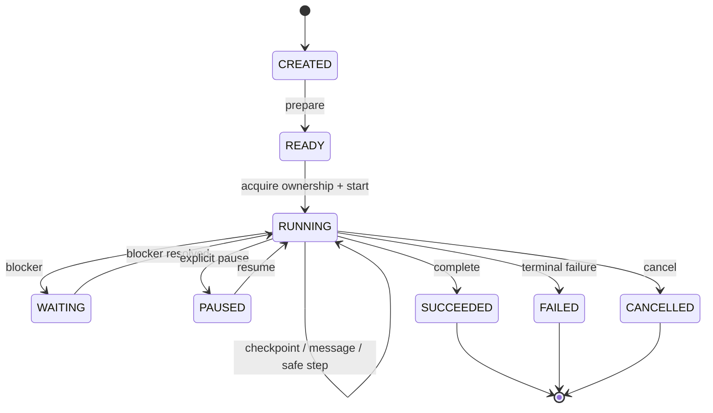
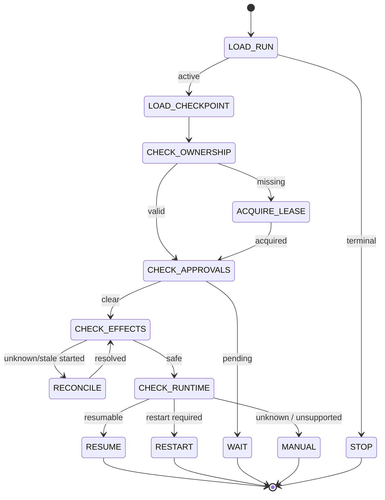

# PyAgentsKit — Durable Execution Model

**Document :** `../runtime/14_PYAGENTSKIT_DURABLE_EXECUTION_MODEL.md`  
**Version :** 1.0  
**Date :** 20 octobre 2026  
**Statut :** Spécification métier et technique — Durable Execution  
**Projet :** PyAgentsKit  

**Documents de référence :**
- `../foundation/00_PYAGENTSKIT_DEFINITION_DU_BESOIN.md`
- `../foundation/01_PYAGENTSKIT_ANALYSE_DU_BESOIN.md`
- `../foundation/02_PYAGENTSKIT_PARTIES_PRENANTES_ET_CAS_D_USAGE.md`
- `../foundation/03_PYAGENTSKIT_EXIGENCES_FONCTIONNELLES.md`
- `../foundation/04_PYAGENTSKIT_EXIGENCES_NON_FONCTIONNELLES.md`
- `../architecture/05_PYAGENTSKIT_PRINCIPES_ARCHITECTURAUX.md`
- `../domain/06_PYAGENTSKIT_OBJETS_METIERS.md`
- `../domain/07_PYAGENTSKIT_ENTITES.md`
- `../architecture/08_PYAGENTSKIT_ERD.md`
- `../domain/09_PYAGENTSKIT_VALUE_OBJECTS.md`
- `../domain/PYAGENTSKIT_MODELE_CONCEPTUEL_DU_DOMAINE.md`
- `../domain/10_PYAGENTSKIT_ETATS_ET_CYCLES_DE_VIE.md`
- `../architecture/11_PYAGENTSKIT_ARCHITECTURE_CIBLE.md`
- `../runtime/12_PYAGENTSKIT_AGENT_RUNTIME_ADAPTER_SPECIFICATION.md`
- `../runtime/13_PYAGENTSKIT_EFFECTS_AND_SIDE_EFFECT_SAFETY.md`

---

# 1. Objet du document

Ce document définit le modèle d’**exécution durable** de PyAgentsKit.

Il décrit comment une exécution agentique peut :

- démarrer ;
- progresser ;
- produire des checkpoints ;
- attendre ;
- être suspendue ;
- reprendre après panne ;
- changer de worker ;
- survivre au redémarrage du processus ;
- éviter de rejouer des effets externes déjà produits ;
- reprendre un runtime externe ;
- terminer de façon cohérente.

Le composant central est :

```text
DurableRunner
```

Le principe directeur est :

> **Une exécution durable n’est pas un processus qui reste vivant ; c’est une exécution dont l’état nécessaire à la reprise est persisté suffisamment tôt pour qu’un nouveau processus puisse poursuivre de manière sûre.**

---

# 2. Problème adressé

Un agent classique est souvent exécuté ainsi :

```text
start process
↓
agent reasons
↓
tools
↓
result
```

Si le processus tombe :

```text
state lost
```

ou :

```text
restart from beginning
```

Dans un contexte réel, cette approche est insuffisante.

Exemple :

```text
agent
↓
create invoice
↓
send email
↓
process crash
```

Un redémarrage aveugle peut provoquer :

```text
duplicate invoice
duplicate email
```

PyAgentsKit doit donc connaître ce qui a déjà été fait avant de reprendre.

---

# 3. Définition d’une exécution durable

Une exécution est durable si :

```text
1. son identité survit au processus
2. son état logique est persisté
3. ses checkpoints sont récupérables
4. ses effects sont persistés séparément
5. ses approvals sont persistés
6. son ownership distribué est vérifiable
7. son runtime externe peut être repris ou redémarré selon capacité
8. sa reprise est déterministe
```

---

# 4. Architecture générale

```text
                 Request / Trigger
                       │
                       ▼
              AdmissionController
                       │
                       ▼
                  DurableRunner
                       │
          ┌────────────┼─────────────┐
          ▼            ▼             ▼
       RunStore   CheckpointStore   LeaseStore
          │            │             │
          ▼            ▼             ▼
     EffectStore  ApprovalStore  RecoveryPlanner
          │                           │
          └────────────┬──────────────┘
                       ▼
              AgentRuntimeAdapter
                       │
                       ▼
               External Runtime
```

---

# 5. `DurableRunner`

## Définition

`DurableRunner` orchestre le cycle de vie durable d’un `Run`.

## Responsabilités

```text
create/start
resume
pause
cancel
checkpoint
inspect blockers
coordinate lease
coordinate runtime
coordinate effect state
coordinate approvals
invoke RecoveryPlanner
complete/fail
```

## Non-responsabilités

Il ne doit pas :

```text
implémenter le raisonnement de l’agent
réimplémenter les tools
faire office de scheduler généraliste
devenir un workflow engine universel
dupliquer un runtime agentique
```

---

# 6. Composants du Durable Runtime

```text
DurableRunner
├── AdmissionController
├── RunTransitionService
├── RecoveryPlanner
├── CheckpointManager
├── RuntimeCoordinator
├── BlockerResolver
├── LeaseCoordinator
├── EffectExecutionService
├── ApprovalService
├── AuditPublisher
└── Telemetry
```

---

# 7. `AdmissionController`

## Responsabilité

Décider si un worker peut accepter un nouveau run.

## Vérifications

```text
worker ready?
not draining?
required runtime available?
stores reachable?
concurrency capacity available?
tenant / workload allowed?
```

## Résultats

```text
ACCEPT
REJECT
DEFER
```

---

# 8. Admission != Scheduling

PyAgentsKit ne doit pas devenir scheduler généraliste.

Le scheduler externe peut décider :

```text
quand déclencher
```

PyAgentsKit décide :

```text
si ce worker peut admettre l’exécution maintenant
```

---

# 9. `RunTransitionService`

Responsable de valider :

```text
CREATED → READY
READY → RUNNING
RUNNING → WAITING
WAITING → RUNNING
RUNNING → PAUSED
PAUSED → RUNNING
RUNNING → SUCCEEDED
RUNNING → FAILED
```

---

# 10. `CheckpointManager`

## Responsabilité

Créer et retrouver les checkpoints durables.

## Opérations conceptuelles

```text
create_checkpoint
get_latest_checkpoint
get_checkpoint
list_checkpoints
validate_checkpoint
```

---

# 11. Checkpoint PyAgentsKit

Un checkpoint PyAgentsKit contient ce qui est nécessaire à la reprise de la **sémantique globale**.

Exemple :

```text
run_id
sequence
created_at
logical_position
runtime_checkpoint_reference?
pending_effect_ids
pending_approval_ids
context_reference
metadata
```

---

# 12. Checkpoint runtime-native

Un runtime peut fournir son propre checkpoint.

Exemple :

```text
LangGraph checkpoint
Claude session handle
Codex thread state
```

Ce checkpoint reste opaque.

---

# 13. Double couche de checkpoint

Le modèle recommandé est :

```text
PyAgentsKit Checkpoint
        │
        └── runtime_checkpoint_reference
```

PyAgentsKit ne dépend pas du format interne du runtime.

---

# 14. Quand créer un checkpoint

Moments candidats :

```text
avant un effet critique
après un effet critique confirmé
avant WAITING
après approval
avant pause
après étape métier importante
avant graceful shutdown
```

---

# 15. Checkpoint frequency

Il ne faut pas checkpoint à chaque instruction de l’agent si cela n’a aucun intérêt métier.

Le bon niveau est :

```text
recovery boundary
```

et non :

```text
every token
```

---

# 16. Recovery Boundary

Une `RecoveryBoundary` est un point à partir duquel l’exécution peut être relancée sans perdre de garantie.

Exemples :

```text
before critical effect
after successful effect
after approval decision
after durable message persisted
```

---

# 17. Crash Boundary

Le système doit être testé autour de chaque frontière critique.

Exemples :

```text
before checkpoint
after checkpoint
before external call
after external call
before effect outcome persistence
after effect outcome persistence
```

---

# 18. Cycle nominal du Run

```text
create
↓
prepare
↓
READY
↓
acquire lease
↓
RUNNING
↓
invoke runtime
↓
checkpoint/effects/messages
↓
complete
↓
SUCCEEDED
```

---

# 19. Diagramme de cycle nominal



---

# 20. `RuntimeCoordinator`

## Responsabilité

Coordonner PyAgentsKit avec `AgentRuntimeAdapter`.

## Opérations

```text
start runtime
resume runtime
cancel runtime
consume events
request checkpoint
inspect runtime status
```

---

# 21. Runtime invocation lifecycle

Chaque interaction avec le runtime peut être modélisée par :

```text
RuntimeInvocation
```

Exemple :

```text
START
RESUME
CONTINUE
CANCEL
```

---

# 22. Une invocation n’est pas un Run

Important :

```text
Run
```

peut survivre à plusieurs :

```text
RuntimeInvocation
```

Exemple :

```text
Run R1
├── Invocation #1 START
├── crash
├── Invocation #2 RESUME
└── Invocation #3 CONTINUE
```

---

# 23. `BlockerResolver`

## Responsabilité

Déterminer ce qui empêche un Run de progresser.

## Types de blockers

```text
PENDING_APPROVAL
UNKNOWN_EFFECT
LEASE_UNAVAILABLE
RUNTIME_UNAVAILABLE
STORE_UNAVAILABLE
EXTERNAL_DEPENDENCY
MANUAL_INTERVENTION
```

---

# 24. `WAITING`

`WAITING` indique :

> **Le Run est durablement bloqué par une condition externe ou de gouvernance.**

Il ne signifie pas :

```text
thread sleeping
```

---

# 25. Suspension longue

Un run peut rester `WAITING` pendant :

```text
minutes
hours
days
weeks
```

sans processus actif.

---

# 26. `PAUSED`

`PAUSED` correspond à une suspension volontaire de l’exécution.

Exemples :

```text
operator pause
maintenance
manual hold
controlled shutdown
```

---

# 27. WAITING vs PAUSED

```text
WAITING
= blocker métier / externe

PAUSED
= décision explicite de suspension
```

---

# 28. `RecoveryPlanner`

## Responsabilité

Analyser l’état durable et déterminer ce qui peut être fait en sécurité.

Entrées :

```text
Run
latest Checkpoint
Effects
Approvals
Lease state
RuntimeBinding
Runtime status
```

Sortie :

```text
RecoveryPlan
```

---

# 29. `RecoveryPlan`

Structure conceptuelle :

```text
run_id
checkpoint_reference
next_action
unresolved_effect_ids
pending_approval_ids
lease_required
runtime_resume_possible
blockers
metadata
```

---

# 30. `NextAction`

Valeurs :

```text
ACQUIRE_LEASE
WAIT_FOR_APPROVAL
RECONCILE_EFFECT
RESUME_RUNTIME
RESTART_RUNTIME
COMPLETE_RUN
FAIL_RUN
MANUAL_INTERVENTION
```

---

# 31. Algorithme conceptuel de recovery

```text
load Run
↓
if terminal → STOP
↓
load latest Checkpoint
↓
validate ownership
↓
inspect approvals
↓
inspect effects
↓
inspect runtime state
↓
resolve blockers
↓
compute NextAction
↓
resume / wait / reconcile / intervene
```

---

# 32. Diagramme Recovery



---

# 33. Reprise sur même worker

Scénario :

```text
temporary runtime failure
↓
worker remains valid owner
↓
RecoveryPlanner
↓
resume
```

Possible si :

```text
lease valid
runtime resumable
effects safe
```

---

# 34. Reprise par un autre worker

Scénario :

```text
Worker A crash
↓
lease expires
↓
Worker B takeover
↓
RecoveryPlanner
↓
resume
```

Le nouveau worker doit reconstruire l’état depuis les stores.

---

# 35. Aucun état critique seulement en mémoire locale

Interdit :

```text
"the only copy of current progress lives in Python object"
```

pour les données nécessaires à la reprise.

---

# 36. État local acceptable

Peut rester local :

```text
temporary cache
stream buffer
runtime client object
non-critical derived state
```

à condition de pouvoir être reconstruit.

---

# 37. Durable state

Doit être persisté :

```text
Run state
Checkpoint
Effect state
Approval state
Lease ownership
Runtime handle/reference if resumable
critical correlation metadata
```

---

# 38. Persist-before-progress

Principe :

> **Si une information est nécessaire pour éviter une reprise dangereuse, elle doit être persistée avant de franchir la frontière critique correspondante.**

---

# 39. Exemple persist-before-effect

```text
persist Effect intent
↓
external write
```

et non :

```text
external write
↓
create Effect record
```

---

# 40. Exemple persist-before-wait

```text
persist Approval
persist Run WAITING
↓
release active process
```

---

# 41. Reprise après graceful shutdown

```text
SIGTERM
↓
DRAINING
↓
stop admissions
↓
checkpoint
↓
persist current states
↓
handle leases
↓
process exits
↓
next worker resumes
```

---

# 42. Reprise après SIGKILL

Aucun code de cleanup n’est supposé.

```text
process disappears
↓
lease expires
↓
another worker takeover
↓
RecoveryPlanner
```

---

# 43. Reprise après process freeze

Scénario :

```text
Worker A frozen
↓
lease expires
↓
Worker B takeover
↓
A returns
```

Le worker A doit détecter :

```text
lost ownership
```

et ne plus produire d’effet protégé.

---

# 44. Resume vs Restart

## Resume

Utilise l’état natif du runtime.

```text
runtime session still exists
```

## Restart

Crée une nouvelle invocation runtime depuis l’état durable PyAgentsKit.

```text
runtime state unavailable
```

---

# 45. Runtime resumability grade

Classification candidate :

```text
NONE
LOGICAL_RESTART_ONLY
SESSION_RESUME
NATIVE_CHECKPOINT_RESUME
```

---

# 46. Logical restart

Même si le runtime ne sait pas reprendre nativement, PyAgentsKit peut :

```text
load durable context
↓
recreate runtime
↓
avoid replaying protected effects
```

La reprise est alors :

```text
logical
```

et non :

```text
byte-for-byte runtime continuation
```

---

# 47. Rehydration

Lors d’un restart logique, PyAgentsKit reconstitue :

```text
session context
conversation context
messages
checkpoint
effect outcomes
pending approvals
runtime config
```

---

# 48. Prompt reconstruction

Le runtime adapter ou l’application peut reconstruire un contexte d’entrée.

PyAgentsKit ne doit pas imposer la construction du prompt.

---

# 49. Replaying pure computation

Les calculs internes purs peuvent être rejoués.

Exemples :

```text
formatting
local parsing
deterministic transformation
```

---

# 50. Non-replayable operations

Ne doivent pas être rejouées aveuglément :

```text
Effect
approval
external write
message emission with external delivery semantics
```

---

# 51. Replay classification

Concept candidate :

```text
ReplayPolicy
```

Valeurs :

```text
SAFE
CONDITIONAL
FORBIDDEN
```

---

# 52. Step model

PyAgentsKit n’a pas besoin d’imposer une entité `Step`.

Mais le runtime peut produire des étapes logiques.

Le `DurableRunner` doit travailler avec :

```text
recovery boundaries
```

plutôt qu’une DAG générique.

---

# 53. Pourquoi ne pas devenir workflow engine

Un workflow engine généraliste fournit :

```text
DAG
timers
signals
activities
complex orchestration DSL
```

PyAgentsKit doit se limiter aux abstractions nécessaires à la fiabilité agentique.

---

# 54. Timers

Des timers peuvent être nécessaires pour :

```text
approval expiration
lease expiration
retry delay
reconciliation delay
```

Ils ne nécessitent pas un scheduler généraliste interne.

---

# 55. External scheduler

Pour :

```text
run every Monday
run at 8am
```

utiliser :

```text
PyScheduleKit
cron
Temporal schedule
external orchestrator
```

---

# 56. Internal wake-up

PyAgentsKit peut cependant gérer des réveils techniques :

```text
retry reconciliation after delay
lease renew
approval timeout
```

---

# 57. `Wakeup`

Concept potentiel interne :

```text
Wakeup
├── run_id
├── reason
├── not_before
└── metadata
```

À introduire seulement si nécessaire.

---

# 58. Runtime event consumption

Le `DurableRunner` consomme :

```text
NormalizedRuntimeEvent
```

et peut déclencher :

```text
Message
Effect
Approval
Checkpoint
Run transition
AuditEvent
```

---

# 59. Event processing

Pseudo-pipeline :

```text
RuntimeEvent
↓
normalize
↓
classify
↓
apply domain logic
↓
persist
↓
emit audit/telemetry
```

---

# 60. Event duplicates

Les runtime events peuvent être :

```text
duplicated
delayed
reordered
```

selon adapter.

Le `DurableRunner` ne doit pas supposer une perfection du transport.

---

# 61. RuntimeEvent dedup

Si disponible :

```text
external_event_id
```

peut être utilisé.

Sinon, la déduplication dépend du type d’événement.

---

# 62. Terminal runtime event

Un événement :

```text
RUNTIME_COMPLETED
```

ne doit pas automatiquement produire :

```text
Run SUCCEEDED
```

sans vérifier :

```text
pending effects
pending approvals
unresolved reconciliation
```

---

# 63. Completion guard

Avant `Run SUCCEEDED` :

```text
runtime completed?
critical effects resolved?
no mandatory approval pending?
no blocker?
final state persisted?
```

---

# 64. Failure guard

Un runtime failure ne signifie pas automatiquement :

```text
Run FAILED
```

Il peut conduire à :

```text
RECOVER
RESUME
RESTART
```

---

# 65. Retry runtime invocation

Les retries d’invocation runtime sont distincts des retries d’effets.

```text
RuntimeInvocation FAILED
→ may retry

Effect UNKNOWN
→ reconcile first
```

---

# 66. Runtime invocation budget

Configuration :

```text
max attempts
max elapsed time
backoff
```

---

# 67. Run failure

Un `Run` passe `FAILED` lorsque :

```text
recovery no longer possible
policy decides terminal failure
manual resolution decides failure
retry budget exhausted and no safe continuation
```

---

# 68. Run cancellation

Annuler un run :

```text
stop future progress
```

mais ne rollbacke pas les effets déjà produits.

---

# 69. Cancel sequence

```text
cancel requested
↓
stop new effects
↓
cancel runtime if possible
↓
persist CANCELLED
↓
audit
```

---

# 70. Cancel while effect in flight

Cas délicat :

```text
effect already sent
↓
cancel requested
```

Le run peut être annulé, mais l’effet doit encore être :

```text
SUCCEEDED
FAILED
UNKNOWN
```

et traité séparément.

---

# 71. Graceful Pause

Sequence :

```text
pause requested
↓
stop new effect boundaries
↓
checkpoint
↓
PAUSED
↓
optionally release lease
```

---

# 72. Pause and lease

Deux stratégies :

```text
PAUSE_KEEP_LEASE
PAUSE_RELEASE_LEASE
```

La stratégie doit être explicite.

---

# 73. Waiting and lease

Un `WAITING` long ne devrait généralement pas monopoliser un lease actif.

Recommandation :

```text
persist WAITING
↓
release execution lease
↓
reacquire on resume
```

selon ressource.

---

# 74. Lease vs Run state

Un Run peut être :

```text
WAITING
```

sans lease actif.

Un Run :

```text
RUNNING
```

en mode distribué doit normalement disposer d’un lease valide.

---

# 75. Takeover recovery

```text
Worker B acquires lease
↓
new fencing token
↓
load Run
↓
load checkpoint
↓
inspect effects
↓
resume
```

---

# 76. Fencing during resume

Le nouveau `OwnershipContext` doit être propagé avant tout nouvel effet.

---

# 77. Checkpoint atomicity

Idéalement :

```text
Run transition
+
Checkpoint
```

peuvent être persistés atomiquement lorsqu’ils forment une même boundary.

---

# 78. Checkpoint immutability

Un checkpoint validé doit être immuable.

Correction :

```text
create new checkpoint
```

pas :

```text
mutate previous checkpoint
```

---

# 79. Checkpoint sequence

```text
sequence
```

doit augmenter de façon monotone par Run.

---

# 80. Checkpoint compaction

Pour runs longs, il peut être utile de :

```text
retain latest N
archive older
snapshot
```

sans supprimer l’historique d’audit nécessaire.

---

# 81. Snapshot vs Checkpoint

```text
Checkpoint
= recovery boundary

Snapshot
= optimized representation of accumulated state
```

Les deux peuvent être distincts.

---

# 82. Durable conversation

Une conversation peut survivre indépendamment d’un run.

Lors d’un restart logique :

```text
load messages
↓
reconstruct runtime context
```

si nécessaire.

---

# 83. Durable messages

Un message persisté ne doit pas être émis à nouveau sans raison logique.

Une clé de déduplication peut être utilisée.

---

# 84. Agent-to-agent resume

Exemple :

```text
Agent A sent Message M1
↓
Agent B responded M2
↓
worker crash
```

Après reprise :

```text
M1/M2 already durable
↓
do not regenerate them blindly
```

---

# 85. Parent/child runs

Pour délégation multi-agent :

```text
Run parent
↓
Run child
```

Une future relation :

```text
parent_run_id
```

peut suffire.

---

# 86. Parent completion rule

Un parent peut attendre :

```text
child terminal state
```

sans conserver un processus vivant.

---

# 87. Child failure

Le parent peut appliquer une policy :

```text
fail
retry child
alternate agent
manual intervention
```

---

# 88. DurableRunner API conceptuelle

```python
class DurableRunner:
    async def create_run(...): ...
    async def start(...): ...
    async def resume(...): ...
    async def pause(...): ...
    async def cancel(...): ...
    async def recover(...): ...
    async def inspect(...): ...
```

---

# 89. `start()`

Préconditions :

```text
Run READY
runtime binding valid
worker ready
lease acquired if required
```

Postconditions :

```text
Run RUNNING
RuntimeInvocation created
audit event emitted
```

---

# 90. `resume()`

Préconditions :

```text
Run PAUSED / WAITING / recoverable
blockers resolved
ownership valid
RecoveryPlan says resume
```

---

# 91. `recover()`

Ne doit pas être synonyme de :

```text
resume blindly
```

Il exécute :

```text
RecoveryPlanner
```

---

# 92. `pause()`

Doit :

```text
request safe boundary
checkpoint
persist PAUSED
```

---

# 93. `cancel()`

Doit :

```text
prevent new work
cancel runtime if possible
persist terminal state
```

sans supprimer l’historique.

---

# 94. DurableRunner concurrency

Un même Run ne doit pas être exécuté simultanément par plusieurs DurableRunner sans coordination.

---

# 95. Run claim

Avant progression distribuée :

```text
claim run
```

via :

```text
LeaseStore
```

---

# 96. Worker process model

Un worker peut exécuter :

```text
1 run
N concurrent runs
```

selon sa configuration.

Le statut `BUSY` n’implique pas forcément un unique run.

---

# 97. Concurrency limit

Configuration :

```text
max_concurrent_runs
max_concurrent_runtime_invocations
max_concurrent_effects
```

---

# 98. Backpressure

Si capacité épuisée :

```text
DEFER
```

plutôt que surcharge non contrôlée.

---

# 99. Store outage

Si le store critique est indisponible :

```text
cannot persist
cannot verify lease
cannot verify effects
```

Réaction :

```text
readiness false
stop new protected effects
stop admissions
```

---

# 100. Store recovery

Après retour du store :

```text
revalidate ownership
reload state
recompute RecoveryPlan
```

Ne pas continuer uniquement depuis l’état mémoire.

---

# 101. Runtime outage

Si runtime externe indisponible :

```text
Run may WAIT
or
runtime retry policy
```

selon durée et policy.

---

# 102. Adapter outage

Un adapter indisponible peut rendre :

```text
specific workload not ready
```

sans nécessairement arrêter tous les autres runtimes.

---

# 103. Artifact store outage

Peut être :

```text
blocking
```

si artifact nécessaire au recovery,

ou :

```text
degraded
```

si artifact secondaire.

---

# 104. Telemetry outage

Ne doit pas bloquer une exécution métier sauf policy explicite.

```text
telemetry unavailable
!=
Run failure
```

---

# 105. Audit outage

Plus sensible.

Si audit obligatoire pour une action critique :

```text
fail closed
```

peut être nécessaire.

---

# 106. Safety vs Availability

En cas de conflit :

```text
safety > availability
```

pour les effets critiques.

---

# 107. Durable event publication

Pour publier des integration events après transition :

```text
Outbox
```

recommandée.

---

# 108. Outbox lifecycle

```text
PENDING
PUBLISHED
FAILED
```

Ce modèle reste infrastructure/application, pas cœur agentique.

---

# 109. Inbox

Une Inbox peut protéger contre les triggers externes dupliqués.

Exemple :

```text
webhook redelivery
```

---

# 110. Trigger deduplication

Un trigger externe peut disposer :

```text
trigger_id
deduplication_key
```

pour éviter plusieurs Runs logiquement identiques.

---

# 111. Run creation idempotency

Option recommandée :

```text
run_creation_key
```

pour certains cas.

Exemple :

```text
same webhook event
→ same logical run
```

---

# 112. Recovery idempotency

Appeler `recover(run_id)` plusieurs fois ne doit pas produire plusieurs progressions concurrentes.

La coordination via lease protège cela.

---

# 113. Recovery lock

Pas besoin d’un lock distinct si :

```text
Run lease
```

est la source d’autorité.

---

# 114. Recovery race

Deux workers tentent recovery :

```text
Worker A acquire lease → success
Worker B acquire lease → conflict
```

---

# 115. Recovery after approval

```text
Approval APPROVED
↓
wake-up
↓
acquire lease
↓
RecoveryPlanner
↓
RESUME_RUNTIME
```

---

# 116. Recovery after reconciliation

```text
Effect reconciled
↓
blocker removed
↓
wake-up
↓
recover run
```

---

# 117. Wake-up source

Peut provenir de :

```text
approval decision
reconciliation resolution
external event
scheduler
manual command
```

---

# 118. Wake-up transport

Peut être :

```text
database polling
queue
event bus
notification
```

Le domaine ne doit pas imposer un mécanisme.

---

# 119. Polling

Si utilisé :

```text
configurable
bounded
backoff-aware
```

---

# 120. Database notification

Une implémentation PostgreSQL peut éventuellement utiliser :

```text
LISTEN / NOTIFY
```

mais cela ne doit pas être requis par le domaine.

---

# 121. RunStore contract

Opérations nécessaires :

```text
create
get
transition
save
list_recoverable
list_waiting
```

---

# 122. CheckpointStore contract

```text
append
get_latest
get_by_id
list
```

---

# 123. RuntimeStore contract

```text
save binding
save runtime handle
save invocation
update invocation status
```

---

# 124. Atomic transition

Pattern recommandé :

```text
transition(
  run_id,
  expected_state,
  target_state,
  expected_version
)
```

---

# 125. Optimistic concurrency

Le Run devrait probablement porter :

```text
version
```

ou mécanisme équivalent.

---

# 126. Terminal completion transaction

Candidate :

```text
final checkpoint
+
Run SUCCEEDED
+
audit event
```

dans une même transaction locale.

---

# 127. Terminal failure transaction

Candidate :

```text
failure descriptor
+
Run FAILED
+
audit
```

---

# 128. Run timeline

L’opérateur doit pouvoir reconstruire :

```text
created
started
checkpointed
waiting
approved
resumed
effect succeeded
worker takeover
completed
```

---

# 129. Run inspection view

Doit exposer :

```text
run status
current worker
current lease
latest checkpoint
pending approvals
unknown effects
runtime binding
latest invocation
blockers
```

---

# 130. Health

`DurableRunner` health dépend de :

```text
process
configuration
internal event loop
```

---

# 131. Readiness

Readiness dépend de :

```text
RunStore
LeaseStore
EffectStore
required runtime adapters
admission state
```

---

# 132. Metrics

Métriques essentielles :

```text
runs_created_total
runs_started_total
runs_resumed_total
runs_recovered_total
runs_waiting_total
runs_failed_total
runs_succeeded_total
checkpoints_created_total
recovery_attempts_total
recovery_failures_total
```

---

# 133. Recovery metrics

```text
recovery_duration
runs_waiting_for_approval
runs_waiting_for_reconciliation
stale_started_effects
recoverable_runs
```

---

# 134. Tracing

Spans candidats :

```text
run.create
run.start
run.resume
run.recover
run.checkpoint
run.complete
runtime.invoke
recovery.plan
```

---

# 135. Logs

Inclure :

```text
run_id
worker_id
lease_id
runtime_binding
checkpoint_id
next_action
blocker
trace_id
```

---

# 136. Failure taxonomy

Erreurs candidates :

```text
RunAlreadyTerminal
InvalidRunTransition
RunNotRecoverable
CheckpointUnavailable
CheckpointCorrupt
LeaseUnavailable
LeaseLost
RuntimeUnavailable
RuntimeResumeUnsupported
RecoveryBlocked
RecoveryInconsistentState
StoreUnavailable
```

---

# 137. Inconsistent durable state

Exemple :

```text
Run SUCCEEDED
+
Effect UNKNOWN
```

peut indiquer :

```text
corruption / invariant violation
```

Le système doit :

```text
stop
audit
require intervention
```

---

# 138. Checkpoint validation

Un checkpoint doit être vérifié :

```text
belongs to run
sequence valid
payload readable
runtime reference compatible
```

---

# 139. Checkpoint corruption

Si checkpoint illisible :

```text
try previous checkpoint
```

peut être autorisé si safety prouvée.

Sinon :

```text
MANUAL_INTERVENTION
```

---

# 140. Previous checkpoint fallback

Ne doit jamais provoquer le replay d’effets déjà réussis.

Le `EffectStore` reste source de vérité.

---

# 141. Source of truth hierarchy

Pour recovery :

```text
RunStore
EffectStore
ApprovalStore
LeaseStore
CheckpointStore
RuntimeStore
```

ont des responsabilités distinctes.

Aucun checkpoint ne remplace l’EffectStore.

---

# 142. Checkpoint != full truth

Un checkpoint peut être ancien.

Les stores spécialisés contiennent l’état courant autoritatif.

---

# 143. Recovery consistency order

Recommandation :

```text
Run
↓
Lease
↓
Effects
↓
Approvals
↓
Checkpoint
↓
Runtime
```

selon nature des invariants.

---

# 144. Long-running runs

PyAgentsKit doit supporter :

```text
minutes
hours
days
```

sans supposer un processus continu.

---

# 145. Extremely long runs

Pour runs de plusieurs semaines :

```text
retention
checkpoint compaction
runtime expiration
approval expiry
artifact lifecycle
```

doivent être gérés.

---

# 146. Runtime session expiration

Si le runtime natif expire :

```text
logical restart
```

peut rester possible grâce au contexte PyAgentsKit.

---

# 147. Deterministic recovery

Même état durable :

```text
same RecoveryPlan
```

dans des conditions équivalentes.

---

# 148. Non-deterministic runtime

Le runtime agentique peut être non déterministe.

Ce n’est pas un problème si les effets déjà produits restent protégés.

---

# 149. Deterministic safety, not deterministic reasoning

PyAgentsKit cherche à garantir :

```text
deterministic safety decisions
```

pas :

```text
deterministic LLM output
```

---

# 150. Re-execution and different reasoning

Après restart logique, le LLM peut prendre un autre chemin.

PyAgentsKit doit quand même empêcher :

```text
duplicate protected effects
```

via état durable.

---

# 151. Recovery and messages

Si le runtime régénère un message identique :

```text
message deduplication policy
```

peut intervenir.

---

# 152. Recovery and approvals

Une approval déjà accordée peut être réutilisée uniquement si :

```text
scope still matches
not expired
effect unchanged
policy allows
```

---

# 153. Recovery and changed inputs

Si l’effet à reprendre a changé :

```text
input fingerprint conflict
```

doit bloquer l’exécution.

---

# 154. Recovery after code upgrade

Un run peut survivre à un déploiement logiciel.

Il faut gérer :

```text
schema compatibility
runtime adapter compatibility
checkpoint compatibility
domain version compatibility
```

---

# 155. Version pinning

Le Run peut référencer :

```text
runtime binding version
adapter version
workflow/application version
```

si nécessaire.

---

# 156. Rolling upgrades

Le système doit éviter :

```text
worker v1 writes incompatible state
worker v2 reads unexpectedly
```

via migrations et compatibilité.

---

# 157. Checkpoint schema version

Un checkpoint devrait porter :

```text
schema_version
```

---

# 158. Migration de checkpoint

Optionnellement :

```text
CheckpointMigrator
```

peut convertir un ancien format.

---

# 159. Run schema evolution

Les stores utilisent :

```text
versioned migrations
```

distinctes de la version métier du Run.

---

# 160. DurableRunner plugin boundaries

Le DurableRunner doit rester indépendant de :

```text
LangGraph
Claude
Codex
GitHub
AWS
```

---

# 161. Durable execution backend

Port futur :

```text
DurableExecutionBackend
```

---

# 162. Native backend

La référence native utilise :

```text
PostgreSQL
DurableRunner
CheckpointStore
LeaseStore
EffectStore
```

---

# 163. Temporal backend

Temporal pourrait remplacer une partie de l’orchestration technique.

Mais PyAgentsKit conserve :

```text
Effect semantics
Approval semantics
Runtime adapters
Audit semantics
```

---

# 164. DBOS / Restate backend

Même principe :

```text
backend durable
≠
domain semantics
```

---

# 165. Backend portability

Un changement de backend durable ne doit pas modifier :

```text
Run meaning
Effect meaning
Approval meaning
Lease meaning
```

---

# 166. Minimal durable implementation

MVP :

```text
Run
RunStore
Checkpoint
CheckpointStore
DurableRunner
RecoveryPlanner
RuntimeAdapter
EffectStore
ApprovalStore
LeaseStore
```

---

# 167. Fonctions différées

Peuvent attendre :

```text
generic timers engine
generic DAG
generic saga engine
workflow DSL
universal scheduler
distributed event bus
```

---

# 168. Test strategy

Tests indispensables :

```text
unit state-machine tests
checkpoint tests
recovery planner tests
adapter contract tests
PostgreSQL integration tests
multi-process tests
fault injection
```

---

# 169. Crash test matrix

```text
crash before runtime start
crash after runtime start
crash before checkpoint
crash after checkpoint
crash before effect
crash during effect
crash after effect
crash before approval wait
crash after approval wait
crash during completion
```

---

# 170. SIGTERM tests

Vérifier :

```text
admission stops
checkpoint created
leases handled
process exits
```

---

# 171. SIGKILL tests

Vérifier :

```text
lease expires
new worker takeover
recovery safe
```

---

# 172. Freeze tests

```text
suspend process > lease TTL
new worker takeover
resume old process
old worker fenced
```

---

# 173. Database outage tests

Scénarios :

```text
DB lost before checkpoint
DB lost during lease renewal
DB restored
worker revalidates
```

---

# 174. Runtime outage tests

```text
adapter reachable
runtime unavailable
runtime returns
resume
```

---

# 175. Recovery property tests

Propriétés :

```text
terminal Run never restarts
SUCCEEDED Effect never replays
UNKNOWN Effect always blocks direct replay
stale worker never authorizes protected effect
same durable state yields compatible RecoveryPlan
```

---

# 176. Multi-worker tests

```text
two workers claim same run
one succeeds
one loses

worker crash
takeover

old worker returns
fenced
```

---

# 177. Load tests

Mesurer :

```text
run transition throughput
checkpoint latency
recovery throughput
lease contention
store latency
runtime invocation overhead
```

---

# 178. Acceptance criteria

Le Durable Execution Model est considéré opérationnel si :

1. un Run survit à un restart de worker ;
2. un checkpoint peut être restauré ;
3. un autre worker peut reprendre ;
4. un run WAITING ne nécessite pas de processus actif ;
5. un effet SUCCEEDED n’est pas rejoué ;
6. un effect UNKNOWN bloque la reprise directe ;
7. une approval persistée contrôle réellement la progression ;
8. un lease expiré entraîne perte d’ownership ;
9. un worker obsolète est fenced ;
10. un runtime peut être repris ou logiquement redémarré ;
11. SIGTERM et SIGKILL sont testés ;
12. PostgreSQL réel est utilisé en qualification ;
13. la timeline d’un run est reconstructible.

---

# 179. Invariants globaux

```text
DUR-INV-01
Aucun état critique nécessaire au recovery ne dépend uniquement de la mémoire locale.

DUR-INV-02
Un Run terminal ne redémarre pas implicitement.

DUR-INV-03
Un checkpoint ne remplace pas l’état autoritatif des Effects.

DUR-INV-04
Un Run ne reprend pas si un Effect critique est UNKNOWN.

DUR-INV-05
Un Run distribué ne progresse pas sans ownership valide.

DUR-INV-06
Un runtime failure n’implique pas automatiquement Run FAILED.

DUR-INV-07
Une reprise peut utiliser un nouveau runtime invocation tout en gardant le même Run.

DUR-INV-08
La reprise logique doit rester safe même si le raisonnement LLM diverge.

DUR-INV-09
WAITING peut survivre sans processus actif.

DUR-INV-10
Le recovery est une décision explicite, jamais un restart aveugle.
```

---

# 180. Anti-patterns

## Restart from beginning

```text
worker crash
→ rerun entire agent
```

interdit si des effets ont déjà eu lieu.

---

## Checkpoint-only truth

Considérer le checkpoint comme source unique de vérité est incorrect.

---

## Runtime owns durability

La durabilité globale ne doit pas dépendre exclusivement du runtime externe.

---

## Keep process alive forever

La durabilité ne doit pas dépendre d’un processus permanent.

---

## Retry runtime == retry effects

Faux.

---

## WAITING == sleep()

Faux.

---

## Pause without checkpoint

Dangereux si l’état utile n’est pas persisté.

---

# 181. Architecture cible Durable Execution

```text
                         Trigger
                           │
                           ▼
                 AdmissionController
                           │
                           ▼
                      DurableRunner
                           │
           ┌───────────────┼────────────────┐
           ▼               ▼                ▼
       RunStore      RecoveryPlanner   LeaseCoordinator
           │               │                │
           ▼               ▼                ▼
   CheckpointStore    BlockerResolver    LeaseStore
           │               │
           └───────┬───────┘
                   ▼
           RuntimeCoordinator
                   │
                   ▼
          AgentRuntimeAdapter
                   │
                   ▼
            External Runtime
                   │
          ┌────────┴────────┐
          ▼                 ▼
       Messages          Tool Calls
                            │
                            ▼
                  EffectExecutionService
                            │
                            ▼
                     External Systems
```

---

# 182. Séquence nominale de référence

```text
Trigger
↓
Create Run
↓
Admission
↓
Acquire Lease
↓
Start RuntimeInvocation
↓
Consume RuntimeEvents
↓
Persist Messages / Effects
↓
Checkpoint
↓
Continue
↓
Final consistency checks
↓
Run SUCCEEDED
```

---

# 183. Séquence crash/recovery de référence

```text
Worker A
↓
Run RUNNING
↓
Checkpoint CP42
↓
Effect E17 STARTED
↓
crash
↓
Lease expires
↓
Worker B takeover
↓
RecoveryPlanner
↓
E17 stale STARTED
↓
Reconciliation
↓
E17 SUCCEEDED
↓
Runtime resume/restart
↓
Run continues
```

---

# 184. Questions ouvertes

```text
Q-DUR-01 CheckpointStore séparé ou intégré à RunStore ?
Q-DUR-02 Faut-il un état Run.RECOVERING ?
Q-DUR-03 Faut-il formaliser RecoveryBoundary comme Value Object ?
Q-DUR-04 Faut-il un WakeupStore ?
Q-DUR-05 WAITING doit-il porter un blocker type obligatoire ?
Q-DUR-06 Pause doit-elle garder ou libérer le lease par défaut ?
Q-DUR-07 Runtime handles doivent-ils être stockés par Run ou Invocation ?
Q-DUR-08 Faut-il formaliser parent_run_id dès le core ?
Q-DUR-09 Faut-il une run creation idempotency key ?
Q-DUR-10 Comment versionner les checkpoints ?
Q-DUR-11 Faut-il rendre Outbox obligatoire pour Run transitions critiques ?
Q-DUR-12 Quels recovery paths sont automatiques vs manuels ?
```

---

# 185. ADR induits

```text
ADR-DUR-001 DurableRunner responsibilities
ADR-DUR-002 Checkpoint model
ADR-DUR-003 RecoveryPlanner algorithm
ADR-DUR-004 Resume vs restart semantics
ADR-DUR-005 WAITING semantics
ADR-DUR-006 Pause/lease behavior
ADR-DUR-007 RuntimeInvocation persistence
ADR-DUR-008 Run creation idempotency
ADR-DUR-009 Wake-up strategy
ADR-DUR-010 Checkpoint schema versioning
ADR-DUR-011 Run completion guards
ADR-DUR-012 Native durable backend
```

---

# 186. Definition of Done

Le modèle d’exécution durable est mature lorsque :

1. `DurableRunner` possède un contrat clair ;
2. les checkpoints sont versionnés et restaurables ;
3. `RecoveryPlanner` produit des décisions explicites ;
4. Run et RuntimeInvocation sont clairement séparés ;
5. WAITING et PAUSED ont une sémantique distincte ;
6. un nouveau worker peut reprendre un Run ;
7. les effects sont inspectés avant resume ;
8. les approvals sont inspectées avant resume ;
9. les leases sont revalidés avant progression ;
10. les runtimes resumables et non resumables sont supportés ;
11. les crash boundaries sont couvertes par tests ;
12. SIGTERM, SIGKILL et freeze sont qualifiés ;
13. une panne PostgreSQL entraîne une safe degradation ;
14. la reprise ne repose pas sur un processus vivant ;
15. les limitations des adapters sont prises en compte ;
16. le modèle ne devient pas un workflow engine généraliste.

---

# 187. Résumé

L’exécution durable PyAgentsKit repose sur :

```text
PERSISTED RUN STATE
+
CHECKPOINTS
+
RECOVERY PLANNING
+
EFFECT STATE
+
APPROVAL STATE
+
OWNERSHIP
+
RUNTIME ADAPTER
```

Le `DurableRunner` n’a pas pour rôle de garder un processus vivant.

Il garantit plutôt qu’un run peut être :

```text
stopped
moved
restarted
resumed
recovered
```

sans perdre la connaissance de ce qui a déjà été accompli.

Le principe central est :

> **Un run est durable lorsque sa continuité ne dépend plus du processus qui l’exécute.**

Le document suivant naturel est :

```text
../runtime/15_PYAGENTSKIT_DISTRIBUTED_COORDINATION_MODEL.md
```
