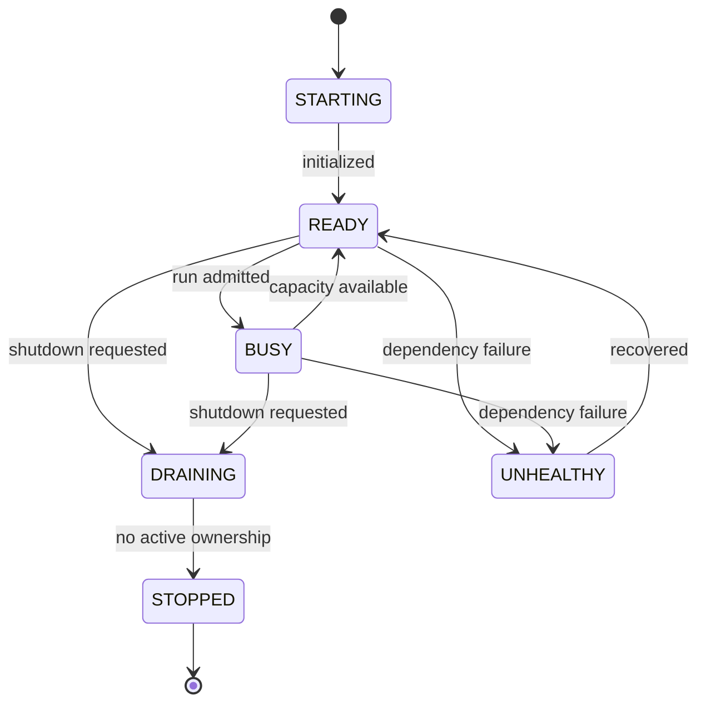
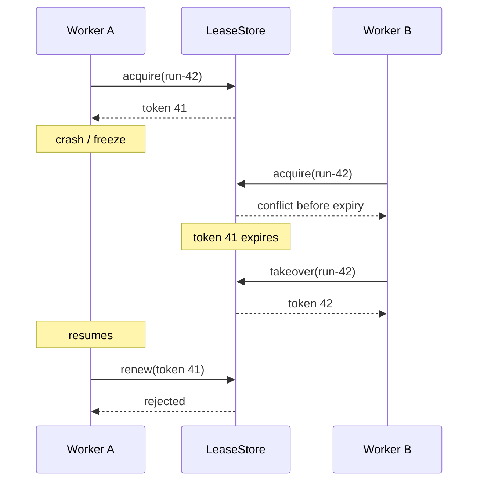

# PyAgentsKit — Distributed Coordination Model

**Document :** `../runtime/15_PYAGENTSKIT_DISTRIBUTED_COORDINATION_MODEL.md`  
**Version :** 1.0  
**Date :** 20 octobre 2026  
**Statut :** Spécification métier et technique — Coordination distribuée  
**Projet :** PyAgentsKit  

**Documents de référence :**
- `../domain/09_PYAGENTSKIT_VALUE_OBJECTS.md`
- `../domain/10_PYAGENTSKIT_ETATS_ET_CYCLES_DE_VIE.md`
- `../architecture/11_PYAGENTSKIT_ARCHITECTURE_CIBLE.md`
- `../runtime/12_PYAGENTSKIT_AGENT_RUNTIME_ADAPTER_SPECIFICATION.md`
- `../runtime/13_PYAGENTSKIT_EFFECTS_AND_SIDE_EFFECT_SAFETY.md`
- `../runtime/14_PYAGENTSKIT_DURABLE_EXECUTION_MODEL.md`

---

# 1. Objet

Ce document définit le modèle de **coordination distribuée** de PyAgentsKit.

Il précise comment plusieurs workers indépendants peuvent :

- découvrir des runs ;
- acquérir un ownership temporaire ;
- renouveler cet ownership ;
- détecter sa perte ;
- reprendre un run abandonné ;
- empêcher un worker obsolète de continuer à agir ;
- coordonner des ressources partagées ;
- survivre aux crashs, freezes, partitions et indisponibilités PostgreSQL.

Le principe directeur est :

> **Un worker n’est jamais propriétaire parce qu’il pense l’être ; l’ownership doit être prouvé par un état durable, temporaire et vérifiable.**

---

# 2. Problème

En mono-processus :

```text
Run → Worker
```

En distribué :

```text
Worker A
Worker B
Worker C
```

peuvent simultanément considérer le même run comme disponible.

Sans coordination :

```text
A executes
B executes
C executes
```

avec risque de :

```text
duplicate execution
duplicate effects
split-brain
```

---

# 3. Objectifs

Le modèle doit fournir :

```text
single logical owner
durable ownership
bounded ownership duration
safe takeover
stale worker rejection
split-brain containment
observable coordination
crash recovery
```

---

# 4. Non-objectifs

PyAgentsKit ne cherche pas à devenir :

```text
consensus system
general-purpose distributed lock manager
cluster scheduler
service mesh
distributed database
Kubernetes replacement
```

---

# 5. Concepts du domaine

```text
Worker
Lease
LeaseStore
LeaseCoordinator
ResourceIdentity
FencingToken
OwnershipContext
Heartbeat
Takeover
FencingValidator
WorkerRegistry
```

---

# 6. Worker

Un `Worker` est une unité d’exécution capable de traiter un ou plusieurs runs.

Attributs conceptuels :

```text
worker_id
status
started_at
last_heartbeat_at
capabilities
instance_id
metadata
```

États :

```text
STARTING
READY
BUSY
DRAINING
UNHEALTHY
STOPPED
```

---

# 7. Identité du worker

`worker_id` doit identifier une instance logique unique.

À éviter :

```text
hostname only
```

car plusieurs processus peuvent partager une même machine.

Exemple :

```text
node42:pid8123:<uuid>
```

---

# 8. Cycle de vie du Worker



---

# 9. Lease

Un `Lease` représente le **droit temporaire d’agir** sur une ressource.

Structure :

```text
lease_id
resource_identity
owner_worker_id
status
fencing_token
acquired_at
renewed_at
expires_at
version
```

---

# 10. Pourquoi un lease

Un lock permanent pose problème si son propriétaire disparaît.

Un lease :

```text
expires automatically
```

et permet :

```text
safe takeover
```

---

# 11. ResourceIdentity

Exemples :

```text
run / run_123
repository_branch / org/repo:main
deployment_environment / production
workspace / workspace_42
```

Le premier cas d’usage du MVP est :

```text
resource_type = "run"
resource_id = run_id
```

---

# 12. LeaseStatus

```text
ACQUIRED
ACTIVE
LOST
EXPIRED
RELEASED
TAKEN_OVER
```

La distinction `ACQUIRED` / `ACTIVE` peut être supprimée si elle n’apporte aucune sémantique utile à l’implémentation.

---

# 13. FencingToken

Le `FencingToken` est une génération monotone d’ownership.

Exemple :

```text
Worker A → 41
Worker B → 42
Worker C → 43
```

Invariant :

```text
new_token > previous_token
```

pour une même ressource.

---

# 14. Pourquoi le lease seul ne suffit pas

```text
Worker A owns token 41
↓
A freezes
↓
lease expires
↓
Worker B gets token 42
↓
A resumes
```

A peut encore croire localement qu’il est owner.

Le fencing permet de rejeter :

```text
token 41
```

---

# 15. OwnershipContext

Structure conceptuelle :

```text
worker_id
lease_id
resource_identity
fencing_token
expires_at
```

Il est propagé vers :

```text
DurableRunner
EffectExecutionService
ProtectedTool
Store operations
```

---

# 16. LeaseStore

Port autoritatif de coordination.

Opérations :

```text
acquire()
renew()
release()
get()
takeover()
validate()
list_by_worker()
list_expired()
```

Backend de production de référence :

```text
PostgreSQL
```

---

# 17. Acquisition

Flux :

```text
Worker requests resource
↓
LeaseStore transaction
↓
active lease exists?
├── yes → conflict
└── no  → acquire
          generate next fencing token
          return OwnershipContext
```

Deux workers concurrents doivent produire :

```text
one winner
one conflict
```

---

# 18. Atomicité

L’acquisition doit être atomique.

Implémentations PostgreSQL candidates :

```text
SELECT ... FOR UPDATE
INSERT ... ON CONFLICT
conditional UPDATE
advisory lock around lease row
SERIALIZABLE transaction
```

Le choix final sera spécifié dans le document persistence.

---

# 19. TTL

Un lease est borné par :

```text
expires_at
```

Exemple :

```text
TTL = 30 seconds
```

La durée doit être suffisamment longue pour absorber la latence normale, mais suffisamment courte pour permettre un takeover rapide.

---

# 20. Renewal / Heartbeat

Le worker renouvelle le lease avant expiration :

```text
acquire
↓
renew
↓
renew
↓
renew
```

Le renouvellement vérifie au minimum :

```text
lease_id
worker_id
fencing_token
current status
```

---

# 21. Heartbeat != Ownership

Un heartbeat signifie :

```text
worker probably alive
```

mais pas :

```text
worker owns resource
```

La source d’autorité reste :

```text
LeaseStore
```

---

# 22. Dimensionnement TTL / heartbeat

Heuristique initiale :

```text
heartbeat_interval <= TTL / 3
```

à qualifier selon :

```text
DB latency
network jitter
GC pauses
event-loop stalls
container scheduling
desired failover time
```

---

# 23. Source du temps

Pour les décisions d’expiration, préférer :

```text
database/server time
```

à l’horloge locale des workers.

Objectif :

```text
limit clock-skew errors
```

---

# 24. Renewal ambiguity

Si un worker ne sait pas si son renouvellement a réussi :

```text
ownership = uncertain
```

Pour les effets protégés :

```text
STOP before next protected effect boundary
```

---

# 25. Lease loss

Le lease est considéré perdu si :

```text
store confirms loss
token superseded
lease expired
takeover detected
```

Réaction :

```text
invalidate local ownership
stop new protected effects
audit loss
stop or detach runtime as appropriate
```

---

# 26. Takeover

Séquence :

```text
Worker A owns token 41
↓
lease expires
↓
Worker B acquires
↓
token 42
↓
Worker B recovers Run
```

Le takeover ne doit jamais réutiliser le token précédent.

---

# 27. Séquence de takeover



---

# 28. Split-brain

Split-brain :

```text
two workers believe they own the same resource
```

Le système doit supposer que cette croyance locale peut temporairement exister.

La garantie importante est :

```text
only current generation may produce protected effects
```

---

# 29. Niveaux de fencing

```text
NONE
LOCAL_GUARD
STORE_GUARD
REMOTE_GUARD
```

## LOCAL_GUARD

Validation avant appel dans PyAgentsKit.

## STORE_GUARD

La ressource interne/store vérifie la génération.

## REMOTE_GUARD

Le système cible rejette directement les tokens obsolètes.

`REMOTE_GUARD` est la protection la plus forte.

---

# 30. Limites du fencing externe

Une API tierce peut ne pas accepter de fencing token.

Dans ce cas, PyAgentsKit ne doit pas prétendre offrir une garantie supérieure à ce qu’il peut réellement imposer.

---

# 31. FencingValidator

Service :

```text
validate(OwnershipContext)
```

Retour :

```text
VALID
STALE
UNKNOWN
```

Pour un effect critique :

```text
UNKNOWN → fail closed
```

---

# 32. WorkerRegistry

Port distinct de `LeaseStore`.

Il décrit :

```text
workers registered
status
capabilities
last heartbeat
active load
```

Le `LeaseStore` décrit :

```text
who owns which resource
```

---

# 33. Liveness vs Authority

```text
liveness
!=
authority
```

Un worker vivant peut ne posséder aucun run.

Un worker sans heartbeat récent peut encore avoir un lease non expiré.

La reprise dépend du lease, pas uniquement du heartbeat.

---

# 34. Process freeze

Scénario critique :

```text
Worker A freezes
↓
no renewal
↓
lease expires
↓
Worker B takeover
↓
A resumes
```

A devient :

```text
stale / zombie worker
```

---

# 35. Zombie worker

Un worker qui reprend après perte d’ownership doit :

```text
revalidate
```

avant toute nouvelle action sensible.

Il ne regagne jamais son autorité en reprenant simplement son thread local.

---

# 36. Reacquisition

Un ancien worker peut éventuellement reprendre plus tard, mais uniquement avec :

```text
new lease_id
new fencing_token
```

---

# 37. Effet déjà en vol

Si le lease est perdu après envoi d’un effet externe :

```text
do not assume rollback
```

L’Effect devient selon les preuves :

```text
SUCCEEDED
FAILED
UNKNOWN
```

puis peut nécessiter reconciliation.

---

# 38. Runtime actif après lease loss

Un runtime externe peut continuer à raisonner.

PyAgentsKit doit toutefois empêcher :

```text
new protected tool calls
```

via le `ToolGateway` / `EffectExecutionService`.

---

# 39. Cancellation du runtime

Sur lease loss :

```text
cancel runtime
```

si supporté.

Sinon :

```text
detach
ignore stale progression where necessary
block protected effects
```

---

# 40. RuntimeInvocation ownership

Une invocation devrait conserver le contexte d’ownership ayant permis son lancement :

```text
worker_id
lease_id
fencing_token
```

---

# 41. Run lease

Protège :

```text
logical execution ownership
```

Il ne protège pas automatiquement toutes les ressources externes touchées.

---

# 42. Resource leases

Ressources candidates :

```text
repository branch
workspace
deployment environment
exclusive external resource
```

À introduire seulement si l’exclusivité est réellement nécessaire.

---

# 43. Run lease + Resource lease

Certains effects peuvent exiger :

```text
valid Run lease
+
valid resource lease
```

Exemple :

```text
Run R42
+
deployment_environment:production
```

---

# 44. Éviter la hiérarchie excessive

Ne pas transformer le framework en système de locks imbriqués.

Avant d’ajouter un lease, poser la question :

> **Quelle autorité exclusive devons-nous réellement protéger ?**

---

# 45. Deadlocks

Des leases multiples peuvent créer :

```text
deadlock
```

Mesures :

```text
global acquisition order
bounded wait
short TTL
avoid unnecessary nesting
```

---

# 46. Optimistic concurrency d’abord

Pour les ressources faciles à versionner :

```text
optimistic concurrency
```

peut être préférable à un lease.

Exemples :

```text
message append
memory entry update
row version
```

---

# 47. Graceful shutdown

Flux recommandé :

```text
SIGTERM
↓
Worker = DRAINING
↓
stop admissions
↓
reach safe boundary
↓
checkpoint active Runs
↓
stop new protected effects
↓
release lease if safe
↓
flush telemetry/audit
↓
STOPPED
```

---

# 48. Release vs natural expiry

## Explicit release

Avantage :

```text
fast takeover
```

Risque :

```text
release before execution is actually safe
```

## Natural expiry

Avantage :

```text
safe when shutdown state is ambiguous
```

Inconvénient :

```text
slower takeover
```

---

# 49. SIGKILL

Aucun cleanup n’est supposé.

La reprise doit fonctionner uniquement grâce à :

```text
lease expiry
+
takeover
+
RecoveryPlanner
```

---

# 50. PostgreSQL outage

Scénario :

```text
active worker
↓
renewal attempted
↓
PostgreSQL unavailable
```

Le worker ne peut plus prouver son ownership.

---

# 51. Safe degradation

Pour les workloads protégés :

```text
readiness = false
stop new admissions
stop new protected effects
continue pure computation only if safe
```

---

# 52. Retour PostgreSQL

Après restauration :

```text
reload lease
↓
revalidate token
├── still current → continue
└── superseded    → stop / recover
```

Ne pas continuer depuis le seul état mémoire.

---

# 53. Network partition

Une partition Worker ↔ PostgreSQL est traitée comme :

```text
cannot prove ownership
```

Pour les effets critiques :

```text
fail closed
```

---

# 54. Lease storms

Après reprise massive :

```text
many workers
many renewals
many acquisitions
```

Peuvent surcharger PostgreSQL.

Mesures :

```text
jitter
backoff
bounded concurrency
batching only if measured useful
```

---

# 55. Contention backoff

Sur conflit de lease :

```text
bounded randomized backoff
```

plutôt qu’une boucle agressive.

---

# 56. Work discovery

Les runs peuvent être découverts via :

```text
polling
queue
event
scheduler assignment
```

Mais :

```text
job delivery != ownership
```

Le worker doit toujours acquérir le lease.

---

# 57. Duplicate delivery

Deux workers peuvent recevoir le même job.

Résultat attendu :

```text
both try acquire
one wins
one backs off
```

---

# 58. Work stealing

Un worker libre peut reprendre un run :

```text
unowned
or
expired
```

C’est acceptable si l’acquisition reste autoritative.

---

# 59. Parent / child runs

Chaque child Run peut avoir son propre lease.

Un parent `WAITING` peut :

```text
release execution lease
```

pendant que le child progresse.

À la fin :

```text
child completion
↓
wake parent
↓
parent reacquires
↓
resume
```

---

# 60. Conversations

Plusieurs agents peuvent écrire dans une conversation sans lease global.

La concurrence des messages relève davantage de :

```text
append semantics
ordering
deduplication
optimistic concurrency
```

---

# 61. Coding agents

Exemple :

```text
Worker A owns Run
↓
Codex edits feature/x
```

Un resource lease peut protéger :

```text
repository_branch:feature/x
```

si plusieurs workers pourraient modifier simultanément le même workspace.

---

# 62. Git-specific concurrency

Git remote ne comprend pas nativement un PyAgentsKit fencing token.

Protections complémentaires :

```text
expected SHA
--force-with-lease
protected branches
PR workflow
```

---

# 63. Terraform

Un lease PyAgentsKit autour de :

```text
terraform apply
```

doit compléter :

```text
Terraform state locking
```

et non le remplacer.

---

# 64. Deployment

Une ressource logique :

```text
deployment_environment:production
```

peut être protégée par lease pour éviter deux déploiements concurrents.

---

# 65. Security

Un worker ne peut pas forger une autorité en présentant simplement un token.

La validation repose sur :

```text
LeaseStore authoritative state
```

---

# 66. FencingToken n’est pas un secret

Il représente :

```text
authority generation
```

et non :

```text
authentication credential
```

---

# 67. Ownership != Authorization

Un worker avec lease doit encore respecter :

```text
authorization
policy
approval
```

---

# 68. Approval != Ownership

```text
Approval
= permission métier/humaine

Lease
= autorité d’exécution courante
```

Les deux sont complémentaires.

---

# 69. Administrative revocation

Extension possible :

```text
revoke lease
```

Elle doit :

```text
invalidate current authority
audit who/why
force a new generation before future execution
```

---

# 70. Force takeover

Opération sensible.

Elle doit :

```text
increment fencing token
invalidate old owner
require explicit authorization
emit audit event
```

---

# 71. Événements de domaine/audit

```text
WorkerRegistered
WorkerReady
WorkerDraining
WorkerStopped

LeaseAcquired
LeaseRenewed
LeaseRenewalFailed
LeaseLost
LeaseExpired
LeaseReleased
LeaseTakenOver

FencingRejected
OwnershipRevalidated
```

---

# 72. Audit du changement d’owner

Chaque takeover doit permettre de reconstruire :

```text
resource
old_worker
new_worker
old_fencing_token
new_fencing_token
timestamp
reason
```

---

# 73. Métriques Lease

```text
leases_acquired_total
leases_renewed_total
lease_renewal_failures_total
leases_lost_total
leases_expired_total
lease_takeovers_total
lease_conflicts_total
fencing_rejections_total
```

---

# 74. Métriques workers

```text
workers_ready
workers_draining
active_leases
active_runs
worker_heartbeat_age
```

---

# 75. Latences

```text
lease_acquire_latency
lease_renew_latency
takeover_latency
ownership_revalidation_latency
```

---

# 76. Cardinalité

Ne pas utiliser par défaut :

```text
run_id
worker_id
lease_id
```

comme labels métriques.

Ils vont dans :

```text
logs
traces
audit
```

---

# 77. Traces

Spans candidats :

```text
lease.acquire
lease.renew
lease.release
lease.takeover
ownership.revalidate
fencing.validate
worker.drain
```

---

# 78. Structured logging

Champs :

```text
worker_id
resource_type
resource_id
lease_id
fencing_token
operation
result
reason
trace_id
```

---

# 79. Single-worker mode

PyAgentsKit peut proposer :

```text
InMemoryLeaseStore
```

pour développement/test.

Mais il ne doit pas être présenté comme coordination distribuée de production.

---

# 80. PostgreSQL LeaseStore

Backend production de référence.

Garanties attendues :

```text
atomic acquisition
conditional renewal
lease expiration
safe takeover
monotonic fencing
concurrency correctness
```

---

# 81. Modèle de table candidat

```text
leases
-----
lease_id
resource_type
resource_id
owner_worker_id
status
fencing_token
acquired_at
renewed_at
expires_at
version
```

---

# 82. Unicité logique

Invariant :

```text
at most one authoritative ACTIVE lease
per ResourceIdentity
```

Implémentation PostgreSQL possible :

```text
partial unique index
conditional transaction
```

---

# 83. Renewal CAS

Exemple conceptuel :

```sql
UPDATE leases
SET renewed_at = now(),
    expires_at = ...
WHERE lease_id = ?
  AND owner_worker_id = ?
  AND fencing_token = ?
  AND status = 'ACTIVE';
```

Si :

```text
0 rows updated
```

l’ownership n’est plus confirmé.

---

# 84. Historique

Deux modèles possibles :

```text
mutable current lease + audit history
```

ou :

```text
append-oriented ownership generations
```

Le modèle physique sera tranché dans le document persistence.

---

# 85. Coordination invariants

```text
COORD-INV-01
Une ressource possède au plus un lease actif autoritatif.

COORD-INV-02
Chaque nouveau ownership reçoit un FencingToken strictement supérieur.

COORD-INV-03
Un worker qui perd son lease ne peut produire de nouveaux Protected Effects.

COORD-INV-04
Un heartbeat ne constitue pas une preuve d’ownership.

COORD-INV-05
La livraison d’un job ne constitue pas une preuve d’ownership.

COORD-INV-06
Un worker repris après freeze doit revalider son ownership.

COORD-INV-07
Une panne du LeaseStore bloque les nouveaux effets protégés si l’autorité ne peut être prouvée.

COORD-INV-08
Un takeover ne rejoue jamais implicitement les Effects du worker précédent.

COORD-INV-09
La sûreté ne dépend pas d’un graceful cleanup du worker précédent.

COORD-INV-10
L’ownership est durable, temporaire, transférable et auditable.
```

---

# 86. Anti-patterns

À éviter :

```text
asyncio.Lock as distributed coordination
threading.Lock as distributed coordination
worker heartbeat used as lock
infinite lock
lease without fencing
queue delivery used as ownership
continue protected effects after store disconnect
reuse stale OwnershipContext
```

---

# 87. Qualification minimale

La coordination distribuée doit être qualifiée avec :

```text
real PostgreSQL
+
at least two independent worker processes
```

Pas seulement :

```text
mocks
threads
in-memory stores
```

---

# 88. Test — acquisition concurrente

```text
Worker A acquire(run-42)
Worker B acquire(run-42)
```

Résultat :

```text
exactly one authoritative owner
```

---

# 89. Test — renewals

```text
acquire
renew N times
```

Vérifier :

```text
expires_at advances
fencing token unchanged
ownership remains valid
```

---

# 90. Test — takeover

```text
A token 41
↓
A stops renewing
↓
expiry
↓
B takeover token 42
```

---

# 91. Test — stale worker

Après takeover :

```text
A resumes
↓
tries token 41
```

Résultat :

```text
REJECT
```

---

# 92. Test — SIGTERM

Vérifier :

```text
DRAINING
admission stopped
checkpoint before release
safe lease handling
```

---

# 93. Test — SIGKILL

Vérifier :

```text
no cleanup required
lease expires
takeover succeeds
```

---

# 94. Test — process suspension

```text
SIGSTOP A
wait > TTL
B takeover
SIGCONT A
```

A doit être neutralisé par fencing.

---

# 95. Test — PostgreSQL outage

Pendant renew :

```text
PostgreSQL unavailable
```

Vérifier :

```text
readiness false
no new protected effects
ownership revalidation after recovery
```

---

# 96. Test — split-brain simulé

Créer :

```text
A believes token 41 is valid
B actually owns token 42
```

Vérifier :

```text
A cannot pass FencingValidator
```

---

# 97. Test — contention

N workers tentent la même ressource.

Mesurer :

```text
conflicts
latency
PostgreSQL contention
backoff effectiveness
```

---

# 98. Test — renewal storm

Avec grand nombre de leases :

```text
measure p50/p95/p99
deadlocks
lock waits
DB CPU
transaction throughput
```

---

# 99. Property-based tests

Propriétés :

```text
never two authoritative ACTIVE leases for same resource
fencing token never decreases
stale token never becomes current again
released lease cannot renew
taken-over lease cannot renew
```

---

# 100. Fault injection

Inclure :

```text
DB restart
transaction abort
network latency
packet loss
process freeze
worker crash
clock skew
```

---

# 101. Acceptance criteria

Le modèle est opérationnel si :

1. deux workers ne peuvent obtenir simultanément un ownership autoritatif sur le même Run ;
2. les leases expirent sans cleanup ;
3. le takeover produit une nouvelle génération ;
4. un zombie worker est rejeté ;
5. PostgreSQL outage entraîne une safe degradation ;
6. graceful shutdown stoppe les admissions avant abandon d’autorité ;
7. `SIGKILL` est récupérable ;
8. `SIGSTOP`/freeze + takeover est qualifié ;
9. les métriques de lease sont disponibles ;
10. les changements d’owner sont audités ;
11. les Protected Effects valident le fencing ;
12. les tests utilisent au moins deux processus indépendants et PostgreSQL réel.

---

# 102. Architecture cible

```text
                  Work Discovery
                        │
          ┌─────────────┼─────────────┐
          ▼             ▼             ▼
      Worker A      Worker B      Worker C
          │             │             │
          └─────────────┼─────────────┘
                        ▼
                LeaseCoordinator
                        │
                        ▼
                   LeaseStore
                  (PostgreSQL)
                        │
             ┌──────────┴──────────┐
             ▼                     ▼
     OwnershipContext        FencingToken
             │
             ▼
        DurableRunner
             │
             ▼
      Protected Effects
             │
             ▼
       External Systems
```

---

# 103. Flux nominal

```text
discover Run
↓
acquire Lease
↓
receive token 41
↓
start/resume Run
↓
periodic renewals
↓
protected effects carry ownership
↓
reach terminal/safe state
↓
release
```

---

# 104. Flux takeover

```text
Worker A token 41
↓
crash
↓
lease expires
↓
Worker B token 42
↓
RecoveryPlanner
↓
Run resumes
↓
Worker A returns
↓
token 41 rejected
```

---

# 105. Flux panne PostgreSQL

```text
Worker active
↓
LeaseStore unreachable
↓
renewal uncertain
↓
readiness false
↓
no new protected effects
↓
store returns
↓
revalidate ownership
├── valid → continue
└── stale → stop / recovery
```

---

# 106. Flux graceful shutdown

```text
SIGTERM
↓
DRAINING
↓
admission off
↓
safe boundary
↓
checkpoint
↓
stop effects/runtime progression
↓
release if safe
↓
STOPPED
```

---

# 107. Questions ouvertes

```text
Q-COORD-01 ACQUIRED et ACTIVE doivent-ils rester distincts ?
Q-COORD-02 Historique append-only ou ligne mutable + audit ?
Q-COORD-03 Quel TTL par défaut ?
Q-COORD-04 Quelle formule heartbeat/TTL recommander ?
Q-COORD-05 Resource leases dès v1 ou extension ?
Q-COORD-06 Release explicite ou natural expiry par défaut au shutdown ?
Q-COORD-07 Faut-il un LeaseSweeper ?
Q-COORD-08 Comment propager le fencing aux tools externes ?
Q-COORD-09 Faut-il exposer force takeover publiquement ?
Q-COORD-10 WorkerRegistry dans PostgreSQL ?
Q-COORD-11 Faut-il batcher les renewals ?
Q-COORD-12 Quel délai de tolérance pendant perte transitoire du LeaseStore ?
```

---

# 108. ADR induits

```text
ADR-COORD-001 Lease-based ownership
ADR-COORD-002 PostgreSQL LeaseStore reference backend
ADR-COORD-003 Fencing token generation
ADR-COORD-004 Worker identity
ADR-COORD-005 Heartbeat vs lease semantics
ADR-COORD-006 TTL and renewal policy
ADR-COORD-007 Takeover transaction
ADR-COORD-008 Graceful shutdown lease handling
ADR-COORD-009 Resource lease scope
ADR-COORD-010 WorkerRegistry
ADR-COORD-011 Store outage behavior
ADR-COORD-012 Force takeover governance
```

---

# 109. Definition of Done

La coordination distribuée est mature lorsque :

1. `LeaseStore` possède un contrat stable ;
2. PostgreSQL est le backend de référence qualifié ;
3. l’acquisition est atomique ;
4. les renewals vérifient l’owner courant ;
5. l’expiration permet un takeover ;
6. chaque takeover incrémente le fencing token ;
7. les Protected Effects vérifient l’ownership ;
8. les stale workers sont détectés ;
9. les zombie workers sont neutralisés ;
10. graceful shutdown, `SIGKILL` et freeze sont testés ;
11. PostgreSQL outage est testé ;
12. les métriques de lease sont exposées ;
13. les changements d’owner sont audités ;
14. TTL/heartbeat font l’objet de recommandations documentées ;
15. les tests multi-processus réels passent ;
16. queue delivery et heartbeat ne sont jamais confondus avec l’ownership.

---

# 110. Résumé

La coordination distribuée de PyAgentsKit repose sur :

```text
WORKER
+
LEASE
+
TTL
+
RENEWAL
+
TAKEOVER
+
FENCING TOKEN
+
OWNERSHIP CONTEXT
+
POSTGRESQL
```

Le lease répond à :

```text
WHO MAY RUN NOW?
```

Le fencing répond à :

```text
WHO IS STILL ALLOWED TO PRODUCE A PROTECTED EFFECT?
```

Le takeover répond à :

```text
WHO CONTINUES WHEN THE PREVIOUS WORKER DISAPPEARS?
```

Le principe fondamental est :

> **L’ownership doit être temporaire, durable, transférable et impossible à prolonger implicitement après perte d’autorité.**

Le document suivant naturel est :

```text
../runtime/16_PYAGENTSKIT_PERSISTENCE_AND_STATE_STORES.md
```
