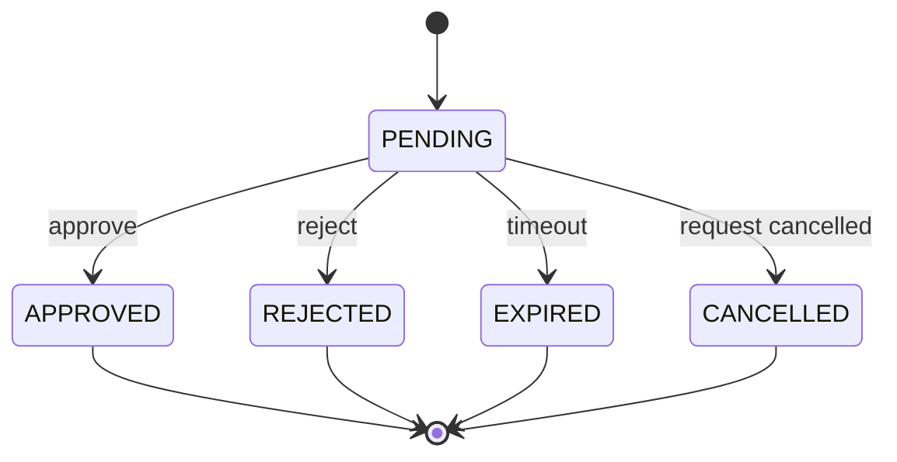

# PyAgentsKit — Human Governance & Approvals

**Document :** `../runtime/17_PYAGENTSKIT_HUMAN_GOVERNANCE_AND_APPROVALS.md`  
**Version :** 1.0  
**Date :** 20 octobre 2026  
**Statut :** Spécification métier et technique — Human Governance & Approvals  
**Projet :** PyAgentsKit  

**Documents de référence :**
- `../foundation/00_PYAGENTSKIT_DEFINITION_DU_BESOIN.md`
- `../foundation/01_PYAGENTSKIT_ANALYSE_DU_BESOIN.md`
- `../foundation/02_PYAGENTSKIT_PARTIES_PRENANTES_ET_CAS_D_USAGE.md`
- `../foundation/03_PYAGENTSKIT_EXIGENCES_FONCTIONNELLES.md`
- `../foundation/04_PYAGENTSKIT_EXIGENCES_NON_FONCTIONNELLES.md`
- `../architecture/05_PYAGENTSKIT_PRINCIPES_ARCHITECTURAUX.md`
- `../domain/06_PYAGENTSKIT_OBJETS_METIERS.md`
- `../domain/07_PYAGENTSKIT_ENTITES.md`
- `../architecture/08_PYAGENTSKIT_ERD.md`
- `../domain/09_PYAGENTSKIT_VALUE_OBJECTS.md`
- `../domain/PYAGENTSKIT_MODELE_CONCEPTUEL_DU_DOMAINE.md`
- `../domain/10_PYAGENTSKIT_ETATS_ET_CYCLES_DE_VIE.md`
- `../architecture/11_PYAGENTSKIT_ARCHITECTURE_CIBLE.md`
- `../runtime/12_PYAGENTSKIT_AGENT_RUNTIME_ADAPTER_SPECIFICATION.md`
- `../runtime/13_PYAGENTSKIT_EFFECTS_AND_SIDE_EFFECT_SAFETY.md`
- `../runtime/14_PYAGENTSKIT_DURABLE_EXECUTION_MODEL.md`
- `../runtime/15_PYAGENTSKIT_DISTRIBUTED_COORDINATION_MODEL.md`
- `../runtime/16_PYAGENTSKIT_PERSISTENCE_AND_STATE_STORES.md`

---

# 1. Objet du document

Ce document définit le modèle de **gouvernance humaine et d’approbation durable** de PyAgentsKit.

Il précise comment le framework doit :

- demander une validation humaine ;
- persister cette demande ;
- suspendre un Run sans garder un processus actif ;
- identifier qui peut décider ;
- appliquer des policies ;
- enregistrer la décision ;
- vérifier que cette décision porte sur la bonne action ;
- reprendre l’exécution après décision ;
- gérer expiration, refus, annulation et escalade ;
- appliquer des règles de séparation des tâches ;
- auditer l’ensemble du processus.

Le principe directeur est :

> **Une approbation n’est ni un message libre, ni un bouton UI, ni une permission IAM : c’est une décision métier durable, portée par un acteur identifié, sur une intention précise, dans un contexte déterminé.**

---

# 2. Problème adressé

Dans de nombreux systèmes agentiques, un “human-in-the-loop” est implémenté comme :

```text
agent asks question
↓
UI shows button
↓
human clicks approve
↓
callback resumes agent
```

Ce modèle devient fragile si :

```text
process crashes
UI reconnects
worker changes
approval arrives hours later
same action parameters changed
message is replayed
```

PyAgentsKit doit donc faire de l’approbation un objet métier durable.

---

# 3. Objectifs

Le modèle doit garantir :

```text
durable approval requests
explicit decision semantics
actor traceability
scope binding
expiration
policy enforcement
safe resume
SoD support
auditability
transport independence
```

---

# 4. Non-objectifs

PyAgentsKit ne doit pas devenir :

```text
IAM
identity provider
enterprise policy suite
ticketing system
chat platform
workflow BPM engine
electronic signature platform
```

Il fournit les abstractions nécessaires à la gouvernance agentique.

---

# 5. Concepts principaux

```text
Approval
ApprovalRequest
ApprovalDecision
ApprovalStatus
ApprovalScope
ApprovalValidity
ApprovalPolicy
PolicyDecision
Approver
Actor
Principal
Authorization
SeparationOfDuties
ApprovalGroup
EscalationPolicy
```

---

# 6. `Approval`

Une `Approval` représente une demande de décision humaine durable.

Attributs conceptuels :

```text
approval_id
run_id
effect_id?
status
requested_by
requested_at
scope
policy_reference?
required_approvers
decision?
expires_at?
metadata
```

---

# 7. États de l’Approval

```text
PENDING
APPROVED
REJECTED
EXPIRED
CANCELLED
```

Extension future possible :

```text
REVOKED
```

mais à introduire seulement si la sémantique est réellement nécessaire.

---

# 8. Cycle de vie



---

# 9. Terminalité

Une décision terminale ne doit pas être modifiée silencieusement.

Exemple :

```text
APPROVED → REJECTED
```

est interdit comme simple mutation.

Si une nouvelle décision est nécessaire :

```text
new Approval
```

ou processus explicite de révocation.

---

# 10. ApprovalRequest

L’`ApprovalRequest` représente le contenu de la demande adressée à l’humain.

Structure conceptuelle :

```text
approval_id
action summary
reason
risk level
scope
requested_by
supporting artifacts
context references
expires_at?
```

---

# 11. ApprovalDecision

Structure :

```text
decision
actor_reference
reason?
decided_at
evidence_reference?
```

Décisions principales :

```text
APPROVE
REJECT
CANCEL
```

---

# 12. ApprovalScope

L’approbation doit être liée à ce qu’elle autorise.

Structure candidate :

```text
action
resource
environment?
effect_id?
input_fingerprint?
risk_level?
constraints?
```

---

# 13. Pourquoi le scope est critique

Mauvais :

```text
"Thomas approved deployment"
```

Meilleur :

```text
approved:
  action: deploy
  environment: production
  artifact: app:v1.4.0
  input_fingerprint: abc123
```

---

# 14. Binding à l’Effect

Pour un `ProtectedEffect`, l’approval devrait idéalement être liée à :

```text
effect_id
+
input_fingerprint
```

afin d’éviter qu’une action modifiée réutilise une ancienne autorisation.

---

# 15. Approval ≠ Message

Un message :

```text
"ça me semble bon"
```

ne doit jamais devenir automatiquement :

```text
Approval(APPROVED)
```

sans un mécanisme explicite de décision.

---

# 16. Message comme canal

Un message peut transporter une demande ou une réponse humaine.

Mais :

```text
Message
!=
ApprovalDecision
```

La conversion doit être explicite et contrôlée.

---

# 17. Approval ≠ Authorization

```text
Authorization
= cet acteur a-t-il le droit de décider ?

Approval
= quelle décision cet acteur a-t-il prise ?
```

Les deux doivent être vérifiés.

---

# 18. Approval ≠ Authentication

```text
Authentication
= qui est l’acteur ?

Authorization
= peut-il décider ?

Approval
= qu’a-t-il décidé ?
```

---

# 19. Approval ≠ Ownership

```text
Lease
= quel worker peut exécuter ?

Approval
= un humain autorise-t-il cette action ?
```

Les deux sont indépendants.

---

# 20. Approval ≠ Policy

```text
Policy
= faut-il une approval ?

Approval
= quelle décision humaine a été prise ?
```

---

# 21. `PolicyEvaluator`

Service :

```text
evaluate(action, context)
```

Retour :

```text
ALLOW
DENY
REQUIRE_APPROVAL
DEFER
```

---

# 22. Exemple Policy

```text
git push to feature branch
→ ALLOW

merge PR to main
→ REQUIRE_APPROVAL

deploy to production
→ REQUIRE_APPROVAL

delete audit records
→ DENY
```

---

# 23. Policy context

Entrées possibles :

```text
actor
effect kind
risk level
environment
tenant
resource
amount
time
current run
current approval history
```

---

# 24. PolicyDecision

Value Object :

```text
ALLOW
DENY
REQUIRE_APPROVAL
DEFER
```

---

# 25. `DEFER`

`DEFER` signifie :

```text
decision delegated to another policy layer
```

et non :

```text
allow
```

---

# 26. Approval creation flow

```text
Protected Effect proposed
↓
PolicyEvaluator
↓
REQUIRE_APPROVAL
↓
ApprovalService.create()
↓
Approval PENDING persisted
↓
Run WAITING
↓
notification
```

---

# 27. Run WAITING

Lorsqu’une approval obligatoire est `PENDING` :

```text
Run → WAITING
```

sans nécessité de conserver un worker ou thread actif.

---

# 28. Libération du lease

Pour une attente longue :

```text
persist WAITING
↓
release execution lease
```

est généralement préférable.

À la décision :

```text
wake-up
↓
reacquire lease
↓
RecoveryPlanner
```

---

# 29. Approval wake-up

Une décision terminale peut produire :

```text
ApprovalApproved
ApprovalRejected
```

puis :

```text
RunWakeupRequested
```

via Outbox ou mécanisme équivalent.

---

# 30. Resume after approval

Flux :

```text
human approves
↓
persist decision
↓
audit
↓
wake run
↓
worker acquires lease
↓
RecoveryPlanner
↓
revalidate approval
↓
continue
```

---

# 31. Revalidation avant Effect

L’approval doit être revalidée juste avant l’effet si le contexte peut avoir changé.

Vérifier :

```text
still APPROVED?
not expired?
scope still matches?
effect fingerprint unchanged?
actor was authorized?
policy still accepts?
```

---

# 32. Approval expiration

Une approval peut expirer automatiquement.

Exemple :

```text
valid for 2 hours
```

Après expiration :

```text
PENDING → EXPIRED
```

ou une approval déjà approuvée peut devenir inutilisable selon `ApprovalValidity`.

---

# 33. Approval validity

Value Object :

```text
valid_from
valid_until?
```

---

# 34. Decision time vs execution time

Une décision peut être valide au moment où elle est prise mais invalide au moment de l’exécution.

D’où la nécessité de :

```text
execution-time validation
```

---

# 35. Cancellation

Une Approval peut être annulée si :

```text
Run cancelled
Effect abandoned
request superseded
operator cancels request
```

---

# 36. Rejection

Une rejection doit généralement conduire à :

```text
Effect blocked
```

et selon policy :

```text
Run FAILED
Run CANCELLED
Run WAITING_FOR_ALTERNATIVE
```

---

# 37. Reject ≠ Failure

Un refus humain est une décision métier.

Ce n’est pas nécessairement :

```text
system error
```

---

# 38. Reason

Le champ `reason` peut être :

```text
optional
```

ou obligatoire selon policy.

Exemple :

```text
REJECT on CRITICAL effect
→ reason required
```

---

# 39. Approver

Un approver est un `Actor` ou `Principal` autorisé à prendre la décision.

---

# 40. ActorReference

L’Approval conserve :

```text
actor_id
actor_type
external_identity_reference?
```

sans dupliquer l’IAM.

---

# 41. IdentityProviderPort

Port possible :

```text
resolve identity
verify authentication context
get principal
```

---

# 42. AuthorizationPort

Port :

```text
can_decide_approval(principal, approval)
```

---

# 43. IAM externe

PyAgentsKit peut s’intégrer à :

```text
OIDC
OAuth2
Entra ID
Keycloak
Auth0
custom IAM
```

sans devenir IAM.

---

# 44. Least privilege

Un acteur ne doit pouvoir approuver que les actions nécessaires à son rôle.

---

# 45. RBAC

Exemple :

```text
ROLE_DEV
ROLE_RELEASE_MANAGER
ROLE_SECURITY
ROLE_FINANCE_APPROVER
```

---

# 46. ABAC

La décision peut aussi dépendre d’attributs :

```text
environment
amount
business unit
tenant
risk
resource owner
```

---

# 47. Separation of Duties

SoD signifie qu’un même acteur ne doit pas cumuler certains rôles incompatibles.

Exemple :

```text
requester
!=
approver
```

---

# 48. SoD example

```text
developer created release
↓
release manager approves production deployment
```

ou :

```text
Human A initiates payment
↓
Human B approves
```

---

# 49. `SeparationOfDutiesRule`

Structure candidate :

```text
initiator_must_differ_from_approver
required_distinct_roles
minimum_distinct_actors
forbidden_actor_sets
```

---

# 50. Multi-approval

Certaines actions peuvent exiger plusieurs approbations.

Exemple :

```text
2-of-3
```

---

# 51. ApprovalGroup

Concept candidat :

```text
ApprovalGroup
├── members / roles
├── quorum
├── strategy
└── timeout
```

---

# 52. Quorum strategies

```text
ANY_ONE
ALL
N_OF_M
ROLE_BASED
SEQUENTIAL
```

MVP recommandé :

```text
ANY_ONE
ALL
N_OF_M
```

---

# 53. ApprovalVote

Si plusieurs acteurs doivent voter, une entité `ApprovalVote` peut porter :

```text
vote_id
approval_id
actor
decision
decided_at
reason
```

À introduire uniquement si le multi-approval devient une capacité réelle du produit.

---

# 54. Multi-approval state

L’Approval reste :

```text
PENDING
```

tant que le quorum requis n’est pas atteint.

---

# 55. Rejection strategy

Selon policy :

```text
one reject → immediate reject
```

ou :

```text
continue collecting votes
```

---

# 56. Sequential approvals

Exemple :

```text
Manager
↓
Security
↓
Operations
```

À supporter sans devenir un BPM générique.

---

# 57. Escalation

Une demande peut être escaladée après délai.

```text
after 30 min → backup approver
after 2 h → manager
```

---

# 58. EscalationPolicy

Structure :

```text
after_duration
target_role / target_group
notification channel
max escalation level
```

---

# 59. Escalation ≠ Decision

L’escalade modifie :

```text
who may or should decide
```

pas la décision elle-même.

---

# 60. Notifications

Canaux possibles :

```text
email
Slack
Teams
web UI
mobile push
webhook
```

Le canal n’est pas la source de vérité.

---

# 61. NotificationPort

```text
notify_approval_requested()
notify_approval_escalated()
notify_approval_expiring()
```

---

# 62. Notification failure

Une notification échouée ne change pas le statut métier de l’Approval.

---

# 63. UI

L’UI est une projection de l’objet durable.

```text
Approve button
↓
DecideApproval command
↓
ApprovalStore
```

et non :

```text
button → runtime callback
```

---

# 64. API candidate

```text
GET /approvals
GET /approvals/{id}
POST /approvals/{id}/approve
POST /approvals/{id}/reject
POST /approvals/{id}/cancel
```

---

# 65. CLI candidate

```text
pyagentskit approval list --status pending
pyagentskit approval inspect <id>
pyagentskit approval approve <id>
pyagentskit approval reject <id> --reason "..."
```

---

# 66. Commands

```text
RequestApproval
ApproveApproval
RejectApproval
CancelApproval
ExpireApproval
EscalateApproval
```

---

# 67. Queries

```text
GetApproval
ListPendingApprovals
ListApprovalsByRun
ListApprovalsByActor
```

---

# 68. ApprovalStore

Responsabilités :

```text
create
get
decide
expire
cancel
list_pending
```

---

# 69. Atomic decision

Deux acteurs peuvent décider simultanément.

Le store doit garantir :

```text
one authoritative terminal transition
```

---

# 70. Optimistic concurrency

```text
PENDING version 3
↓
APPROVED version 4
```

Un second update basé sur la version 3 échoue.

---

# 71. Decision idempotency

Après timeout réseau :

```text
client retries same APPROVE command
```

Le système devrait pouvoir retourner le même état final sans produire une seconde décision logique.

---

# 72. Conflicting decisions

```text
already APPROVED
+
new REJECT command
```

→

```text
ApprovalAlreadyDecided
```

---

# 73. Request deduplication

Une même intention ne doit pas créer plusieurs demandes identiques sans raison.

Clé candidate :

```text
approval_request_key
```

ou :

```text
effect_id + policy requirement
```

---

# 74. Superseded approval

Si l’action change :

```text
input fingerprint changes
```

l’ancienne Approval ne doit plus autoriser l’action.

Créer :

```text
new Approval
```

avec lien éventuel :

```text
supersedes_approval_id
```

---

# 75. Approval et Effect

Modèle préféré :

```text
reserve Effect
↓
Policy → REQUIRE_APPROVAL
↓
Approval(effect_id, fingerprint)
↓
Run WAITING
```

---

# 76. Approval before Effect

Si l’Approval est demandée avant création de l’Effect, elle doit au minimum être liée à :

```text
stable action fingerprint
```

---

# 77. Approval and idempotency

Une même Approval ne doit pas permettre plusieurs actions logiquement différentes.

Le binding doit porter sur :

```text
effect_id
or
stable scoped fingerprint
```

---

# 78. Approval and fencing

L’Approval ne doit pas être liée au fencing token d’un worker.

Pourquoi :

```text
worker may change while human waits
```

---

# 79. Takeover after approval

```text
Worker A requests approval
↓
A disappears
↓
Human approves
↓
Worker B takes over
↓
B revalidates approval
↓
B executes
```

Scénario normal et attendu.

---

# 80. RuntimeAdapter integration

Un runtime peut demander une approval via hook :

```text
runtime
↓
AgentRuntimeAdapter
↓
ApprovalService
↓
ApprovalStore
```

Le hook runtime ne remplace pas l’Approval durable.

---

# 81. Resume après décision

```text
Approval decision
↓
Outbox / wake-up
↓
RecoveryPlanner
↓
Runtime resume
```

et non :

```text
UI directly resumes runtime
```

---

# 82. Conversation integration

La demande peut apparaître dans la conversation :

```text
System Message:
"Approval required for production deployment"
```

mais :

```text
Message != Approval
```

---

# 83. Réponse en langage naturel

Pour une action critique, éviter que le LLM interprète automatiquement :

```text
"ça marche"
"vas-y"
"ok"
```

comme une décision formelle.

---

# 84. Explicit confirmation

Préférer :

```text
APPROVE
REJECT
```

sur une demande identifiée et affichant précisément le scope.

---

# 85. Human-in-the-loop

L’action est bloquée tant qu’un humain n’a pas décidé.

C’est le cas principal de `Approval`.

---

# 86. Human-on-the-loop

L’humain supervise sans bloquer systématiquement l’action.

Cela relève davantage de :

```text
audit
alerts
policy
monitoring
```

---

# 87. Risk-based governance

Exemple :

```text
LOW      → ALLOW
MEDIUM   → ALLOW + AUDIT
HIGH     → one approver
CRITICAL → two approvers + SoD
```

---

# 88. Environment-based governance

```text
dev        → ALLOW
staging    → policy dependent
production → REQUIRE_APPROVAL
```

---

# 89. Amount-based governance

```text
payment < 1 000       → ALLOW
1 000–10 000          → one approver
> 10 000              → two approvers
```

---

# 90. Actor-based governance

La confiance accordée à un agent ne doit pas permettre de contourner une policy exigeant un humain.

---

# 91. Policy versioning

Conserver si possible :

```text
policy_id
policy_version
policy_decision
```

pour audit.

---

# 92. Policy change while waiting

Options :

```text
grandfather
re-evaluate
invalidate and recreate
```

Pour les effets critiques, recommandation :

```text
revalidate at execution time
```

---

# 93. Approval TTL

La durée peut dépendre du risque.

Exemple configurable :

```text
MEDIUM   → 24h
HIGH     → 4h
CRITICAL → 30 min
```

---

# 94. Expiration detection

Peut utiliser :

```text
polling
scheduled wake-up
DB query
external scheduler
```

sans faire de PyAgentsKit un scheduler généraliste.

---

# 95. ApprovalExpiryService

Composant optionnel chargé de :

```text
find expired PENDING approvals
transition to EXPIRED
emit audit event
request Run wake-up
```

---

# 96. Audit Events

```text
ApprovalRequested
ApprovalApproved
ApprovalRejected
ApprovalExpired
ApprovalCancelled
ApprovalEscalated
ApprovalSuperseded
ApprovalAuthorizationDenied
ApprovalScopeMismatch
```

---

# 97. Audit payload

Inclure :

```text
approval_id
run_id
effect_id?
actor
decision
scope
policy_reference
timestamps
reason?
```

sans secrets.

---

# 98. Timeline opérateur

Exemple :

```text
10:02 Effect proposed
10:02 Policy requires approval
10:02 Approval requested
10:05 Notification sent
10:17 Approved by Actor X
10:18 Worker B acquired Run
10:18 Approval revalidated
10:18 Effect executed
```

---

# 99. Métriques

```text
approvals_requested_total
approvals_approved_total
approvals_rejected_total
approvals_expired_total
approvals_cancelled_total
approvals_pending
approval_authorization_denied_total
```

---

# 100. Latence

```text
approval_wait_duration
approval_decision_latency
approval_execution_gap
approval_escalation_latency
```

---

# 101. Cardinalité

Ne pas utiliser :

```text
approval_id
actor_id
run_id
```

comme labels Prometheus.

---

# 102. Tracing

Spans candidats :

```text
approval.request
approval.authorize_actor
approval.decide
approval.revalidate
approval.escalate
approval.resume_run
```

---

# 103. Privacy

Les commentaires humains peuvent contenir des données sensibles.

Prévoir :

```text
retention
redaction
access control
```

---

# 104. Secrets

Une Approval ne doit pas stocker :

```text
password
API token
private key
secret environment value
```

---

# 105. Evidence

Une décision peut référencer :

```text
Artifact
ticket
document
diff
plan
report
```

via une référence durable.

---

# 106. Coding Agent — git push

```text
feature branch
→ policy ALLOW
```

ou approval selon organisation.

---

# 107. Coding Agent — merge PR

```text
merge to main
↓
REQUIRE_APPROVAL
↓
release manager approves
↓
merge Effect executes
```

---

# 108. Coding Agent — package publish

Le scope doit inclure :

```text
package
version
checksum
registry
```

---

# 109. Coding Agent — production deploy

Le scope peut inclure :

```text
artifact checksum
environment
deployment target
release version
```

---

# 110. Terraform

Pour `terraform apply`, l’Approval devrait référencer :

```text
workspace
environment
plan checksum
```

Un plan différent exige une nouvelle décision.

---

# 111. Paiement

Scope critique :

```text
amount
currency
beneficiary
business reference
```

---

# 112. Data operations

Une suppression massive peut inclure :

```text
dataset
filter
estimated row count
environment
```

---

# 113. Approval presentation

L’humain doit voir :

```text
what?
why?
where?
risk?
parameters?
expected consequence?
requester?
```

---

# 114. UX safety

Pour les actions CRITICAL :

```text
clear target
clear environment
clear action
no deceptive defaults
no ambiguous CTA
```

---

# 115. Bulk approvals

À éviter pour des actions critiques hétérogènes.

Si supporté :

```text
homogeneous scope
explicit batch fingerprint
clear count and consequences
```

---

# 116. Delegation

La délégation de rôle appartient principalement à l’IAM/gouvernance externe.

PyAgentsKit conserve :

```text
actual deciding actor
```

---

# 117. Break-glass

Une procédure exceptionnelle doit exiger :

```text
explicit permission
reason
strong audit
short validity
alert
```

---

# 118. Break-glass ≠ silent bypass

Tout contournement silencieux de policy est interdit.

---

# 119. Revocation

Si une Approval est accordée mais l’Effect non exécuté, une future capacité `REVOKED` peut être pertinente.

Elle doit rester :

```text
explicit
audited
race-safe
```

---

# 120. Revocation after execution

Une révocation après `Effect SUCCEEDED` :

```text
does not rollback the effect
```

---

# 121. Cancellation race

```text
Run cancelled
+
Approval approved concurrently
```

Le Run terminal ne doit pas repartir.

---

# 122. Decision race

Deux décisions simultanées :

```text
APPROVE
REJECT
```

Pour une Approval simple :

```text
first valid terminal transition wins
```

---

# 123. Expiration race

```text
expires_at reached
+
human approves
```

Utiliser :

```text
database time
conditional update
```

pour déterminer l’état autoritatif.

---

# 124. Transaction de décision

Candidate :

```text
Approval terminal transition
+
AuditEvent
+
Outbox wake-up
```

atomiquement en PostgreSQL.

---

# 125. Outbox

Évite :

```text
Approval committed
but Run never notified
```

---

# 126. Inbox

Pour les décisions reçues via webhook externe :

```text
Inbox
```

peut dédupliquer les redeliveries.

---

# 127. External approval systems

Intégrations possibles :

```text
ServiceNow
Jira
Slack workflows
Teams
custom approval portal
```

---

# 128. External Approval Adapter

Responsabilités :

```text
create external request
receive decision
map identity
preserve external reference
reconcile status when needed
```

---

# 129. Source of truth

Deux modèles :

```text
PyAgentsKit authoritative
```

ou :

```text
external approval system authoritative
```

Le choix doit être explicite.

---

# 130. Reconciliation externe

Si un webhook est perdu :

```text
query external approval status
```

peut permettre de réconcilier la décision.

---

# 131. Human availability

L’absence d’humain n’est pas une erreur technique.

Le Run reste :

```text
WAITING
```

jusqu’à :

```text
decision
expiration
cancellation
```

---

# 132. Long-lived approvals

Une demande peut rester ouverte plusieurs jours sans processus actif.

---

# 133. Crash recovery

```text
Approval PENDING
↓
Worker crashes
↓
state remains durable
↓
Human approves later
↓
new Worker resumes
```

---

# 134. Recovery invariant

Une Approval `APPROVED` ne doit pas être redemandée après restart si :

```text
scope still matches
validity remains
policy allows reuse
```

---

# 135. Approval reuse

Possible uniquement pour :

```text
same logical intention
same scope
same fingerprint
within validity
```

---

# 136. No broad reuse

Une Approval n’est pas un grant permanent.

```text
approved one production deploy
!=
approve every future production deploy
```

---

# 137. Approval vs Grant

```text
Approval
= one bounded intention

Grant
= permission over a class of actions/time window
```

Le modèle `Grant` est hors périmètre initial.

---

# 138. Invariants

```text
APP-INV-01
Une Approval possède une identité durable.

APP-INV-02
Une décision terminale est immutable.

APP-INV-03
Un Message libre n’est pas une ApprovalDecision.

APP-INV-04
L’acteur décidant est authentifié et autorisé.

APP-INV-05
Une Approval possède un scope explicite.

APP-INV-06
Une Approval expirée ne peut autoriser un nouvel Effect.

APP-INV-07
Une modification significative de l’action invalide le scope existant.

APP-INV-08
Un Worker takeover n’invalide pas une Approval toujours valide.

APP-INV-09
Une Approval n’est pas une preuve d’ownership.

APP-INV-10
Une Approval ne rollbacke jamais un Effect déjà produit.
```

---

# 139. Anti-patterns

À éviter :

```text
approval as in-memory callback
approval represented only by chat message
approved=True without actor
UI button directly resumes runtime
approval without scope
approval reused after input change
SoD bypass without explicit policy
approval stored only in logs
silent policy bypass
```

---

# 140. Tests unitaires

Couvrir :

```text
state transitions
scope validation
expiration
policy decision
SoD
quorum
revalidation
```

---

# 141. Test — basic approval

```text
PENDING
↓
authorized actor approves
↓
APPROVED
```

---

# 142. Test — unauthorized actor

```text
actor lacks permission
↓
decision rejected
↓
Approval remains PENDING
↓
audit authorization denial
```

---

# 143. Test — duplicate decision

```text
approve
network timeout
client retries approve
```

Résultat :

```text
one logical approval decision
```

---

# 144. Test — conflicting decision

```text
APPROVED
↓
REJECT command
```

Résultat :

```text
rejected transition
```

---

# 145. Test — expiry

```text
PENDING
↓
expires_at
↓
EXPIRED
```

Puis approve :

```text
rejected
```

---

# 146. Test — scope mismatch

```text
approval for checksum A
current effect checksum B
```

Résultat :

```text
block + new approval required
```

---

# 147. Test — SoD

```text
requester == approver
```

avec policy interdisant cette combinaison :

```text
reject
```

---

# 148. Test — quorum

Pour `2-of-3` :

```text
1 valid approval → PENDING
2 valid approvals → APPROVED
```

---

# 149. Test — takeover

```text
Worker A requests approval
A crashes
Human approves
Worker B takeover
```

Résultat :

```text
safe resume
```

---

# 150. Test — service restart

Une Approval pending doit survivre au redémarrage de tous les services applicatifs.

---

# 151. Test — cancellation race

```text
Run CANCELLED
+
late Approval APPROVE
```

Résultat :

```text
Run remains terminal
no Effect execution
```

---

# 152. Test — external adapter

Couvrir :

```text
duplicate webhook
out-of-order webhook
unknown external identity
external status lookup
```

---

# 153. Acceptance criteria

Le modèle est opérationnel si :

1. une Approval est durable ;
2. le Run peut attendre sans processus actif ;
3. l’acteur décidant est identifié ;
4. son autorisation est vérifiée ;
5. le scope est explicite ;
6. `effect_id` ou fingerprint lie la décision à l’action ;
7. expiration et cancellation sont supportées ;
8. SoD peut être appliquée ;
9. les décisions concurrentes sont maîtrisées ;
10. une décision peut réveiller un Run durablement ;
11. un nouveau worker peut reprendre après Approval ;
12. l’UI n’est pas source de vérité ;
13. un Message libre ne vaut pas Approval ;
14. l’historique est auditable ;
15. les Protected Effects revalident l’Approval avant exécution.

---

# 154. Architecture cible

```text
                   Agent / Runtime
                         │
                         ▼
                 Proposed Action
                         │
                         ▼
                  PolicyEvaluator
                         │
             ┌───────────┼────────────┐
             ▼           ▼            ▼
           ALLOW        DENY     REQUIRE_APPROVAL
                                      │
                                      ▼
                               ApprovalService
                                      │
                                      ▼
                                ApprovalStore
                                      │
                  ┌───────────────────┼───────────────────┐
                  ▼                   ▼                   ▼
              Notification       Human UI/API      Authorization
                  │                   │                   │
                  └───────────────────┼───────────────────┘
                                      ▼
                              ApprovalDecision
                                      │
                                      ▼
                            Audit + Outbox Wake-up
                                      │
                                      ▼
                               RecoveryPlanner
                                      │
                                      ▼
                              Protected Effect
```

---

# 155. Flux nominal

```text
Effect proposed
↓
Policy requires approval
↓
Approval created
↓
Run WAITING
↓
Human reviews
↓
Authorization check
↓
APPROVED
↓
Audit + Outbox
↓
Run wakes
↓
Lease acquired
↓
Approval revalidated
↓
Effect executed
```

---

# 156. Flux refus

```text
Approval PENDING
↓
Human rejects
↓
REJECTED
↓
Audit
↓
Run wakes
↓
policy decides:
fail / cancel / alternative path
```

---

# 157. Flux expiration

```text
Approval PENDING
↓
expires_at reached
↓
EXPIRED
↓
Run wakes
↓
new approval / fail / manual intervention
```

---

# 158. Flux takeover

```text
Worker A proposes action
↓
Approval PENDING
↓
A releases lease / crashes
↓
Human approves
↓
Worker B acquires lease
↓
RecoveryPlanner
↓
Approval still valid?
↓
execute
```

---

# 159. Questions ouvertes

```text
Q-APP-01 ApprovalVote doit-il être une entité dès v1 ?
Q-APP-02 Quel quorum minimal supporter en MVP ?
Q-APP-03 Faut-il supporter REVOKED dès v1 ?
Q-APP-04 Comment versionner les policies ?
Q-APP-05 Une Approval doit-elle toujours référencer un Effect ?
Q-APP-06 Quel comportement si la policy change pendant PENDING ?
Q-APP-07 ApprovalRequestKey nécessaire dès v1 ?
Q-APP-08 Faut-il un ApprovalExpiryService dédié ?
Q-APP-09 Quelle intégration native aux systèmes d’approbation externes ?
Q-APP-10 SoD appartient-il au core ou à un policy provider ?
Q-APP-11 Break-glass doit-il être supporté dans le core ?
Q-APP-12 Quel modèle pour batch approvals ?
```

---

# 160. ADR induits

```text
ADR-APP-001 Approval as durable aggregate
ADR-APP-002 Approval scope binding
ADR-APP-003 Approval decision immutability
ADR-APP-004 Authorization integration
ADR-APP-005 Separation of Duties model
ADR-APP-006 Approval expiration
ADR-APP-007 Approval wake-up via Outbox
ADR-APP-008 Multi-approver/quorum model
ADR-APP-009 Policy versioning
ADR-APP-010 External approval systems
ADR-APP-011 Break-glass governance
ADR-APP-012 Approval vs conversational confirmation
```

---

# 161. Definition of Done

La gouvernance humaine est mature lorsque :

1. `Approval` est un aggregate durable ;
2. `ApprovalStore` possède un contrat stable ;
3. les décisions sont immuables ;
4. le scope est vérifié à l’exécution ;
5. les acteurs sont authentifiés et autorisés ;
6. l’Approval reste indépendante du worker ;
7. une attente humaine ne nécessite aucun processus actif ;
8. les décisions réveillent les Runs durablement ;
9. expiration, rejection et cancellation sont testées ;
10. SoD est applicable ;
11. les races concurrentes sont qualifiées ;
12. le takeover après Approval fonctionne ;
13. Message, Authorization, Policy et Approval sont clairement séparés ;
14. audit, métriques et traces sont disponibles ;
15. les coding-agent Effects critiques peuvent être protégés ;
16. aucune UI ou callback runtime ne devient source de vérité.

---

# 162. Résumé

La gouvernance humaine de PyAgentsKit repose sur :

```text
POLICY
+
IDENTITY
+
AUTHORIZATION
+
DURABLE APPROVAL
+
EXPLICIT SCOPE
+
HUMAN DECISION
+
AUDIT
+
SAFE RESUME
```

Le modèle sépare clairement :

```text
MESSAGE
≠
APPROVAL

AUTHENTICATION
≠
AUTHORIZATION
≠
APPROVAL

APPROVAL
≠
LEASE

POLICY
≠
DECISION
```

Le principe fondamental est :

> **L’humain ne doit pas seulement pouvoir interrompre un agent ; il doit pouvoir exercer une autorité durable, vérifiable et précisément bornée sur les actions que l’agent s’apprête à produire.**

Le document suivant naturel est :

```text
../security-governance/18_PYAGENTSKIT_SECURITY_AND_TRUST_MODEL.md
```
